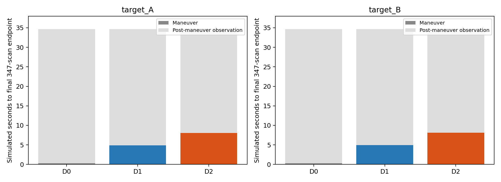
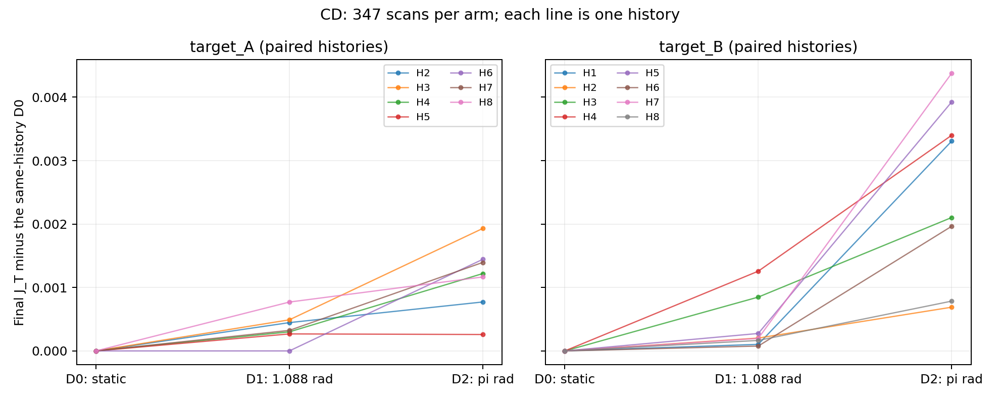
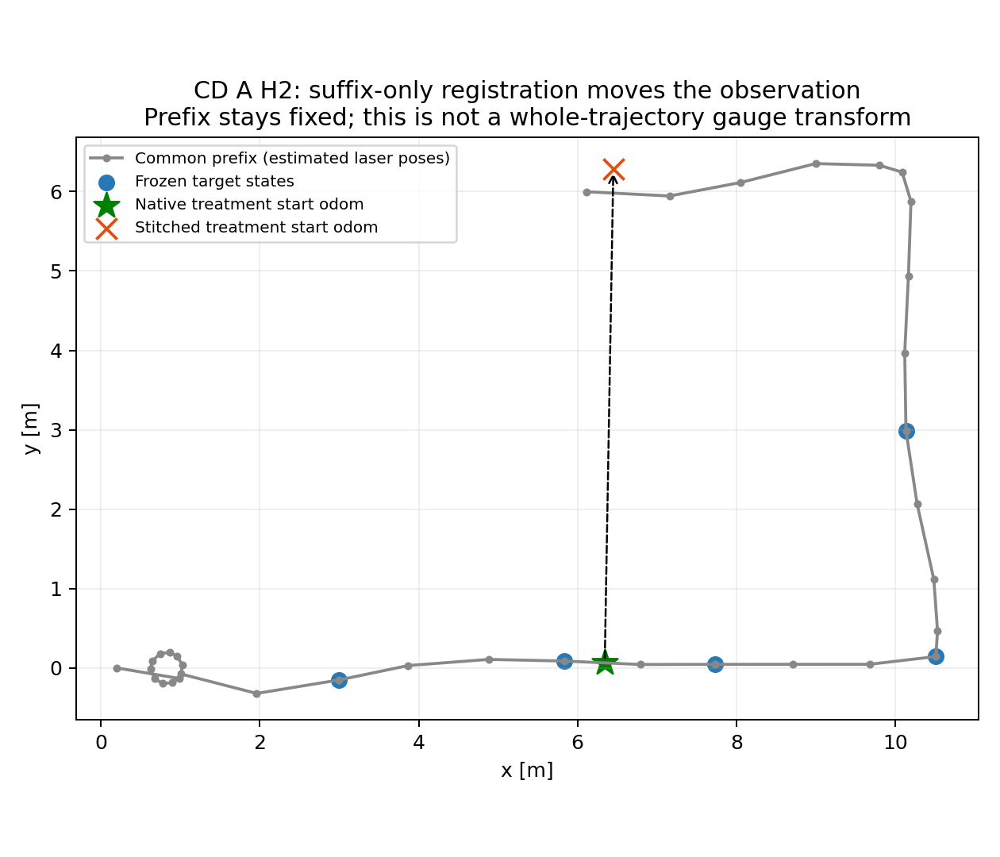

# 76 — 固定回访目标下的局部观测动作：现有证据、方法空间与下一步

2026-10-10。依据当前仓库、归档数据及七篇论文原文；未使用其他对话记忆。

## 结论与建议

**这个问题可以收缩成适中的方法问题，但当前结果还不足以支持“简单自适应选择优于固定动作”的论文主张。现在应做一次小规模辨别性验证，不应直接开发选择器。**

本轮实际重算了 CD Amendment 1 的15个完整历史组、45条成功分支，逐组核验目标身份、图信息、动作预算、约束来源和已有GT。主要发现是：

1. 固定347帧下，D2的最终目标信息分数在14/15组最高，15/15组超过D0。唯一D1优势仅 `9.27×10⁻⁶`；事后逐组选最优相对固定D2的平均优势仅 `6.18×10⁻⁷`。**现有CD基本留下的是收益量级差异，而不是有实用价值的最优动作切换。**
2. 更影响科学解释的是：采集只保留到达目标后的动作扫描，重放却把这个后缀的起点对齐到原H末端。两点在原始里程计坐标中相距6.17–7.93m。这不是整条轨迹的坐标规范变换，而是改变了H与C的相对几何。
3. CD新增53条非顺序历史连接，全部来自 `RUNNING_SCAN_CHAIN`，**没有一条直接连接该组冻结的五个目标状态**。信息分数仍可通过其他区域的连接提高，但不能直接解释为“机器人在选定回访区域创造了这些有用约束”。
4. v14确有不同动作对应不同历史端点集合和目标分层的排序反转；但剂量、接近过程与地点未分离，而且也使用了后缀起点拼接。因此它是值得验证的线索，不是选择器的可靠训练/验证依据。

建议暂时把研究问题表述为：**在几何与历史状态正确对应、目标已固定、采样预算相同的条件下，局部旋转幅度是否改变有用历史约束的覆盖和冗余，并产生足够大的、可用执行前信息解释的动作排序差异？** 尚未证明其中“排序差异”这一必要条件。

## 1. 当前基线与证据范围

本轮核查的本地HEAD和远端 `research/phase4c-formal` 均为用户给定的 `846fc296909d0ab18c3c2a2d54a0b5120b7a8574`，没有新增远端提交。本轮仅新增独立分析文件，没有改生产代码或旧实验。

日志55对应来源分类；67、68对应v14及其探索性异质性；72记录CD Amendment 1失败的三条分支；73对应生产前缀分叉；74、75是串行筛选与状态恢复后端技术验证。关键判断已追至图、采集/重放代码与provenance，不以这些日志的状态标签代替证据。

CD冻结16组，每组3动作。物理采集48条均存在；成功重放45条属于15个完整组：A H2–H8共7组，B H1–H8共8组。缺失为 **A H1，seed101002，三个动作全部缺失最终图**。该组六次既定尝试均在发布治疗后缀之前失败；不是某个动作收益不好而被删除。不过当前结果仍只适用于通过资格与重放的完整历史组，不能声称代表全部16组，更不能代表地图或机器人总体。

本次读取科学结果有用户新的明确授权，采用独立脚本、独立输出目录；旧预注册流程的锁与判决保持不变。未计算旧确认性置信区间、未补跑缺失组。

## 2. 这三种动作实际检验的是什么

| 决策问题 | 所需比较 | CD能否回答 |
|---|---|---|
| 执行前选择动作强度 | 同一历史/目标/初始姿态，固定预算的D0/D1/D2 | 是现有设计的主要问题，但物理—重放接线限制解释 |
| 过程中继续、停止或切换 | 同一过程的中间图、反馈时刻、不同停止/切换规则及其时间成本 | 不能；三条独立最终分支不等于在线决策实验 |
| 是否前往该目标 | 不回访/继续探索与回访的完整行程、预算和收益 | 不能；三个动作都已到达目标 |

`ContextDoseCapture.run()`先完成setup和 `probe_arrival`，然后 `_begin_treatment()`清空扫描/GT缓冲，开始保留最先347条动作扫描。D0在目标处保持静止并继续采样，不是“立即停止”，更不是“不回访”。

动作模板为 `theta0 → theta0+dose/2 → theta0`，D1计划累计转角1.08795rad，D2计划累计转角πrad。**D2不是单向转180°，也不是论文中的360°全景动作**。所有动作回到共同初始朝向。

以下为完成组均值；时间为记录的仿真秒，不是分析程序耗时。

| 地点/动作 | 实际累计转角(rad) | 动作完成时间(s) | 最终347帧观测时间(s) | 完成后静止帧数范围 |
|---|---:|---:|---:|---:|
| A D0 | 0 | 0.300 | 34.643 | 343–344 |
| A D1 | 1.052 | 4.886 | 34.686 | 297–300 |
| A D2 | 3.107 | 8.071 | 34.686 | 265–267 |
| B D0 | 0 | 0.300 | 34.700 | 344 |
| B D1 | 1.053 | 4.913 | 34.688 | 297–299 |
| B D2 | 3.110 | 8.100 | 34.675 | 265–266 |

D2多用约2.06rad和3.2s完成旋转，但**没有多用3.2s总观测时间**，只是少留静止尾段。D0的0.3s是初始保持，不是最终观测结束。若另把旋转能耗/执行风险作为成本，D2未必占优；目前未测能耗，也没有事前任务权重，不能从这些数据后定权重制造自适应优势。

Karto该批运行采用1m距离/0.52rad角度关键帧门槛。`LocalizedScan.x/y/yaw`是ROS float32；直接用JSON double在0.52边界重建会错计。按wire精度重建后，45/45关键帧数与图增量吻合：D0全为0，D1为14条1帧、1条0帧，D2为10条4帧、5条3帧；**动作完成后的所有静止尾段均未新增关键帧**。这提示最终图收益主要在动作过程中形成，但没有动作完成时的同步图，不能把8s动作的最终收益正式当成8s端点，也不能据此宣布一个动态停止策略已被验证。



## 3. J_T能否公平地进行组内比较

指标为固定根状态后的线性化SE(2)图信息：

\[
\Lambda=\sum_e A_e^\top\Omega_e A_e,\qquad
\Sigma_T=[\Lambda_{\mathrm{root-fixed}}^{-1}]_{T,T},\qquad
J_T=-\frac1{15}\log\det\Sigma_T.
\]

T是动作前冻结的五个历史状态，15维包括每个状态的x/y/θ。它们按目标anchor附近固定时间段的**轨迹弧长分位数**选择，不是五个完全重合的目标pose。不同历史的状态ID可以不同，故跨组主要比较配对增量，而不是把绝对J差异当动作效果。

独立重构得到：

- 每组三个 `graph_pre` SHA完全一致；冻结state/unique身份在最终图均保留，维度始终15，根为state0，继承边未改变。
- 逐边3×3协方差对称化后构造信息；沿用原特征值下限规则，45个最终图实际均无协方差裁剪，无伪逆兜底。
- Cholesky选列求解与仓库已有逆矩阵提取最大差仅 `4.44×10⁻¹⁵`。Jacobian有限差分和整体SE(2)规范不变性回归测试通过。
- 原分数在**各动作各自的最终估计位置**线性化，不是三个动作全部用同一套最终坐标。“fixed-linearization”不能理解成跨动作共同线性化。另把历史状态固定到共同pre坐标进行敏感性核查，15组最佳动作和主要结论不变。

因此，**作为已归档重放图的组内信息指标，比较成立**；但这不修复H/C几何含义，也不证明协方差模型已校准。J使用固定m/rad单位；差值可换算为几何平均目标协方差比例 `exp(-ΔJ)`，不可直接解释为平移误差下降或用ΔJ/J计算“精度提升百分比”。

## 4. CD逐组结果与固定策略留下的空间

下表J保留9位小数；三个差值为便于阅读放大1000倍，完整精度见CSV。

| 历史 | D0 J_T | D1 J_T | D2 J_T | 10³(D1−D0) | 10³(D2−D1) | 10³(D2−D0) |
|---|---:|---:|---:|---:|---:|---:|
| A H2 | 7.719975089 | 7.720421374 | 7.720746682 | 0.446286 | 0.325308 | 0.771594 |
| A H3 | 7.617138081 | 7.617628255 | 7.619068668 | 0.490175 | 1.440413 | 1.930588 |
| A H4 | 7.424673006 | 7.424973325 | 7.425892429 | 0.300319 | 0.919104 | 1.219423 |
| A H5 | 7.818840171 | 7.819108288 | 7.819099016 | 0.268117 | -0.009272 | 0.258845 |
| A H6 | 8.811437139 | 8.811437139 | 8.812881298 | 0.000000 | 1.444159 | 1.444159 |
| A H7 | 8.035902547 | 8.036226155 | 8.037297554 | 0.323607 | 1.071399 | 1.395006 |
| A H8 | 7.773109143 | 7.773879499 | 7.774275285 | 0.770356 | 0.395786 | 1.166142 |
| B H1 | 7.926669951 | 7.926773376 | 7.929976984 | 0.103425 | 3.203607 | 3.307033 |
| B H2 | 7.739271476 | 7.739474255 | 7.739960662 | 0.202779 | 0.486407 | 0.689185 |
| B H3 | 7.428207295 | 7.429055754 | 7.430310117 | 0.848459 | 1.254363 | 2.102822 |
| B H4 | 7.558556576 | 7.559813451 | 7.561955839 | 1.256875 | 2.142388 | 3.399262 |
| B H5 | 7.939020461 | 7.939295462 | 7.942945320 | 0.275001 | 3.649858 | 3.924859 |
| B H6 | 7.842514160 | 7.842590639 | 7.844479029 | 0.076479 | 1.888390 | 1.964869 |
| B H7 | 7.931692401 | 7.931890206 | 7.936069077 | 0.197806 | 4.178871 | 4.376676 |
| B H8 | 7.807618778 | 7.807784046 | 7.808403824 | 0.165268 | 0.619778 | 0.785047 |

| 地点 | D1−D0均值±组间SD | D2−D1均值±组间SD | D2−D0均值±组间SD | 最佳动作 |
|---|---:|---:|---:|---|
| A，7组 | 0.000371±0.000236 | 0.000798±0.000571 | 0.001169±0.000532 | D2 6组，D1 1组 |
| B，8组 | 0.000391±0.000427 | 0.002178±0.001386 | 0.002569±0.001396 | D2 8组 |

A的D2−D1范围为 `−0.00000927…0.00144416`，B为 `0.00048641…0.00417887`。B的平均额外收益较大，但两处范围重叠，不能把地点标签当作可泛化的选择规则。A H6的D1与D0图收益相同；它也是D1唯一未产生新关键帧的组。

D2−D0的平均差对应几何平均目标协方差约A下降0.117%、B下降0.257%（对平均ΔJ作比例转换）。这不是显著的真实定位精度变化。

事后上界采用每组实际J最大的动作。相对固定D2，A均值优势 `1.325×10⁻⁶`，B为0，全部15组为 `6.181×10⁻⁷`；优势全部来自A H5。它使用结果信息、有乐观偏差，**即使这个理想化选择也几乎没有可利用空间**，更不能把它称为自适应方法成绩。若引入独立的旋转成本，必须先确定任务容许的信息损失/代价，当前结论只针对同N、同总观测时间的J最大化。



## 5. 最有解释力的机制：新增了什么，以及它实际上连接哪里

### 5.1 CD的图机制

| 动作 | 新关键帧总数 | 新边总数 | 新非顺序H—C边 | 直接触及T的新增边 | 显式TryCloseLoop历史边 |
|---|---:|---:|---:|---:|---:|
| D0 | 0 | 0 | 0 | 0 | 0 |
| D1 | 14 | 28 | 14 | 0 | 0 |
| D2 | 55 | 109 | 39 | 0 | 0 |

这里H—C是跨动作前历史与新增状态的连接；“非顺序”排除 `H最后状态→C第一状态` 的普通连续边。它不是仅凭state gap就认定物理闭环成功。所有新增边都记录实际 `AddConstraint` 调用；53条非顺序历史边的provenance端点与最终图逐一吻合，均为 `RUNNING_SCAN_CHAIN`，不是显式闭环事件。

旧状态端点主要为2–7，另有21；不同历史里ID含义不同。逐组D2的旧历史端点集合都包含D1的旧端点，14/15组还有额外旧端点；A H2仅重复连接同一旧来源。这种模式比“各历史需要不同动作”更接近较大动作扩大已有连接覆盖。新状态的相同ordinal ID不代表两个动作观察了同一方向，因此未用跨动作新ID对的Jaccard直接解释观测一致性。

边数不是质量：这些历史边的匹配响应为0.0122–0.6167，XY协方差迹为0.001166–3.900828m²；在共同历史线性化下，逐条删边的目标J贡献为约 `1.62×10⁻⁶…0.00416`。差异很大，贡献也不可直接相加。`RUNNING_SCAN_CHAIN`接线没有显式loop fine-response的同一接受门槛；低响应边存在不等于绕过或调低了闭环阈值。原代码 `Process→AddEdges→LinkChainToScan` 与日志55的分类一致。

整批新增非顺序历史边删去后，D2平均目标增益几乎消失：A贡献0.001170，B贡献0.002569。这说明图指标的变化确与这些边有关；**这是同一图模型内的机械解释，不是独立定位改善的因果证据**。

### 5.2 后缀坐标接线为何是当前关键未知点

`cd_confirmatory_replay.py`复用 `v14_confirmatory_replay.prepare_combined()`，后者将 `scientific_treatment_stream.jsonl` 交给 `stitch_probe_stream.stitch()`。stitch只对C进行如下SE(2)变换：

\[
C'_0=H_{last},\quad \Delta\theta=\theta(H_{last})-\theta(C_0),
\quad C'_i=H_{last}\oplus(C_0^{-1}\oplus C_i).
\]

H字节不变、C扫描内容不变，但C的里程计位置和朝向被整体搬到H末端；中间从H末端走向回访点的真实观测不在后缀里。时间也被接为下一采样周期，掩去了这段行程。common-prefix gate只检查H，不检查这种物理一致性。

以A H2 D2为例，原H末端激光里程计约 `(6.451,6.282,3.053)`，C起点约 `(6.343,0.072,−0.079)`；拼接转角3.132rad、平移距离6.211m。冻结anchor state16约 `(5.836,0.087,−0.060)`。物理采集在anchor附近，重放首个新状态却约 `(6.191,5.956,−2.934)`。所有有新节点的CD分支首个新节点距离本组冻结anchor为5.72–7.36m；这与0条直接目标新增边相一致。

采集记录共同Stage初始位置和原始odom，不能将以上差别简单视为两次运行原点不同。它是仅变换后缀造成的相对几何变化。**这不是作者Graph-Based planner的逻辑错误，而是本仓库后期受控采集—离线拼接流程的问题。** 它并不使已归档J算术错误，却限制了把这些图当成“在真实回访目标执行该动作”的结论。



### 5.3 v14为何不能直接支撑当前选择器

本轮独立重算其24条最终图，复现A2−A3在A四组全部负（−0.1084至−0.3387），在B四组全部正（0.1585至0.2218）。A2比A3的非顺序历史边在A少1–2条、B多2–3条。八组**旧历史来源集合**均同时存在A2独有、A3独有来源，是真正的不同历史连接集合，而不只是新状态ordinal ID改变。

但v14科学扫描从 `move_to_treatment_start(probe_arrival)` 开始，包含到达过程；CD从到达后开始，二者不能池化。v14在A/B的实际额外旋转量范围不重叠，地点效应与动作剂量混在一起。v14拼接前两端原始位置差也有3.47–7.48m，并非天然连续的H+C。它的目标排序反转值得保留为线索，但不能反驳本次标准剂量CD中的D2基本占优，更不能直接证明可部署的局部选择规则。

本轮v14全部三动作共有176条新增非顺序H—C连接，均是running-chain。日志68的140条是**仅A2/A3且包含普通PREVIOUS_SCAN边界边**的历史因子口径；不同计数有明确范围差异，不是丢失了约束。

## 6. 已有准确度数据与重复性会不会改变判断

### 已有GT只做正确配对的历史状态核查

15组均有历史GT与作者保存的SLAM轨迹。原 `/karto_out` scan header为stamp0，不能据它配对GT。本轮用归档 `/slam_path` 的state顺序及其x/y与TUM轨迹的**精确六有效位ostream序列化一致性**核验身份，再取轨迹原采集时间与GT精确时间join。五组仅state0缺GT，其五个目标时间均可用，没有删除这些组。

每组用共同pre历史与GT冻结一次SE(2)规范，不对各动作后图重新对齐；GT为已处理0.2m传感器偏置的激光轨迹。得到45条历史目标状态检查：B所有动作目标位置RMSE不变；A的D2平均相对pre变化为**恶化0.128mm**，最大恶化0.366mm，4/7组不变。D1平均恶化0.076mm。这个量级没有显示明显定位改善，也不能据此判定动作有实质危害。

这是冻结历史目标的误差核查，不是整条新分支ATE/RPE。由于C采用后缀独立变换，物理C的GT不能直接与最终C图拼作共同轨迹。没有可正确配对的该批最终地图质量对照；未计算或用别批全程APE冒充。一个小探针无ATE下降不自动否定信息指标，但**也不能拿图信息提升宣称真实准确度改善**。

### 已有生产重放的J变动

本轮没有启动重复实验。读取F2既有生产前缀图，A H1八次J范围0.051658，超过本次CD增量；A H2与B H1各八次J完全相同。A H1恰是缺失组，故该变动不能作为其余15组的误差条，也不能宣称剩余组必然稳定。

v8另有四次同一完整输入（instrumentation off/on）最终图的J完全一致，但输入、历史与协议不是这45条CD分支。**没有这45条完整生产分支的同输入重复图，特别是无法用重复性确认A H5的9微量优势。** 串行A1只有技术前缀，不替代完整分支稳定性。

重复性可能改变极小的名次反转或收益量级，却不会把目前几乎为零的事后选择空间自动变成自适应成功；坐标接线问题也独立于数值重复性。无需先扩大数十次重复才能决定当前不应训练选择器。

## 7. 原文方法对照：哪些已经有，哪些仍需证明

核对的是方法章节与算法，而不是摘要关键词。下表的关系均针对“目标已固定、相同采样预算下执行前选择局部动作”。

| 原文与具体位置 | 决策对象/时刻 | 输入信息 | 收益计算 | 实际动作与结束条件 | 与候选问题关系 |
|---|---|---|---|---|---|
| [Kim、Eustice，IJRR2015](https://s3.us-east-2.amazonaws.com/publications.perl.engin.umich.edu/akim-2015a.pdf)，§4.1–4.3，式(3)(6)(10)，图2 | 探索或某个回访往返路径；出发前 | pose graph、saliency、当前/历史特征、目标不确定度 | 经验匹配成功概率加权测量信息，比较终点协方差与覆盖 | 回访waypoint后返回release point；不是D0/D1/D2局部预算终止实验 | **基本思想已有**：不能把“非必然匹配的信息收益”作为新概念 |
| [Pathak等，IJRR2018](https://indelman.github.io/ANPL-Website/Publications/Pathak18ijrr.pdf)，§4.4–4.8、算法1第1–17行；§5 | 评估候选控制/多步动作；执行前规划 | belief、历史、场景/关联事件似然、运动与观测模型 | 模拟未来观测，对关联假设后验混合与权重求期望成本 | 按规划控制执行；算法1返回候选成本，不定义某个固定局部扫描动作的停止条件 | **最强方法重叠压力**：局部旋转选择可作为其一般框架的特例，单纯换成离散动作不是创新 |
| [Yin等，ICRA2024](https://cdn.amazon.science/7b/55/cb3dafd14b5ba7210870af299c8f/probabilistic-active-loop-closure-for-autonomous-exploration.pdf)，§V–VI、式(9)(10)、算法1–3 | 是否触发ALC及选择哪个keyframe cluster；到达前 | graph/map距离、view score、历史cluster、不确定度 | 闭环概率×不确定度减少−旅行成本 | 到目标后固定旋转360°；触发阈值随距上次ALC时间变化。正文未给出局部旋转的收益反馈停止条件 | **相关但不同决策**：固定目标后的幅度选择不是它的主决策；概率收益思想已有 |
| [Stachniss等，IROS2004](https://www.ipb.uni-bonn.de/wp-content/papercite-data/pdf/stachniss04iros.pdf)，式(3)、算法1、§V-D | 进入历史loop并决定继续/退出；在线 | FastSLAM粒子、地图/拓扑距离、当前与entry时不确定度 | 实现用粒子包围体积，而非仅理论entropy | 沿旧路径重走，while `H(t)>H(entry)`且超过threshold；达不到即返回探索 | **反馈终止基本方法已存在**，不是D0/D1/D2执行前选择的直接等价方法 |
| [Placed、Castellanos，IFAC2022](https://zaguan.unizar.es/record/120215/files/texto_completo.pdf)，§4、式(6)，§5 | 整个Active SLAM探索是否结束；动作窗口之后 | 图D-opt utility变化、已知面积变化、窗口w | `Γ=ΔU+|ΔA|`，低于阈值持续w窗口 | 终止探索/改任务效用；不是固定回访点的一次旋转停止 | **相关但尺度不同**；“收益饱和就停”不能仅换名称当新方法 |
| [Kitanov、Indelman，IJRR2024](https://anpl-technion.github.io/Publications/Kitanov24ijrr.pdf)，§3–4.5、式(21)、算法1第1–17行 | 给定候选控制对应factor graph的排序/剪枝；规划时 | 候选图、pairwise Gaussian模型、图签名、可选uncertainty margin | 生成树/von Neumann签名与entropy bounds、性能保证 | 返回动作或候选子集；不定义局部观测动作执行器或实际matcher接受规则 | **指标思想已有、实现问题不同**：输入候选图不等于已验证实际生成那些约束 |
| [Bai等，复现的Graph-based工作](https://arxiv.org/pdf/2308.16522)，§IV算法1、§V-A步骤1–4 | prior graph访问顺序/loop edge插入；高层规划 | prior topo-metric graph、D-opt边权、距离 | 信息/额外距离权衡 | loop顶点执行过去轨迹的一段，然后去下一顶点；原V0代码按waypoint结束 | **最近的执行基线**，没有同预算局部剂量选择的实证；不同动作能否更好需独立证明 |

Kim使用作者实验室的17页2014草稿，对应2015发表文，故不混用出版社页码；Bai使用作者预印本的章节。Pathak/Kitanov本地PDF读取预检出现xref不可达对象的 `UNAVAILABLE` 提醒，全文可提取，算法页面已独立渲染核对，保留提醒而未写成PASS；Placed有重复文字层，§4公式已按原页视觉核查。来源、版本、SHA/页数说明存于 `literature/` 的元数据。

另追到当前作者V0兼容路径：`path_planner.py:handle_reliable_loop`选择距prior顶点最近的历史pose，再返回其后至多7个XY；并未按最小匹配协方差选择。`MyPlanner::performReliableLooping`以位置waypoint完成为V0终止依据，不强制历史朝向或backend约束成功。仓库还含后续oracle/repair扩展，本轮没有把它们误称作者原方法。论文§V-A只承诺跟随历史段，不应从“reliable”名称补出一个论文未规定的成功判据。

本轮没有在这七篇中确认一套与所述固定目标、固定N、实际历史约束剂量选择器完全相同的具体实现；**这不是“该方法不存在”的证明**。决策对象较窄只能帮助界定工程范围，不能单独构成新意。需要新增的是能解释并利用真实动作—观测—历史关联差异、又实际超过最佳固定动作的规则和跨几何证据，而不是给概率收益或D-opt换名字。

## 8. 如何选择下一步，而不是预设答案

### 五个问题的直接回答

1. **最值得研究的具体问题：**预算相同且目标固定时，改变局部旋转范围是否创造与原历史正确对应、而非仅数量更多的有效约束；这种差异是否让最优动作随几何改变。目前应先验证这两个必要条件。
2. **固定策略是否留下明显空间：**CD按最终J看基本没有；固定D2几乎达到事后上界。v14有反转但混杂/拼接限制，不足以推翻这一判断。存在旋转成本的权衡空间不等于已经证明上下文选择空间。
3. **执行前真实可用信息：**共同pre图与T、已有边/协方差、历史scan姿态/方向、当前pose与第一张动作前scan、规定预算与动作模板。CD有严格动作前的sector range profile、openness等描述，45条记录的descriptor时间均不晚于动作开始。但这些几何摘要不能直接当匹配概率，更不能拿target A/B标签代替可泛化输入。最终关键帧、接受的边与响应/协方差、删边贡献、动作后J、最终GT误差都是事后解释；只能在未来在线实际发生后用于反馈，不可冒充执行前特征。
4. **先选动作还是反馈控制：**若后续几何一致的数据确有排序差异，先做执行前离散动作选择更符合现有设计，也更容易控制预算、避免把固定尾段与提前结束混淆。当前没有支持继续/停止规则的中间图或实际时间收益证据；不能因为静止帧被丢弃就转向动态停止。
5. **相对已有方法新增什么：**可能是低成本、固定回访目标处的实际观测分配规则，针对历史关联覆盖/冗余做可部署选择并验证成本收益。这个新增部分现在还不存在且未被数据支撑；一般的概率测量收益、关联感知动作选择和不确定度停止都不是本项目的新思想。

**本轮不提出新选择器原型，也不训练模型。** 当前最诚实的可执行参考是固定D2，并同时保留D1/D0的成本与收益对照。只有获得明显、非接线造成的排序反转或相近收益但可测的成本差异，才值得写一个少量输入、透明阈值的规则；不应用已知最终J来为每组制定规则。

### 唯一下一步小实验：几何一致的三地点剂量辨别探针（仅设计，未启动）

最影响方向的未知是：**在真实的目标历史几何下，是否仍几乎总是D2最好？** 它比现在重复同一点十几次更能决定要不要做方法。

建议在现有地图中事前选择三个尚未使用、自然几何不同的回访点：长直走廊、转角、交汇/较开阔区域。每处先取一个完整历史组，三个同剂量动作，共9分支；不制造prior错误，不迁移后端。它是范围筛选，不是显著性或泛化认证。

实验关键不是增加模块，而是把共同H延伸到**机器人已经到达目标、尚未开始剂量动作**的时刻。完整记录这段共同接近历史；C在同一真实odom/传感器坐标连续接上，禁止把异地C首姿态强行搬到H末端。五个历史目标状态、动作顺序、347帧预算、共同起始朝向、backend参数在看结果前冻结。现有生产前缀若未通过技术条件，整组报告未完成，不改变旧零容差gate或填补旧CD。

采集/重放只需新增三项有辨别力的观测：H/C边界原生位姿与scan一致性；动作完成时及347帧末端的同步图；新增历史边的真实端点/质量及共同规范下的目标GT检查。输出仍是九条最终J、成本、目标连接来源和三个组的排序。中间图仅判断收益时刻，不把它升级成停止算法试验。

看结果前确定“值得选择”的最小任务收益/代价差，依据任务容许误差/旋转预算与已有数值精度，而不是看结果后调阈值；若无法事前确定，首轮只画原始差值，不宣布小名次差有用。

- 若D2仍在三个几何处基本占优：收缩为固定局部观测动作/执行机制问题，不继续包装自适应选择；如收益本身也很小，就停止这条方法路线。
- 若有超出误差量级、伴随可解释历史连接变化的排序反转：才进入执行前简单规则的小验证。应以动作前scan/历史方向覆盖解释，不以地点标签训练。
- 若信息增加仍只连接非目标区域或坐标不一致：不能选择方法，先解决实验有效性；若图信息与误差无关系，仅能提出图信息层面的贡献，不能宣传定位收益。

这九条分支不会证明普通SCI投稿已就绪。它能决定是否值得投入：一个适中的SCI方法至少要有可重复的实际差异、一个不用结果信息的规则、超过强固定动作的公平比较、以及独立几何上的验证。当前最欠缺的是前两项的事实基础，不是更复杂的优化公式。

## 9. 交付与复现

报告对应独立输出根：[分析目录](../../results/realizability_pilot/p1_action_selection_exploratory_20261010/README.md)。其中包含15组配对表、45分支成本/关键帧表、137新增边明细、v14配对表、已有重复图指标、历史目标GT表、指标敏感性、环境与输入SHA清单、三张关键图和原文来源。

从仓库根目录运行，使用离线分析环境，不影响ROS系统Python：

```bash
OPENBLAS_NUM_THREADS=1 OMP_NUM_THREADS=1 PYTHONPATH=tools/realizability_pilot \
  /home/wcqw/anaconda3/bin/python3 tools/realizability_pilot/test_action_selection_exploratory.py
OPENBLAS_NUM_THREADS=1 OMP_NUM_THREADS=1 PYTHONPATH=tools/realizability_pilot \
  /home/wcqw/anaconda3/bin/python3 tools/realizability_pilot/action_selection_exploratory.py
```

Python3.12.7、NumPy1.26.4、SciPy1.13.1、Matplotlib3.9.2；7项离线回归测试通过。脚本独立组装信息矩阵，不调用旧分析解锁/采集/replay流程。651个读取文件在计算结束后逐一SHA核验不变，包含12个被登记的旧锁/预注册/判决文件；这不是对从未读取的所有ignored raw文件的全树认证。所有旧tracked文件无diff，全部新增文件位于新的结果根、分析脚本和本报告。

**下一步任务只有一个：先确认上述三地点几何一致探针的范围与任务有效差值，再单独冻结新小实验。此次未启动任何ROS/仿真、未迁移后端、未续跑旧CD，也未自动上传或提交。**
