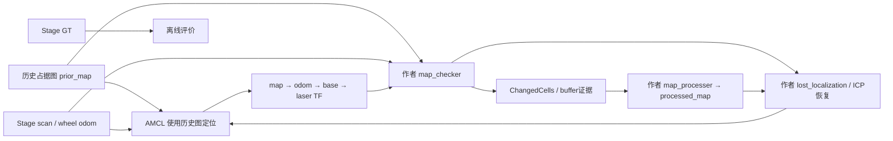

# Stefanini 2023 原始代码验证与主动必要性审查

2026-10-14。结论：**REVISE，暂不进入 A 的主动方法设计。** 已复现作者公开代码在定位偏差下的地图污染，但没有复现“定位正常、持久变化导致不必要冻结”；同一批扫描的被动位姿重估已消除 S1 污染并明显改善 S3。剩余地图误差仍在，不能宣布被动方法完全解决所有问题；也没有证据证明它需要新的主动消歧算法。

证据标记：**事实**＝本机代码/运行数据；**文献**＝所引原文；**推测**＝待验证解释；**UNRESOLVED**＝尚缺证据。四个物理科学回合每类一次，没有独立重复、没有显著性或泛化主张。本轮没有训练、frontier系统、新主动评分器或主动动作实验。

**1. 五项最终判断**

| 判断项 | 结论与证据边界 |
| --- | --- |
| TECHNICAL_QUALIFICATION | **事实：作者公开代码名义运行资格成立。** 第二次技术尝试通过，四类场景的数据可严格评价；与最终论文的配置/机制并不完全一致，不能称完整论文实验复现。 |
| PROBLEM_REALITY | **事实：定位偏差造成地图污染成立。** S1/S3最终错误修改1251/609个cell。目标中的“正确定位且真实变化导致冻结”本轮未出现；主动可解而合理被动难解的联合问题仍UNRESOLVED。 |
| PASSIVE_BASELINE_NECESSITY | **事实：必须先对照更强被动定位。** B1使S1错误修改为0，S3降到92；B2时间累计shadow不能解决持续偏差。**未知：** B1残差是否造成后续任务损失、其他合理被动方法是否仍不足。 |
| ACTIVE_ACTION_VALUE | **未执行，UNRESOLVED。** 未达到“强被动仍有明确剩余任务损失”的门槛，因此没有启动A0/A1/A2，更没有重启discriminative。 |
| NOVELTY | **UNRESOLVED。** 联合pose/环境估计、主动多假设消歧、变化核验及证据提交已有强前例；当前没有被资格审查的新机制，不能给GO。 |

选择REVISE而不选GO：问题及必要性链未闭合。选择REVISE而不宣称STOP_A的“被动已经充分解决”：S3还有92个错误修改和未更新区域，不能抹去。**实际工程决策仍是暂停主动选择器，只允许先澄清原系统与被动残差；这不是让失败toy评分器继续调参。**

**2. 版本核实：需要纠正旧报告的一处事实**

**事实**：作者仓库固定为 `57e83ec9ecdc9382b15b140c6f1eb89f4fd35fbe`，提交日期2023-05-12，pristine副本clean。见 [原始仓库](https://github.com/CentroEPiaggio/safe_and_robust_lidar_map_updating) 和本地 [parameters.yaml](sources/author_pristine/parameters.yaml)。

| 来源 | 异常观测规则 | 其他关键差异 |
| --- | --- | --- |
| 上一轮toy | range冲突比例0.2；不是真正作者beam分类 | 不能用于判定原系统冻结 |
| 作者README | `max_anomalous_beam_fraction: 0.8` | 文档也有与YAML不同的位移/转角值 |
| 作者实际YAML/代码，本轮主对象 | **0.58**；`anomalous > fraction × valid_beams`时跳过本次变化证据并请求恢复/停止 | 只有一个异常阈值；所有原始数值参数不改 |
| Sensors最终论文Table2、5.2 | **0.75 / 0.90 两级**，分别暂停/恢复 | buffer10、阈值7、位移0.05m、转角20° |

上一轮REPORT把README0.8写成“公开配置”，遗漏了真实YAML0.58；该记录有误。**旧报告没有覆盖修改，本报告新增纠正。** 全部150条toy负结果及B的六组core调用结论保留。

本轮取得了最终出版全文的 [Europe PMC JATS](sources/stefanini_final_jats.xml)，核查了Table2及5.2/5.5/5.6、6和附录。论文两级保护、虚拟局部expected cloud等与这个公开提交不同，公开提交更早于最终论文。**因此以下结果首先是“固定作者公开实现”的结果，不是已经重现最终论文全部机制/数字。** [出版原文](https://www.mdpi.com/1424-8220/23/13/6066)。

**3. ROS1数据流、依赖及原作者触发逻辑**

**事实**：Ubuntu20.04/Noetic，Stage ROS1.8.0，AMCL/map_server、PCL1.10、OpenCV、catkin、TF/TF2、ROS消息/服务均用已有安装。输入地图210×171、0.05m、origin=[−5.25,−4.275,0]；原作者输出`/changed_cells`和`/processed_map`。运行部署只覆盖话题/frame/可视化开关，原数值YAML一致性有hash检查。

原作者机制如下，均由源码核实：

- `ScanHandler`在**扫描原stamp**查询map→配置base_frame；本轮base_frame=laser frame，XY与底盘重合。原代码没有通用laser外参变换，不能直接接一个未知偏置的真实雷达。
- 小于18m的束计为valid；YAML最小角增量0.01°，本轮901束360°实际不下采样。虚拟beam配对阈值随量程从0.15m线性到0.28m、封顶0.3m；搜索至少±4°，源码有360°索引绕回假设。
- 超过0.58异常比例时，不给这次扫描新增变化证据，调用`/lost_localization`及`/publish_cmd_vel/stop`。恢复模块使用最新processed_map、当前scan和估计pose，经作者PCL ICP发布`/initialpose`，随后请求start。没有关闭已有恢复功能。
- buffer长度10。源码提交条件是本cell changed count≥7，**或本cell count加成熟邻居数≥7**；不只是论文文字中的单cell计数规则。changed/unchanged会滚动更新。
- 时间间隔≥0.3s，还须平移≥0.05m或转角≥20°；过快旋转≥12°/s触发idle。**静止继续扫描不能自动增加本模块处理证据。** 这属于处理门控，不能把A0不更新误称为动作缺乏信息。
- `Grid::updateMap()`仍每个loop发布旧累计delta；processer从initial_map加累计delta生成输出。**收到地图消息不等于有新的地图修改；一次FREEZE也不等于停止所有map消息。** 本轮评价逐图实际diff。

源码与部署：[runtime.launch](protocol/runtime.launch)、[作者checker](sources/author_pristine/src/map_change_detection.cpp)、[Grid](sources/author_pristine/include/safe_and_robust_lidar_map_update/grid.hpp)、[恢复](sources/author_pristine/src/update_localization.cpp)。

**兼容修改**：C++11→14适配PCL1.10；补齐生成消息的target依赖；RollingBuffer头文件定义inline、初始化空指针并正确delete[]；补三个bool服务callback返回值；增加只读审计topic。阈值、buffer规则、配对、ICP参数和服务保护不改。完整 [patch](audit/author_compatibility_and_instrumentation.patch) 和三次build日志保留；前两次build失败不是科学负结果。只读buffer日志含cell ID、count、成熟邻居数和buffer size，未导出逐flag顺序。

**4. 技术资格及事先冻结的科学条件**

第一次技术尝试：Stage输出`/base_scan`而模块订阅`/scan`，未取得有效定位/更新数据，保留日志和bag，未算科学样本。第二次补话题连接；AMCL订阅历史图。避免将10Hz候选地图持续输入AMCL导致重复初始化，该行为由Noetic源码核查，属于部署错误修正。[AMCL源码](sources/amcl_noetic.txt)。

第二次30s技术回合：306帧scan、301帧严格TF/GT配对（98.37%），33次作者处理，0次冻结、0个错误修改，最大位姿误差0.0983m，真实位移3.00m；owned进程全部退出。见 [资格评价](results/technical_02_T0/evaluation.json)。这只资格了名义链条，未预先证明所有故障恢复正确。

**事实**：科学 [冻结协议](protocol/science_frozen.json) 在第一回合前生成。场景尺度10.5×8.55m、0.05m栅格借鉴论文实机设置；两个可移动货架，持久变化为一次固定移位。机器人起点[−3,−2,0]；启动后8–28s以0.15m/s直行，其余静止，总50s。S1/S3在16s后，将**当时在线AMCL pose**加1.5m的x偏差注入`/initialpose`；不读取GT。与原论文手动pose错误实验的量级一致。[原文](https://www.mdpi.com/1424-8220/23/13/6066)。

Stage使用360°/901束/25m，wheel odom误差参数所有条件固定[0.05,0.05,0.1,0]，未寻找失败噪声。历史图为准确栅格先验，隐藏变化图只供模拟器和离线评价。场景不是作者仓库发布的原Gazebo warehouse，不宣称原场景复现。launch请求了AMCL random_seed=7，但所查Noetic节点未读取该参数，不能声称控制了AMCL全部随机状态；没有挑选有利seed，也没有独立重复。

每个回合记录scan、odom、GT、TF、AMCL pose、initialpose、cmd、作者异常beam统计、buffer count状态、ChangedCells和完整map，零collector丢弃。GT的header虽为odom，Stage实际发的是world GetGlobalPose；map已知坐标与world一致，**没有拟合GT对齐或在线GT修正**。扫描同stamp/严格间隔内TF与GT进行离线评价。[评价代码](code/evaluate_ros.py)。

**5. 四类场景真实结果**

| 条件 | scan / 严格配对 | 作者处理 | 最大异常比例 | FREEZE次数 | 错误修改cell | 正确变化更新cell | 最终地图错误cell | 平均/最大平移误差m |
| --- | --- | ---: | ---: | ---: | ---: | ---: | ---: | --- |
| S0 无变、正常 | 505/500 | 33 | 0 | 0 | 0 | 0 | 0 | 0.0637 / 0.0983 |
| S1 无变、偏差 | 506/501 | 33 | 0.5660 | 0 | **1251** | 0 | 1251 | 1.0403 / 1.5470 |
| S2 变化、正常 | 505/500 | 33 | 0.1521 | **0** | 32 | 268 | **724，初始960** | 0.0473 / 0.0718 |
| S3 变化、偏差 | 506/501 | 33 | 0.5816 | 1 | **609** | 438 | 1131，初始960 | 0.3601 / 1.5061 |

数据：[S0](results/scientific_01_S0/evaluation.json)、[S1](results/scientific_02_S1/evaluation.json)、[S2](results/scientific_03_S2/evaluation.json)、[S3](results/scientific_04_S3/evaluation.json)；各目录包含raw.bag、trajectory/map/audit CSV、collector/进程记录和日志。图：[异常比例与位姿误差](figures/four_conditions.png)、[S3地图](figures/S3_maps.png)。

直接回答Q1–Q6：

1. **Q1：有限成立。** S0不污染；S2进行了正确增删，整体cell误差降低，但还有32个错误修改和未观测/未提交区域，不称完美更新。
2. **Q2：本例不能防止。** S1异常比例低于原阈值，恢复未触发，418个错误occupied addition、833个错误free removal；后半段误差仍约1.55m。[几何分解](results/map_error_geometry.json)。
3. **Q3：未复现。** S2定位正常，最大异常0.152，未冻结。不能扩大货架或调阈值制造冻结。
4. **Q4：本例不完全安全。** S3在26.4s触发一次冻结/ICP，26.7s发布恢复pose；27s后平均误差约0.117m，但此前污染仍留在地图。恢复功能实际工作过，不把它描述为关闭/不存在。
5. **Q5：目前主要证据是定位与地图损失。** S3真实移动2.97m，S0/S1/S2为3.00m；仅是定时直行，不是完整导航任务。没有证明长时冻结导致导航失败，也没有用新地图完成下一任务的独立定位对照。
6. **Q6：稳定性UNRESOLVED。** 每类一次；S1/S3共同出现污染，但不能替代同场景独立重复。未宣称稳定正收益或负收益。

**6. 强被动对照：不增加观测，不弱化作者保护**

**B0**为上述全部作者模块。**B1**采用普通有限搜索的correlative scan-to-map位姿重估，之后仍运行同一个作者checker、processer、恢复和停止服务；是基础方法适配，**不是Olson2009完整复现，也不是新增算法**。[作者文献](https://april.eecs.umich.edu/papers/details.php?name=olson2009icra)。

B1输入是当前scan、历史图、已收到的原在线pose和wheel odometry；每5帧重估，搜索XY±2m/yaw±0.2rad，粗/细网格固定，截断距离场loss，不用GT或未来scan。参数一次冻结后不调。B1对S1/S3各做一次**真实作者节点的ROS replay**，复用原始506帧scan/odom。GT仅发到评价记录通道。额外扫描=0，新增运动=0；实际搜索计算时间分别合计11.06s/8.75s。工具：[passive_replay.py](code/passive_replay.py)、[参数](protocol/passive_frozen.json)。

**B2**是五个不同作者processed-scan下，candidate cell状态一致才提交的时间证据shadow。避免把10Hz重复map消息计成独立证据。原B0本来已有buffer；这是检查额外时间一致性是否能帮助，非新机制。**B2未改变反馈后的恢复/轨迹，不能称完整闭环B2复现。** [实现](code/passive_temporal_shadow.py)。

| 同一记录 | B0错误cell | B1错误cell / 最终地图错误 | B2 shadow错误cell | B1平均/最大平移误差m |
| --- | ---: | --- | ---: | --- |
| S1 | 1251 | **0 / 0** | 1197 | 0.0294 / 0.0520 |
| S3 | 609 | **92 / 830** | 609 | 0.0378 / 0.0555 |

**事实**：B1输入scan/odom/GT的全部payload和stamp与原记录逐字节相同，只有rospy重发Header.seq统一+1；首次全消息hash检查失败及原因保留，未掩盖序号变化。[检查](audit/final_checks.json)。B1作者处理次数29/31，B0均33，ROS调度导致有效处理集合不是完全相同；原数值门控没改。这限制精确因果归因/公平性，不能把表当正式论文性能评估。

**事实**：B1解决S1的定位/毁图，在S3消除了错误free removal，仍有92个false occupied addition；这些新增cell距真实occupied最近距离中位0.05m、最大0.112m。保留92这个原指标，不改评价阈值把它变成成功。S3还有大量未更新区域，部分为不可见旧货架/物体内部，不能称全部是定位歧义。**推测**：近边界离散误差、稀疏提交及遮挡可能解释剩余部分；本轮没有逐cell因果证明。

B1没有新增物理闭环运动，故不能证明任务完成率改善；B2也不能证明换反馈地图后的新定位结果。尽管如此，数据明确反对“原有观测必然不足、必须主动运动才能修正本例大位姿偏差”。**没有据此启动主动动作。**

**7. 旧150条toy的离线失败机制诊断**

旧数据/冻结配置均未改，未再生成toy观测。nearest12/30、uncertainty12/30、stable3/30、discriminative0/30仍是负结果；B旧六组core调用仍不是主动SLAM证据。本轮复算了原始30个NPZ的bank、分数、选点和后验，最大重构差0，选点全一致。[重构检查](results/toy_diagnosis02/reconstruction_checks.json)、[逐case诊断](results/toy_diagnosis02/rows.csv)。

| 问题 | 数据诊断及边界 |
| --- | --- |
| 为什么评分高？ | change/both/out-of-bank的评分贡献中，**99.75%/99.89%/99.998%来自两个change proposal之间的pair**，几乎全部是不同pose下的预测差异；不是在区分“变化/不变”。 |
| 主要是错误地图proposal？ | 高分pair至少一方pose错误，固定当前scan生成的proposal也随之错位。**但不能一概而论**：in-bank最终MAP pose常是对的；选中proposal在初始已见cell仍错27/29个，随后硬写新scan又新增false cell。错误提案与不对齐目标均有证据，单一根因UNRESOLVED。 |
| 选点到底看什么？ | change/both全部选[3.2,4,π]，观察背向变化的一侧；24个真pose仍在bank的case中，22个在所选动作下，真pose对应旧图/提案的预测range完全相同。不能把大混合分歧当地图更新信息。 |
| 后验过度自信？ | out-of-bank时真pose质量恒为0，change probability平均0.999988，但joint maximum仅约0.509；更新规则的joint门槛是0.15。**change分类本身是真的有变化，不能仅据高PC称分类失准**；问题是封闭bank没有unknown质量，这个PC不能保证pose/地图提交正确。统计校准未完成。 |
| 模型外误差如何污染？ | out-of-bank所选pose平移错约0.583m；6例提交了1182个false cell，其中472来自原proposal残留、710在新scan写入中新增。真pose不在候选集，主动看得不同也无法把它估出来。 |
| in-bank为什么仍差？ | change/both选中pose正确，但分别有162/174个初始错误cell残留，新增156/154个false cell；当前硬逆观测更新不具有安全提交资格。分数优化的是pose间预测分歧，而不是错误修改的决策损失。 |
| 坐标/实现错误？ | 保存分数/后验/动作可精确重构，独立SE(2)代数检查差0；未发现解释这批结果的坐标错。不能据此证明代码无所有bug或等同真实TF执行。旧浮点栅格边界失败仍保留。 |
| 理论不可区分？ | 同步平移环境和全部pose的规范歧义，无稳定锚点时观测不变；本轮选点下旧图/提案预测相同也不能消歧。**没有证明整个asymmetric/symmetric场景在所有安全动作下都不可辨识。** |

这些是诊断，不是优化证据。没有改变A_frozen.json、门槛、噪声或地图，也没有把discriminative失败解释为方法有效。

**8. 新颖性及下一轮建议**

详细 [机制矩阵](NOVELTY_MATRIX.md) 覆盖DA-BSP、Sensors2023、PBD-AG、Chamelion、Ocean2026、OASIS，以及更早的联合动态地图定位/普通鲁棒配准。近邻正文/代码未核全的功能始终留未知，维度差异不作新颖性依据。

**文献**：DA-BSP已有主动关联消歧；PBD-AG已有不确定性核验与evidence-gated状态修改；Chamelion已有visibility条件更新；Ocean2026已有跨session主动语义核验；Tipaldi等2013已有pose与动态环境状态联合估计。[DA-BSP](https://indelman.github.io/ANPL-Website/Publications/Pathak18ijrr.pdf)、[PBD-AG](https://arxiv.org/html/2608.10449v1)、[Chamelion](https://arxiv.org/html/2602.08189v1)、[联合长期定位](https://journals.sagepub.com/doi/10.1177/0278364913502830)。没有为保留A而把普通被动补强或绕到背面查看称为新方法。

**本轮不继续A0/A1/A2。** 首先，S2没有目标冻结；其次，已有扫描足以进行更可靠的pose重估；最后，S3剩余误差尚未证实是强被动难以解决的任务损失。当前无法满足GO_TO_METHOD_DESIGN四项条件。

如果下一轮仍审查A，只做一个有明确停止出口的小包：先统一“作者公开代码复现”和“最终论文双阈值复现”的对象，确认原作者是否有未发布的对应版本；对现存S3/B1的残差按可见区域、边界误差、未观测区域分类，检查它是否导致可信后续定位/导航损失。这个检查先用已有数据，**不调toy、不先扩场景、不先设计新选择器**。若剩下的是普通遮挡补测或已被动解释的地图提交问题，给STOP_A；只有强被动仍有明确动作可改善的剩余缺陷，才重新讨论最小主动对照。

**9. 资源、保护和交付**

技术物理尝试2次，物理科学回合4次，B1 ROS replay2次，B2 shadow2次，主动0次；没有自动扩大为全矩阵。独立目录约25MB，根分区仍约6.4GB可用。没有下载大数据集、安装依赖、训练或迁移ROS2。全部owned进程退出。

ac-slam主目录两处未提交diff、两个研究checkout状态、旧AB目录全部文件、暂停RTAB目录全部文件，前后保持一致。pristine作者代码clean，运行源码数值YAML未改，场景asset hash未改。[保护/输入核验](audit/final_checks.json)、[尝试台账](protocol/attempts.json)。旧纯旋转STOP和旧B暂停状态不变。

可复核交付包括：完整源码与patch、两个launch、冻结场景及所有参数、原始bag、在线/GT配对CSV、buffer/freeze/map commit日志、地图数组、三张图、旧toy诊断、失败获取/编译/资格/输入identity日志。**ANALYZED，不冒称独立团队复验。**
