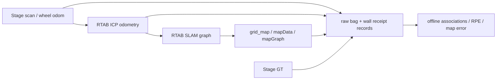

# 主动 SLAM 分支终止与下一方向决策报告

2026-10-14。独立目录：`/home/wcqw/active_slam_next_direction_20261014/`。本轮结果为 **ANALYZED**，不是独立团队复验。没有正式算法、模型训练、ROS2迁移、新A科学实验或原12条B实验。

证据标签：**事实**＝当前文件、实际源码/运行/离线重算；**文献**＝可定位原文；**推测**＝尚未验证的解释/方案；**未知 / UNRESOLVED**＝不能由当前证据确认。全文获取不足不等于功能不存在。

**1. 决策先行**

| 对象 | 本轮判断 | 直接依据 |
|---|---|---|
| A 主动地图变化核验 | **STOP_PRIMARY**；`STOP_ACTIVE_MAP_VERIFICATION_AS_PRIMARY` | 未复现正确定位下的目标冻结；已有观测能支持被动重估；残差混合边界、覆盖、提交不足，未证明主动移动可改善的剩余任务损失。 |
| B 实际有效观测收益 | **TECHNICAL_INCOMPLETE**；科学假设 **UNRESOLVED** | 两次技术启动用完。第二次有真实SLAM数据，但严格配对199/283＝70.3%，未达启动前90%门槛；缺失输出不能分类为ICP拒绝。 |
| 候选1：代价接近路线的错误接受约束与地图损失 | **CANDIDATE_ONLY** | 有真实文献问题依据、当前工程复用成本最低；本机科学问题、主动必要性、新增机制均未成立。 |
| 候选2：突发遮挡后的等待/受限回退与旧视觉地图恢复 | **CANDIDATE_ONLY** | 特定近邻全文明确承认故障后恢复不足；本机视觉闭环和强被动比较缺失，Help Me Through全文排重未完成。 |
| 通用概率×收益、反馈重规划、动态权重NBV、多假设主动消歧 | **NOVELTY_CONFLICT** | Kim/P-ALC、FIT、动态NBV、DA-BSP/ARAS已有直接机制前例。 |

**当前没有值得直接进入正式方法开发的方向，不给GO。** 若必须安排工作顺序，候选1作为低成本技术/问题资格主线，候选2作为备选；这不是论文选题已经通过。A不再设计新的视点评分器，也不改旧discriminative。

**2. 已读材料、旧结果和保护边界**

首先读取实际存在的作者验证REPORT、NOVELTY_MATRIX、science_frozen/passive_frozen、S0–S3和B1评价、toy_diagnosis02；并读取AB/topic审查、暂停RTAB准备、两个相关ac-slam研究checkout。具体范围见 [read_scope](audit/read_scope.json)。本轮逐格归因读取S3/B1原始bag；其他旧结果从原冻结评价核对，没有重跑。

作者固定公开SHA仍为`57e83ec9ecdc9382b15b140c6f1eb89f4fd35fbe`，公开运行YAML异常阈值0.58、README0.8、最终论文0.75/0.90不同；名义运行资格不等于最终论文完整复现。旧S1错误修改1251；S2不冻结、错误修改32；S3错误修改609；B1 S1为0、S3为92。旧A150条负结果和B六组core调用结论不变。

ac-slam当前`research/phase4c-formal`，HEAD `4746834ffa44504443fd07214105fe850d6f94e6`，保留两个dirty文件`same_input_replay.py`、`se2_information.py`。两个研究checkout HEAD与未提交状态也保存。旧四个独立研究目录按所有普通文件SHA256保护；暂停RTAB目录仍PAUSED_BY_USER、原台账仍0次，本轮另建台账。

**3. A最终残差：830不是一个单一机制的损失**

**事实**：按原始精确binary定义，B1 S3的最终错误分解为：

| 类别 | cell数 | 可确认的含义 |
|---|---:|---|
| 错误地图修改 | **92** | 全部为无真实变化位置上的occupied新增，没有错误free删除；全部进入最终ChangedCells.toOcc。 |
| 真实变化尚未正确更新 | **738** | 历史图仍错；不是738个新增错误修改。 |
| 合计最终地图错误 | **830** | 92＋738；原定义、原指标不变。 |

**边界与离散化诊断。** 92个错误新增离真实occupied距离最小/中位0.05m，90分位0.10m，最大0.1118m。辅助“超过距离容差”的数目：0m→92，0.05m→33，0.10m→1，0.15m→0。**这不是把92降为0的替代评价，不定义成功。**

所有92个都有在线pose重投影的原始scan端点支持，其中**70个也有GT重投影端点**，22个只有在线重投影端点支持。GT端点落在整个binary truth free区域的cell合计628，说明Stage扫描表面、位图边界/栅格定义并不精确等价。**推测**：渲染与栅格离散化参与了残差，剩余厘米级pose偏差也可能参与。**未知**：各因素独占贡献，22个是否全部由pose造成，92个是否导致实际导航损失。没有修改原评价或宣布这些错误无害。[端点核验](results/A_residual/endpoint_check.json)。

**已观测错误更新。** 原可见mask覆盖全部92个；所有92个在导出的buffer记录中都达到count＋成熟邻居≥7，最终也达到。它们不是“系统冻结后一直没提交”的cell，而是获得模型内证据并提交了的边界假阳性。原buffer日志只导出count>0的cell，不能恢复每个flag/beam到cell的完整关联。[逐cell证据](results/A_residual/B1_cells.csv)。

**未观测与提交不足。** 原评价visible＝在GT下沿实际扫描射线每0.025m采样，延伸到端点后0.05m。这是原协议的几何support代理，不能当真实“变化证据到达”。保持该定义，738分解为：

| 已有扫描支持范围 | cell数 | 再分解与边界 |
|---|---:|---|
| 全部506帧均未覆盖 | **524** | 330个需要新增occupied，194个需要删除旧occupied。 |
| 全部扫描覆盖但未提交 | **214** | 新增occupied148、删除旧occupied66。 |
| 上述214中，仅未被作者实际处理扫描覆盖 | **21** | 收到扫描不等于模块处理证据，不能直接叫遮挡。 |
| 作者实际处理扫描覆盖但仍未提交 | **193** | 90个出现过正changed count，所有已导出count＋邻居均<7；103个没有正count历史。 |

**日志限制**：103个“无正count历史”不等于未分配buffer；count=0时成熟邻居未导出，不能完整判断这103个的所有提交资格。193也不是193个有充分独立变化测量的cell，因为原visible有端点延伸、ray support与作者beam分类不同。[语义及增删分解](results/A_residual/semantics_and_subtypes.json)。

330个未见的新occupied中，292个距occupied边界超过0.05m，188个超过0.10m。它们大量处于实心货架内部。**事实/推测边界**：激光直接测表面；这些GT内部体素不会因换一个视点就自动成为逐格实测证据。部分旧occupied删除区域可能被当前货架遮挡，侧移可能增加可见性；**并未验证哪条安全动作能看到它、改善提交或后续任务**。[内部深度辅助统计](results/A_residual/unseen_interior.json)。

**处理集合公平性。** B0/B1都输入506帧相同stamp/扫描内容，但作者处理33/31帧；只有**6个processed stamp重合**，不是仅少两帧，其余选用时间不同。processed-visible的未完成变化分别127/193，未见部分分别395/545。B0错误更新还可能“碰巧”改到真实变化区域，所以较高变化召回也不能独立叫地图更好。定位质量改善与gross错误free removal消失具有一致证据，但609→92的精确差额、正确更新438→222的差额不能全归因于位姿算法；本轮不做统一处理集合的新ROS replay。[原始分解与处理集合](results/A_residual/summary.json)。

**A的必要性判断。** 没有获得证据支持的“合理被动仍无法解决、必须主动移动才能改善”的剩余任务损失。没有后续导航/定位损失比较或新增观测动作。普通覆盖不足、固体内部评价、门控/提交不足与联合定位变化歧义必须分开。**停止A作为主线，保留全部原数据；不再以残差为理由扩场景或开发评分器。** [残差图](figures/A_residual.png)。

**4. 旧toy最后边界**

沿用已经完成的toy_diagnosis02，不重新调参：nearest12/30、uncertainty12/30、stable3/30、discriminative0/30；错误修改合计分别412/523/1501/1828。discriminative评分主要区分不同pose产生的错误change proposals，而非真变化vs旧图；22/24 in-bank case的选中视点对真pose旧图/提案预测相同；out-of-bank无法给真pose质量，硬提交造成污染。旧数据精确重构和独立SE(2)检查没有发现解释这批结果的坐标错误，但不证明系统无bug。高change posterior不等于正确pose/安全地图提交；不能把它当主动方法正收益。

**5. B真实SLAM：两次技术启动到此停止**

**事实**：当前Noetic安装RTAB-Map ROS/core 0.21.13，复用此前固定源码commit `364b7da750f3be3203863c7b913a69c4f6b0b59e`做静态接口审查。部署独立私有master11631；没有AMCL或第二个map→odom发布者。使用既有Stage旧场景的独立副本，已知安全直行：准备完成后静止5s、0.15m/s直行15s、再静止5s。没有探索规划器。

TF配置链：`map → icp_odom → wheel_odom → base_footprint → base_link → base_laser_link`。Stage原odom改名wheel_odom；ICP使用wheel frame的guess，源码实际发布icp_odom→wheel_odom；SLAM发布map→icp_odom。第二次将Stage固定底盘/激光外参转到tf_static，不重复发布对应动态边。**没有GT TF送入SLAM**；GT话题只有采集器订阅，控制器只按时间发速度，GT回调仅入队。

安装包清单在 [runtime_packages](audit/runtime_packages.txt)。运行启动器、桥接器、采集器、离线评价均在code；[启动配置](protocol/b_runtime.launch)、[首轮冻结](protocol/b_frozen.json)、[第二次必要工程修正](protocol/attempt02_technical_fixes.json)保留。第二次改时间/单写线程/固定TF/队列20/正确TF等待duration0.3s，未改场景噪声、配准拒绝阈值或科学门槛。

| 技术尝试 | 结果 | 失败/边界 |
|---|---|---|
| 01 | **TECHNICAL_FAIL** | 新采集器的最终service结果绕过队列并发写bag，读取报expected op field；use_sim_time设定晚于rospy初始化，事件是wall epoch；动态激光TF等待/queue1造成大量丢帧。运行日志、原损坏bag和首轮源码保留。 |
| 02 | **TECHNICAL_FAIL / 部分链条可分析** | bag可读、时钟正确，完成2.25m；但严格配对199/283<0.9，缺失扫描原因与拒绝接口未完整资格。没有第三次启动。 |

第二次实测：

| 信号 | 实际结果 | 可以与不可以得出的结论 |
|---|---|---|
| raw scan / GT / wheel odom | 各283 | scan/GT原stamp精确匹配；GT标头虽写odom，Stage源码实际world pose。 |
| ICP odom / OdomInfo | 各217；nonlost217；其中216有对应点，1帧初始化 | 有实际诊断；**66个无OdomInfo的scan不能叫rejected**。未诱发lost/rejection，拒绝分支没有运行证据。 |
| 严格pose/GT/TF配对 | **199/283＝70.3%** | 66个精确stamp缺输出；另18个map correction超记录范围。无latest替代、无外推。 |
| 部分配对误差 | 平移均值0.00895m、最大0.01521m；1s RPE均值0.001218m | 仅对可配对部分，不能用低误差宣布整链PASS或主动收益。 |
| 图 | 25节点、29约束：neighbor24，局部空间约束5 | node.id/stamp匹配scan、OdomInfo和Info；29边可关联到两端GT，最大相对平移残差0.01111m。neighbor主要来自里程，不等于29次独立ICP验证。 |
| mapGraph / grid_map | 各15；15节点有同stamp的直接map/graph快照 | MapData/服务补出全部25节点。静止时不发新map/graph快照属于源码语义，不以“25vs15”自动叫丢图。 |
| 地图精确binary评价 | 已知且原射线可见区域错误604＝false occupied539＋false free65；可见unknown671 | 真值厚位图与端点地图表示不同；unknown单列，不能当全部地图错误；没有将604称算法失败或有效收益。 |
| 时间/成本 | clock单调；采集28.82wall s；运动15sim s、2.25m；ICP timeEstimation均值13.68ms | timeEstimation不含整个TF等待/排队。scan→OdomInfo墙钟延迟中位20.45ms、90分位112.93ms、最大120.45ms。 |
| TF | 多父frame=0，冲突同stamp transform=0 | receipts确认tf话题来自bridge/ICP/SLAM三者，符合配置；bag写入未保留逐消息caller connection header，不能冒称每条边发布者已独立实测认证。重复相同TF警告不等同冲突。 |

离线GT只按**已知Stage初始pose[-3,-2,0]**对应新SLAM初始坐标转换，不用任务后/最终图拟合。保留raw scan、raw GT、Info stats、OdomInfo covariance/accepted/lost、图节点stamp与ID、边信息矩阵、地图快照、原接收ROS/wall时间。没有在线收益预测器。

主要工程阻碍：源码`OdometryROS::processData()`在dataMutex lockTry失败时直接drop，mainLoop处理/TF等待期间持锁；这是可信丢帧通道。**确切66帧各自原因仍UNRESOLVED**，没有ingress/queue/drop计数，不能把它们算ICP拒绝。正常初始化18帧TF范围缺口也需与任务区间分开登记，不能事后放宽90%门槛。第二次没有TF ERROR并不证明没有丢帧。

证据：[第二次评价](results/B_technical_02/evaluation.json)、[node associations](results/B_technical_02/node_associations.csv)、[边与GT](results/B_technical_02/constraint_gt.csv)、[时间/调用者诊断](results/B_technical_02/offline_diagnostics.json)、[部分信号图](figures/B_signal_partial.png)、[地图误差图](figures/B_map_metric.png)。原6组RegistrationIcp调用仍不等于本轮真实SLAM、更不等于主动SLAM。

**6. 最近邻审查：具体缺口不能用术语代替**

两家族分别定向审查，完整方法/动作/最强基线/代码与10项问题在 [family1矩阵](literature/family1.md) 和 [family2矩阵](literature/family2.md)。它们是本综合报告的证据附件，不是两个工程项目。这里只列影响决策的发现。

| 最近邻 | 明确已有机制 | 证据与仍未知 |
|---|---|---|
| [Help Me Through, T-RO2025](https://doi.org/10.1109/TRO.2025.3582817) | 模仿主动视图防止转场tracking failure；官方摘要明确在线无监督微调 | 只有机构摘要；IEEE全文/PDF获取失败保留。对应2025完整代码、动作/恢复/最强基线未知。早期同名DQN仓库不是其已确认代码。 |
| [LA-Planner, IROS2025](https://arxiv.org/html/2503.15273v1) | 共视视点图与localizable yaw corridor，未知探索/特征保留；真实ORB-SLAM3实验 | 全文+固定代码；仿真特征阈值失败不等于真实SLAM失败。四旋翼独立yaw不能假定地面车有。 |
| [ActLoc, CoRL2025](https://arxiv.org/html/2508.20981v1) | 已有SfM地图条件的任意位置朝向定位成功预测与平滑视图 | 全文+公开推理；不是未知环境在线SLAM。动态扩展/特征域限制在正文；完整训练评价资产、本机8GB资格未知。 |
| [动态层级semantic NBV, SciRep2026](https://www.nature.com/articles/s41598-026-36259-x) | ORB-SLAM2、动态跟踪/KF、FPM/local NBV/DWA反馈，规避遮挡 | 全文明确突发大遮挡仍失跟踪、恢复列未来工作；证明该系统局限，不证明全领域未解决。完整作者代码未知。 |
| [UM/UF, RAS2025](https://arxiv.org/html/2506.17775v1) | 不确定性地图、补测frontier、实际测量反馈和位置/landmark协方差传播 | 全文A.5明确线性KF已知朝向、不考虑matching error；公开ROS1代码航向依赖仿真真值，不可原样用于我们的在线SLAM。 |
| [FIT-SLAM2, RAS2025](https://doi.org/10.1016/j.robot.2025.105188) | 自适应路网、Fisher健康监测、取消/屏蔽/后退 | 固定代码+新增出版社长正文节选；真实SLAM/FI实验与GT规划效率分开。仍未获得连贯最终全文，不断言无在线校准。ROS2不部署。 |
| [Kim/Eustice, IJRR2015](https://doi.org/10.1177/0278364914547893) | 历史proposed/verified视觉链接经验频率拟合成功概率，评估路径预期约束/信息 | 作者全文本轮PDF获取并预检PASS；单步/未知区saliency插值限制明确。“实际成功统计×收益”直接重复。 |
| [DA-BSP, IJRR2018](https://doi.org/10.1177/0278364918759606) | 未来观测与关联边际化、混合belief、主动路径消歧 | 作者全文；实机/Gazebo、BSP-uni/mul基线；多步分支成本明确。二维laser主动消歧不是新增。 |
| [P-ALC, ICRA2024](https://assets.amazon.science/7b/55/cb3dafd14b5ba7210870af299c8f/probabilistic-active-loop-closure-for-autonomous-exploration.pdf) | 回环概率×预期不确定性降低−行程，branch-and-bound | 作者全文；on-device距离代理/局部D-opt和数据驱动概率的后续工作边界明确。泛化概率收益不新。 |
| [ARAS, IROS2020](https://robots.et.byu.edu/jmangelson/pubs/2020/Hsiao20iros.pdf) | MH-iSAM2多假设状态/地图、探索及主动回环消歧，含ambiguous odometry与loop validity | 作者全文；仿真完整主动、人携RGB-D辅助实机。§VI.A明确未预测未来歧义、超预算可能剪枝；这不是我们已经验证的新机制需求。 |

**文献支持**：宽泛问题级都存在强前例，尤其ARAS使“把错误accepted约束纳入主动SLAM”也不能直接称新。**未知**：故障后等待/恢复旧图的完整机制覆盖、低成本动作条件偏差预测的具体剩余缺陷。没有因为未找到代码就宣布作者缺机制。新下载均为论文/小型证据，没有大数据集或学习依赖。

**7. 只保留两个具体问题**

**候选1（工作顺序主线，CANDIDATE_ONLY）：** 同一探索目标的两条安全、运动和观测成本接近的路线，能否稳定改变错误但accepted约束与最终地图误差，而且合理被动稳健前后端/简单保重叠路线仍不能消除差异？

问题文献依据是DA-BSP/ARAS的关联歧义及路线信息差异；本机尚未验证。可能动作是从不同安全侧经过同一目标，实际改变重叠/结构，不能把全向激光纯旋转当自动增加信息。事前可用online map/scan、几何/候选关联差距、轮速与ICP一致性；是否预测有效、是否能给可信延迟正确性标签未知。GT只评价边相对误差、RPE与地图损失。基线必须包含最短/保重叠路线、Kim思想等价成功概率、同输入被动稳健配准/图保护；不人为关闭后台保护。

**可能新增机制（推测）：** 动作条件下错误关联/偏差的结构性分布及独立延迟一致性，而不是接受概率标量；须先证明在某个已知近似失效上比现有多假设/经验模型有新增价值。**当前没有成立的机制，更没有必要写公式或预测器。** 公开代码可复用当前RTAB/Stage、数据可公开自产短bag；已有固定轨迹数据只能验证信号，不能证明反事实动作收益。工程成本：采集修复小；稳健前后端和可比较近邻中；可信多假设规划高，不能默认为低成本。

**候选2（备选，CANDIDATE_ONLY）：** 突发大面积遮挡失跟后，何时应等待标准重定位，何时值得沿已行驶安全段短退/转向，才能恢复旧视觉地图的有效关联并降低真实任务损失？

特定2026动态NBV全文承认问题；Help Me Through摘要支持相关转场失效但具体恢复覆盖未知。现有动态预测NBV/共视/LocMap已解决大量预防与已知图定位，不可重复包装。固定相机差速车的动作仅停止、受约束底盘转向/回退，不假设云台pitch。2D雷达和轮速提供独立安全支撑，视觉lost时不能用不可信pose保证运动安全。预测量候选为最近成功关键帧、静态关联身份/寿命、遮挡运动和旧图可重匹配区域；lost后可信性需资格。

**可能新增机制（推测）：** 对旧图静态关联的多帧可恢复性与等待/回退成本进行原因条件预测。通用成功概率、共视和期望损失已经有近邻；排重仍UNRESOLVED。强基线是正常ORB重定位/多图、常规雷达/轮速辅助、固定等待超时回退、最近成功关键帧回退。如果简单方法足够，不做复杂选择。已有公开视觉数据可离线筛片段；实际主动价值需要冻结视觉/遮挡场景的动作分支，Stage激光不能证实该问题。Gazebo图像、标定、视觉SLAM/GT资格尚未完成，成本高于候选1；不训练ActLoc/模仿网络。

两者均未满足 **PROMISING_FOR_MINIMAL_VALIDATION** 的科学/新颖性完整证据链；候选1仅具有当前工程复用优势。若标准被动视觉重定位或激光辅助已经足够，候选2也应停止，不能为了转路线继续制造困难。

**8. 下一轮唯一优先任务与停止条件**

**唯一优先任务：修复并核验B的时间/前端处理事件契约，先离线定位缺口，再安排下一轮新预算内的一次正常资格复核。** 这属于工程资格，不是新论文算法；本轮已经停止，不执行第三次启动，也不设计/启动成对科学路线。

具体可交接工程小包：给每个输入scan固定stamp/seq和received wall；记录前端callback进入、slot接受/锁忙丢弃、TF等待结果、初始化、ICP成功/拒绝、OdomInfo输出原因，保存逐消息connection header；固定外参只发布一次，保证scan与wheel TF到达次序；服务结果始终走单写队列；将预初始化/静止/运动区间显式分层，保留原90%门槛及当前失败结果。已有29条约束身份和15次直接地图快照关联工具可继续复用。仅凭当前低误差不能降低门槛或把缺失scan计拒绝。

下一轮资格若仍失败、拒绝/丢弃无法区分或graph/map/stamp不可关联，停止有效收益预测器工程；若通过，才讨论一个同目标代价匹配路径对的冻结问题实验设计，先对照强被动和简单路线。不得自动恢复原12条矩阵。若没有实际任务损失、简单方法已解决、事前online信号无预测力、成本匹配后动作收益消失，停止候选1的方法开发；若近邻已完整覆盖，则NOVELTY_CONFLICT。需要GT在线保证动作安全或产生标签也停止。

A关闭主线，不把普通补覆盖改名主动变化消歧；重新打开它需要独立的新任务损失与被动不足证据，而非重新调旧toy。候选2仅保留文献/已有视觉数据离线入口；本轮不启动新的视觉工程项目。

**9. 资源、复核与交付**

本机23GiB RAM、可用约16GiB；RTX4060 Laptop8188MiB，当前只使用轻量CPU/ROS。根分区开始/结束均约6.4GiB空余；本目录约23MiB，后续manifest可能略增。两次owned进程全部退出，11631私有master已释放。没有安装依赖、清理磁盘、删除旧修改或推送。

代码、旧A逐cell残差表、原B两次bag（第一次损坏也保留）、callback wall记录、图节点/边/map指标、冻结协议、失败源码/日志、文献矩阵和三张图均在此目录。复核入口：[台账](protocol/b_attempts.json)、[A代码](code/a_residual.py)、[B启动器](code/b_run.py)、[离线评价](code/b_evaluate.py)、[保护检查](audit/protection_after.json)。可复现命令见README；所有A分析命令只读旧bag、不会启动ROS。
