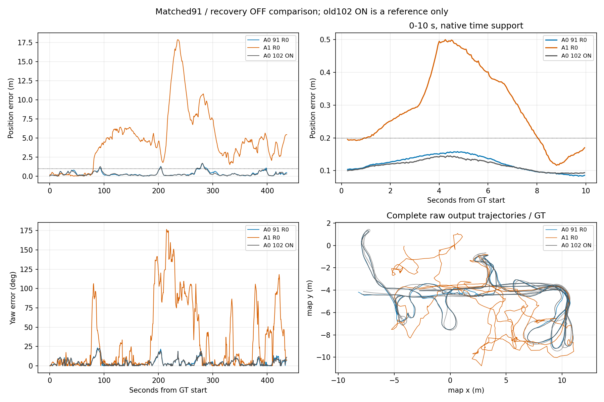

# 近期SLAM研究进度与阶段收口（2026-10-15—16）

**当前状态：NO_METHOD_READY。** 没有方向取得正式SCI方法开发资格。二维激光A1/A2新观测模型与L1开发停止；视觉walking方法开发停止；V3仅为优先补证候选，数据未取得，尚未执行ETH3D科学实验。

本归档延续[2026-10-15发布记录](../20261015_direction_review/README.md)，汇总随后真实执行的工作。原报告按字节保留；其中“下一轮建议”是当时状态，**当前安排以本页及最新阶段收口/数据门报告为准**。报告中的失败、UNKNOWN和预算未改写。

## 进度与最终状态

| 阶段 | 已获得的证据 | 当前结论与入口 |
|---|---|---|
| 主动建图D1 | 作者CNN CPU推理合格，但没有可重放的真实误停决策前缀；ROS/策略矩阵未启动 | 暂停，不作为主线。[报告](snapshots/active_mapping_d1_exploratory_20261015/REPORT.md) |
| 被动ORB-SLAM3 RGB-D基线 | 官方commit `4452a3c4ab75b1cde34e5505a36ec3f9edcdc4c4`；TUM walking/sitting完整无窗口运行与SE3无尺度评价 | 原生默认viewer退出失败保留；无窗口基线合格，不等于动态方法有效。[报告](snapshots/passive_visual_slam_qualification_20261015/REPORT.md) |
| 输入格式和重复控制 | 正确BGR后walking三次ATE 0.413644–0.437544m、1s平移RPE 0.258353–0.299724m；827帧均公开返回OK | 真实运动误差成立，动态污染原因未证实。P0_02重复stamp/多map身份不合格，保留而不当可信全局精度。[诊断](snapshots/passive_visual_slam_qualification_20261015/diagnostic_comparison_20261015/REPORT.md) |
| walking机制审计/P2 | 22–24.5s高误差可重复，低误差后段也有人；固定帧对几何不能归因真实优化约束。人物权重获取失败，P2从未运行 | **STOP_CURRENT_WALKING_METHOD_DEVELOPMENT**；不宣称人物排除有效或无效。[窗口](snapshots/passive_visual_slam_qualification_20261015/p2_window_validation_20261015/REPORT.md) / [最终审计](snapshots/passive_visual_slam_qualification_20261015/offline_correspondence_audit_20261015/REPORT.md) |
| V2/V3选题 | V2有直接近邻/平台成本；V3位置不确定范围跨深度表面有文献和源码依据 | V3仅可证伪候选；GMM/完整协方差/可见性门等已有前例。[筛选](snapshots/passive_visual_slam_v2_v3_screen_20261015/REPORT.md) |
| V3 cables_3数据资格 | 原Phase0无数据；本轮限定官方获取，两ZIP均curl35/TLS握手失败、0字节 | **DATA_NOT_QUALIFIED / TECHNICAL_INCOMPLETE**；B0/B1均未运行，不是科学失败。[原Phase0](snapshots/passive_visual_slam_v3_cables3_20261015/REPORT.md) / [最新数据门](snapshots/v3_cables3_data_gate_20261016/REPORT.md) |
| LILocBench/AMCL原生基线 | 真实map、scan、odom TF、GT及作者评价合格；static A1/A2约0.037m；长期变化A1/A2严重失准，A0约0.43m | **BASELINE_READY**；不能仅凭A1/A2大误差认领新模型。[报告](snapshots/lilocbench_amcl_validation_20261016/REPORT.md) |
| 原生随机恢复反证 | A1/A2各一次关闭恢复；仍约6–7m，误差持续时间更长，方向有取舍 | **RECOVERY_NOT_SUFFICIENT**；旧ON注入次数UNKNOWN，不称恢复是唯一原因。[报告](snapshots/lilocbench_amcl_recovery_control_20261016/REPORT.md) |
| 同91束离线似然 | 固定扫描/候选集出现加和/乘积排序冲突；静态健康数据乘积也尖锐 | **MAP_LIKELIHOOD_CONFLICT_OBSERVED**仅限离线排序。5/7s远端候选源于A1-ON，不能冒称A1-R0真实粒子。[报告](snapshots/lilocbench_likelihood_audit_20261016/REPORT.md) |
| 最终原生聚合控制 | A0-91-R0完整一次，对A1-R0同91槽、同恢复关闭、Gaussian seed1702；原生加和显著缓解失准 | **EXISTING_AGGREGATION_SUFFICIENT**；正式结题A1/A2新观测模型，不追加权重/切换/区域网络。[报告](snapshots/lilocbench_aggregation_control_20261016/REPORT.md) |
| A0两段残差收口 | 只查两段>1m误差，共27次实际更新；GT的原生加和评分27/27高于当时估计，仍缺实际粒子支持/起因证据 | **L1_NOT_YET_JUSTIFIED / NO_METHOD_READY**；不以残差另起AMCL模型。[阶段收口](snapshots/slam_stage_closeout_20261016/REPORT.md) |

## 关键控制结果

以下为已有完整长期变化运行，不是本次发布重跑；GT按官方全局坐标评价，不做事后SE2/SE3拟合。

| 条件 | 位置RMSE m | 航向RMSE ° | 位置P95 m | >0.2m累计 s | 本轮解释 |
|---|---:|---:|---:|---:|---|
| A1-R0：乘积，91槽，恢复关 | 6.142 | 56.81 | 13.476 | 387.60 | 主要对照 |
| A0-91-R0：加和，91槽，恢复关 | **0.445** | **6.17** | **0.973** | **235.30** | 现成简单方法已显著缓解严重损失 |
| 旧A0-102-ON：加和，恢复开 | 0.432 | 6.11 | 1.004 | 218.45 | 强简单参照；不是纯聚合对照 |

A0-91-R0/A1-R0均6540输入扫描、708次更新，位姿时间跨度覆盖约99.62%（不是逐scan跟踪成功率）。实际同物理索引0,9,…,810；A0参数max_beams=91，而A1原参数100，不能说只改了一个字面参数。两者用户CPU约40.20/4.30s，实际粒子数不同；改善不是无代价，也不证明所有地图都应使用加和。

[原始摘要CSV](snapshots/lilocbench_aggregation_control_20261016/results/full_comparison.csv) / [随机恢复对照](snapshots/lilocbench_amcl_recovery_control_20261016/results/comparison_metrics.csv) / [A0两段残差](snapshots/slam_stage_closeout_20261016/results/window_summary.csv)

## 当前唯一下一步

**先取得两份官方cables_3完整ZIP，恢复V3数据验收和原生ORB深度边界暴露检查。** 不自动重试网络，不运行B0/B1、不开发多表面优化器。数据/标定/深度尺度及边界暴露门通过后，再按既有预算决定是否做原生/简单深度无效化反证。若无合格暴露、原生健康或简单处理已足够，则停止方法开发。

当前没有已证明独立新颖性的SCI机制；不将工程资格、离线评分、网络失败或技术失败包装为科学正负结论。旧主动回环、主动地图核验、RTAB封装链继续冻结。

## 公开范围与复查

包含13份阶段报告、冻结协议、摘要数据、有限关键图、作者来源/最近邻审查、诊断与评价脚本/小补丁。`snapshots`中的选中文件与本地原件逐字节一致；导出清单见[publication/source_inventory.json](publication/source_inventory.json)。

**这是一份研究记录归档，不是开箱即用的全系统发行版。** 原始bag/RGB-D/GT/地图文件、权重、源码下载缓存、文献PDF、编译库、逐帧/粒子原始流、机器日志留在本机；不删除、不覆盖。原报告链接到未发布原始附件时可能无法直接打开，见[出版范围与附件说明](PUBLICATION_SCOPE.md)。脚本保留原绝对路径以忠实记录，不宣称已移植到任意机器。

本次发布只执行归档完整性、摘要一致性、纯离线评价/几何单元测试及泄密/文件范围检查；没有新增SLAM科学运行或训练。验证范围见[publication/verification.json](publication/verification.json)。历史版本仍在上一研究分支和本分支祖先提交内。
