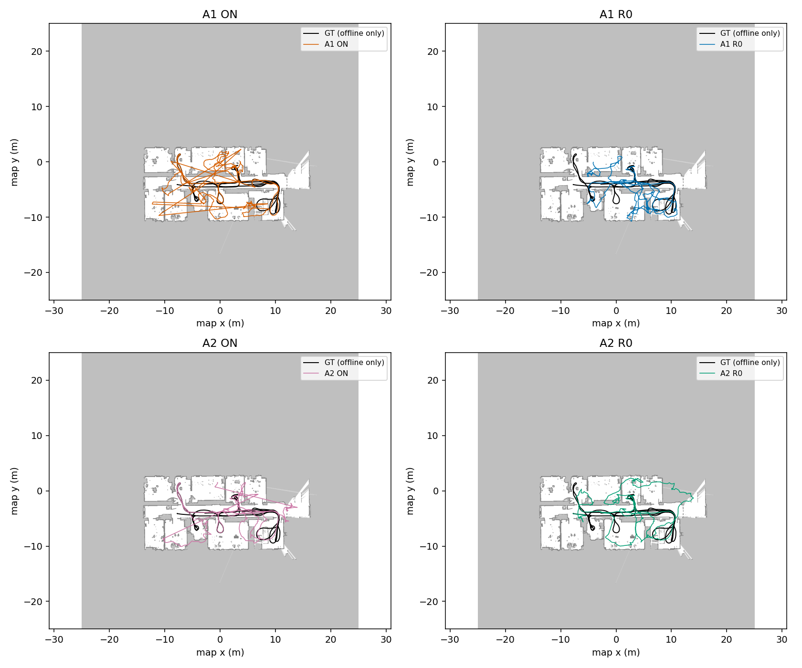
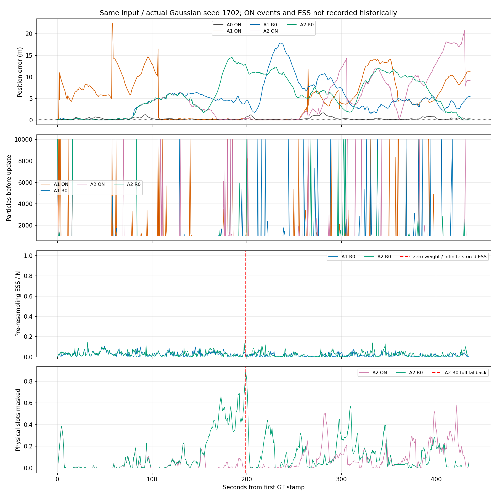
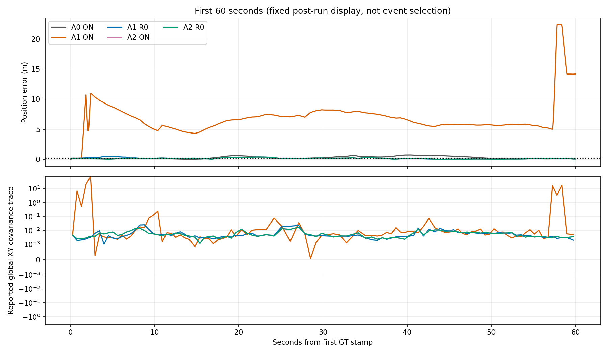

# LILocBench AMCL随机恢复：两次参数反证

2026-10-16，ANALYZED。**最终决策：RECOVERY_NOT_SUFFICIENT。关闭随机恢复没有解决当前严重定位损失；未取得开发新观测模型的必要性证据。**

本轮仅新增A1-R0、A2-R0各一次完整运行，均退出0，预算2/2关闭。位置RMSE变化方向不一致，高误差累计时间均增加。不能据此把随机恢复认定为初始错误的唯一原因，也不能用单种子推断恢复成功概率。

标签：**实测**＝本机原始运行/复算；**源码支持**＝固定代码；**推测/UNKNOWN**＝缺直接证据。不是独立团队复验。旧研究结论BASELINE_READY保留；没有SCI算法、als_ros、额外数据、视觉/主动SLAM实验。

## 1. 公平性与执行范围

已读取上一轮REPORT、REPRODUCE、runs_frozen、all_run_metrics、beam_summary、case_records、effective_seed_register和SOURCE_AUDIT。固定官方navigation commit `f13af47ee2bca6c3bf99db2965e46e55303f6e66`，以实际Gaussian日志为准，旧ON和新R0的初始化均为**1702**；没有把名义1701或旧静态A0当作独立1702重复。

复用同一原始map、lt_changes_0及已认证topic别名bag、前置激光/外参/odom TF、omni-corrected、局部初始均值和协方差、1000–10000粒子、100束预算、运动与观测配置。GT仅用于既有一次起点初始化和离线评价，无在线GT流。原生`--run-from-bag`、壁钟管理/原scan时间估计，无外部高速回放。

**实测**：启动前参数及启动后有效参数与对应旧ON均只差`recovery_alpha_slow: .001→0`和`recovery_alpha_fast: .1→0`。708次更新的**seq与整数stamp全部一致**，708条输出时间也完全一致；两次都收到全部6540扫描，未剔除困难时段，未出现TF外推或冲突父节点。

[冻结设计](protocol/design_frozen.json)、[运行前输入/代码hash](protocol/run_inputs_frozen.json)、[公平性检查](audit/fairness.json)、[预算结算](protocol/attempts_final.json)。运行顺序A1-R0→A2-R0，没有重试、追加种子或扫描更改。

计数只在独立PF库增加；旧执行程序、观测/地图库及其他PF对象不变。撤回计数能恢复旧源码，恢复开/关的软件夹具数值及随机流逐字一致，见[等价性测试](audit/pf_equivalence_test.json)。这不是完整ROS时序等价证明。参数干预本身会改变随机分支和后续随机流；**相同初始种子不代表分支后仍有逐次相同的随机数配对**。

## 2. 全部结果：不只看RMSE

下表ON及A0为既有实际seed1702结果，R0为本轮新增。评价沿用官方XY/yaw、原GT时间插值与首尾填充规则，**没有SE2/SE3最佳对齐**；不外推/输出时刻指标另存各次metrics.json。

| 条件 | 位置RMSE m | 航向RMSE ° | 位置P95 m | 最大误差 m | >0.2m累计 s | 最长连续高误差 s |
|---|---:|---:|---:|---:|---:|---:|
| A0 ON，强简单参照 | 0.432 | 6.11 | 1.004 | 1.695 | 218.45 | 51.55 |
| A1 ON，旧 | 6.900 | 95.47 | 13.648 | 22.398 | 319.45 | 179.40 |
| **A1-R0，新** | **6.142** | **56.81** | **13.476** | **17.862** | **387.60** | **358.65** |
| A2 ON，旧 | 6.726 | 106.83 | 16.904 | 20.773 | 307.15 | 105.85 |
| **A2-R0，新** | **7.133** | **55.03** | **12.512** | **14.611** | **373.90** | **351.15** |

五组均708条位姿；GT时间跨度覆盖**99.6207%**，最长输出间隔**2.0665s**。跨度覆盖不是逐scan成功率；1s/2s插值支持分别95.4253%/99.1379%。因此R0没有靠少输出改变主指标，但更小的航向/P95/最大误差也不能掩盖高误差持续更久。

| 条件 | 总管理墙时 s | AMCL用户/系统CPU s | 峰值RSS MiB |
|---|---:|---:|---:|
| A0 ON | 47.59 | 41.90 / 0.61 | 51.29 |
| A1 ON | 10.49 | 4.62 / 0.58 | 50.41 |
| A1-R0 | 10.09 | 4.30 / 0.56 | 49.69 |
| A2 ON | 10.39 | 4.55 / 0.59 | 58.47 |
| A2-R0 | 12.49 | 6.49 / 0.77 | 58.48 |

耗时含本机负载与诊断差异，不归结为恢复模块的独立开销。完整精度表：[comparison_metrics.csv](results/comparison_metrics.csv)。原始命令、参数、轨迹、资源、stdout/错误与TF日志均在[两次结果](results)。

## 3. 实际恢复、权重与粒子证据

**源码支持**：total>0时，slow/fast由相同w_avg初始化，随后各自指数更新；`w_diff=max(0,1-w_fast/w_slow)`决定每个输出粒子的随机地图采样概率。关闭两个alpha不关闭普通/KLD重采样。A0为近似加和，A1/A2为对数乘积，A0/A1不能当跳束开关对照。详见[源码审查与零权重路径](audit/SOURCE_AUDIT.md)。

| 本轮实测 | A1-R0 | A2-R0 |
|---|---:|---:|
| 正常重采样调用 | 708 | 708 |
| 随机注入粒子 / 含注入事件 | **0 / 0** | **0 / 0** |
| w_diff范围 | 0–0 | 0–0 |
| 重采样后粒子数 min/median/max | 1001/1001/10000 | 1001/1001/10000 |
| 有限ESS中位数，重采样前 | 18.06 | 25.01 |
| 有限ESS/N中位数 | 1.73% | 2.42% |
| ESS/N<10%更新数 | 706/708 | 696/707有限事件 |
| 最大归一化权重的P95 | 0.9545 | 0.7155 |
| 总权重为零 | 0 | **1** |
| 总权重非有限 / 非有限归一化权重事件 | 0 / 0 | 0 / 0 |
| 原生ESS非有限 | 0 | **1，见下文** |

两组slow和fast一直相等，均固定为首个w_avg=`2.8212050900679147e-30`。很小的未归一化值本身不等于故障；有效证据是归一化后权重高度集中。首更新10000粒子的ESS仅13.39，重采样后1001粒子。**这证明R0中观测后权重集中，不证明它一定错误，也不证明旧ON没有同样现象。** KLD最小数量附近1001来自原生停止规则，没有调粒子预算。

**旧ON每次w_diff、注入数量、ESS均UNKNOWN，原先未记录。** 本轮没有额外重跑ON去补齐证据，不能把轨迹跳变、粒子不收敛或地图上的远粒子直接称为已记录的恢复注入。旧/新采样粒子云保留；云header是壁钟，不能伪造精确scan对应。[云分布摘要](results/cloud_samples_summary.json)、逐更新[A1-R0](results/A1_R0_recovery_events.csv)/[A2-R0](results/A2_R0_recovery_events.csv)及原始observations可复查。图中N是更新前N，ESS是归一化后/重采样前ESS，二者不混用。

## 4. 先看误差起点，再看最大值

运行前固定：首次位置误差**>0.2m**；持续偏差为连续>0.2m **≥3s**；重新接近为之后连续≤0.2m≥3s。时间零点为首GT stamp。下表用冻结的GT时间插值估计，边界不是内部故障事件时刻，且不外推到原生轨迹范围之外。

| 条件 | 首次>0.2m s | 首次持续偏差起点 s | 第一次偏差后持续重新接近起点 s |
|---|---:|---:|---:|
| A0 ON | 16.70 | 16.70 | 24.00 |
| A1 ON | 1.05 | 1.05 | 108.30 |
| A1-R0 | 1.05 | 1.05 | 11.45 |
| A2 ON | 7.05 | 17.65 | 24.60 |
| A2-R0 | 7.05 | 17.65 | 24.60 |

A1-R0早期较快重新接近，但之后仍长期错误；不能只截早期认定恢复关闭解决问题。A2两组前**115条位姿逐字相同**，首次输出差异在69.18s；17.65s的持续偏差发生在这之前。A1仅第一条位姿完全一致，0.779s已有数值差异。**这些是输出差异时间，不是随机注入时间。** 旧ON事件缺失，不能判断首次ON注入与误差的先后；但R0在零注入条件下仍出现同样早期偏离，随机注入不是这类偏离发生的必要条件。

[全部持续偏差/重新接近区间](results/onsets.json)保留，不只报告最佳恢复段。原生公布协方差是整体粒子集合协方差、公布均值来自最大权重簇，不是GT误差；源代码已核对。它不认证定位正确。

## 5. Beam skipping交互与新发生的工程边界

旧A2跳束有效657/708次、新A2-R0为653/708次。**旧ON全量回退0，本轮R0为1；未修改旧事实。** A1仍为0次跳束。关闭恢复的A2比旧ON位置RMSE更差、航向及最大误差较小，高误差时间增加66.75s；A1同样高误差时间增加68.15s。仅一个种子，不估计交互显著性或恢复概率。

本轮唯一回退在**198.911742s**，原seq12105。91个物理槽中81个不满足一致门，另9个未采样分配槽使计数达到90/100，触发原生全量回退。随即总权重0，原代码置均匀权重；原生ESS记账为inf，**不是有效样本无穷**。归一化权重仍有限，正常重采样继续，随机注入仍0。

源码回退积分会纳入9个未填写零槽，`log(0)`路径与该零权重吻合。这是当前公开实现的工程边界，未修补。前一更新198.379s误差12.85m，当次12.84m，下一更新199.446s仍12.36m；**它出现在大误差之后，不能解释最初失准，也没有证据证明其改善了恢复概率**。[相邻更新](results/fallback_adjacent_updates.json)。不围绕该事件开发算法或增加实验。

## 6. 判断与唯一下一步

- **实测：关闭恢复不足。** 两组仍6–7m RMSE，均远未接近A0的0.432m。未获得“一个简单recovery设置就解决问题”的结果。
- **实测：恢复开关改变轨迹，收益有取舍。** A1-R0位置RMSE稍降、A2-R0反升；两组高误差时间均变长。有与恢复可能保护长期恢复能力相容的现象，不能把它升级成多次重复的保护概率证据。
- **UNKNOWN：旧ON随机注入实际次数和首次时间。** 因此不选RECOVERY_EFFECT_SUPPORTED来宣称随机恢复是严重错误的主要原因。主结论仅RECOVERY_NOT_SUFFICIENT。
- **仍未隔离：** 锐利乘积似然、地图别名、初始化粒子支持、重采样耗散、scan畸变/地图表示、运动噪声。高度集中的权重不是其中某个解释的专属证据。A0还改变实际束采样数102 vs91，不能直接用其优越性证明乘积聚合缺陷。正常重采样仍存在，关闭恢复没有隔离重采样本身。
- 两次仅一个真实Gaussian种子，诊断增加时间开销；相同更新身份和软件等价测试增强可比性，但不能证明泛化、不含运行变异或精确反事实粒子谱系。没有SCI新方法立项结论。

**唯一下一步建议：如继续，仅授权一次离线“首0–10s固定扫描的地图位姿候选似然剖面审计”。** 使用现有输入，不重跑完整滤波器；用相同91个物理槽比较A0式加和与A1式乘积，在相同局部位姿网格和已记录估计/离线GT位置核查评分排序、峰宽及错误峰。GT仅离线参照，不选择在线束或权重；不调参数，不部署als_ros，不加新模型。目的只是区分“正确模式支持不足/错误地图峰/单纯过度集中”是否有可检查证据。若差异不稳定或仍不能解释初始偏离，停止观测模型开发，不追加更复杂机制。本轮没有执行该建议。

## 7. 保护、失败记录与复查

全部新增文件在本目录；数据留系统盘但只读复用，不重复下载。1903项旧文件前后hash一致，主仓HEAD `4746834ffa44504443fd07214105fe850d6f94e6`、两个未提交文件与diff不变，见[保护结果](audit/protection_after.json)。范围限清单，不宣称重哈希全部历史视觉数据。开始约15.06GiB可用，结束约15.01GiB，始终保留5GiB；没有删除/扩容/挂载操作。

分析首版对整个启动前后参数字典全等的断言失败：AMCL自动补入六个默认键。已验证所有登记参数未变、两组启动后完整参数仍仅差recovery的两个值；首版脚本和说明保留于audit。清理首版文本匹配误将包含源码的父shell当作ROS进程；修正为先核查进程身份，未杀任何该误匹配进程。两项是审计工具修正，没有重跑科学任务或更改评价阈值。

两次AMCL及采集/map/master均正常退出，专用11331端口释放，没有本轮ROS节点残留。没有网络、软件安装、训练或额外科学运行。复查入口：[REPRODUCE.md](REPRODUCE.md)。原始日志、源码补丁、软件测试、全部轨迹及图表均保留；最终MANIFEST列出新增交付。
