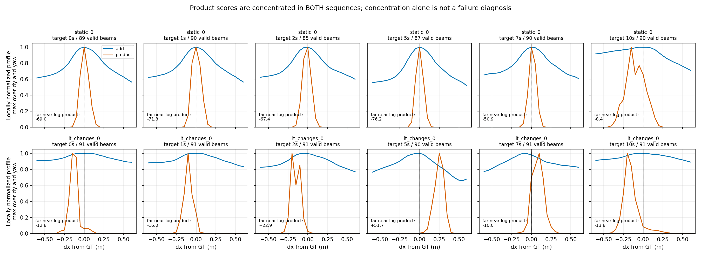
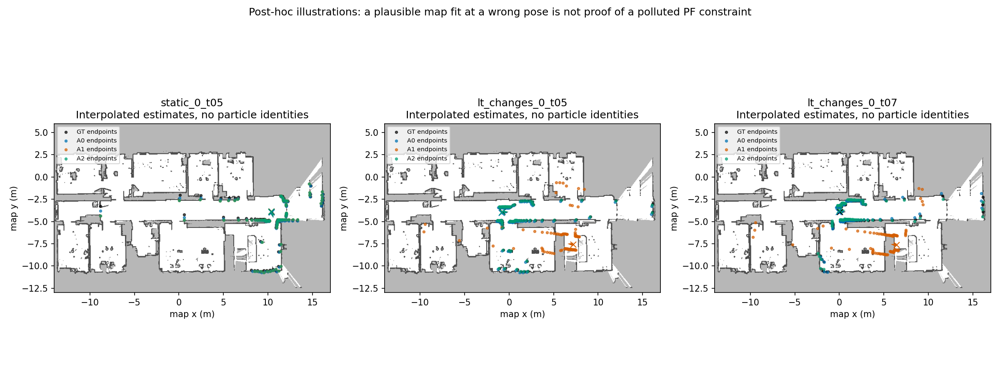
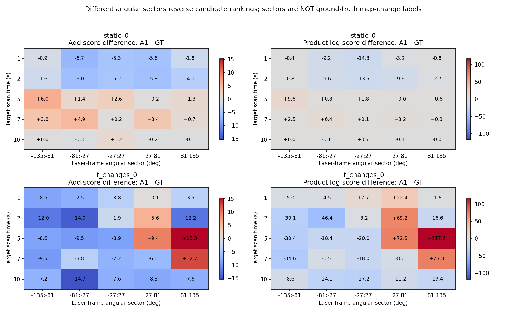

# 前0–10秒同束数观测似然审计

2026-10-16，**OFFLINE_DIAGNOSTIC / ANALYZED**。最终决策：**MAP_LIKELIHOOD_CONFLICT_OBSERVED**，严格限定为固定候选位姿间的观测评分排序；**完整PF初始失准的根因仍UNRESOLVED，不取得新方法开发资格。**

约5s、7s，偏离GT约8.75m、7.37m的A1插值位姿，相对于GT在乘积模型中得分更高、在同91槽加和模型中更低。但这不等于乘积模型总选错或加和模型总选对：约5s加和模型的候选集最优点也远离GT；约7s乘积模型的局部正确邻域又优于远端候选。两种情况完整保留。

没有新AMCL/ROS运行、数据/权重下载、安装、训练或地图修改。范围只有static_0与lt_changes_0、六个固定扫描时刻。此前BASELINE_READY、RECOVERY_NOT_SUFFICIENT不变，视觉/主动方向均冻结。

## 1. 原生公式与数值资格

读取两份正式报告、对应SOURCE_AUDIT与REPRODUCE、comparison_metrics、两份实际命名的`A1_R0_recovery_events.csv`/`A2_R0_recovery_events.csv`和onsets。固定官方navigation **1.17.3 / f13af47ee2bca6c3bf99db2965e46e55303f6e66**。

使用相同逐束概率：

`p_i = 0.95 exp(-d_i² / (2·0.2²)) + 0.05 / range_max`

`S_add = 1 + Σ p_i³`；`L_product = Σ log(p_i)`。

主比较均使用**索引0,9,…,810的91个物理采样槽**，相同invalid/max-range排除，实际有效返回85–91束。不是默认A0的102槽和A1的91槽之间的比较。保留log评分/相对量；不跨模型比较绝对值。加和是原生启发式评分，不冒称已校准观测概率。

复用原生map_server图像加载、convertMap规则及旧AMCL地图距离场库，精确保留OccupancyGrid分辨率float32提升后的`0.05000000074505806m`、半格索引、离图距离2m、未知格处理、range_min/max和激光平移/偏航约定。没有用普通floor或近似距离变换替代。GT按官方intrinsic ZYX投影为base_link二维位姿，无空间对齐。

**实测数值PASS**：42个可用中心×3项比较（同91槽加和/乘积、原生102槽加和），Python与已编译C++原生函数最大log差**1.42×10⁻¹³**，小于事前1e-10。探针直接调用观测函数，不调用滤波、重采样或节点。源码/处理细节见[SOURCE_AUDIT](audit/SOURCE_AUDIT.md)、[核对原始结果](audit/native_equivalence.json)。没有完整原生逐束内点trace，不把聚合核验说成内部打点全等。

**A2只是候选位姿来源**：历史逐束mask与对应粒子集缺失，本轮不生成伪A2跳束mask，评分对应无跳束同束数模型。

## 2. 事前固定扫描和候选集

时间零点各取首个官方GT stamp；在原扫描header相对时间[0,10]内选择离0/1/2/5/7/10s最近者，同距取早者。以下12帧全部保留：

| 目标s | static实际s / stamp_ns | changes实际s / stamp_ns |
|---:|---|---|
| 0 | 0.060564 / 1733376701271241755 | 0.045160 / 1733413849651810312 |
| 1 | 0.993345 / 1733376702204023045 | 0.978289 / 1733413850584938990 |
| 2 | 1.993567 / 1733376703204245273 | 1.978876 / 1733413851585526653 |
| 5 | 4.994039 / 1733376706204717584 | 4.978263 / 1733413854584913649 |
| 7 | 6.994023 / 1733376708204700784 | 6.978387 / 1733413856585037836 |
| 10 | 9.993451 / 1733376711204128920 | 9.978316 / 1733413859584965977 |

各扫描共同候选为GT、旧A0/A1/A2周围 **x/y±0.6m、0.05m步长、yaw±20°、2°步长**；每中心13125点，包含中心，精确去重后共**498750个候选**。候选在任何评分之前登记，未移动/扩展网格。结果只叫“固定候选集最优”，不叫全地图最优。

两条0s扫描早于AMCL首输出，A0/A1/A2均**UNAVAILABLE**，仅有GT网格，不外推。其他中心采用原轨迹线性XY＋四元数SLERP，**是插值候选，不是该scan真实PF粒子**。约10s配对的右端输出可能稍超过10s，仅用于形成本窗口时刻的插值，不评价其后扫描/失效。

约2s的A1插值跨越**近20m、约176°的输出跳变**，中间位姿不能当实际模式；该行保留但不用于解释实际粒子支持。5s、7s的A1插值分别来自相距约0.10m、0.18m的相邻输出，比2s更适合此排序诊断。参见[真实插值端点](results/interpolation_audit.json)。早期candidate_manifest有一个未计算的跨10s标志占位字段，不能当事实；以此实际端点表和[audit说明](audit/interpolation_metadata_note.json)为准，冻结候选未改。

静态A0目录虽名seed1702，实际Gaussian seed为1；静态A1/A2及变化三组为1702。本轮仅借这些轨迹生成位姿候选，不冒称静态三组同种子因果对照。不同序列路径不同，静态/变化对比也不是严格环境干预配对。

[扫描原件](data/scans.json)、[候选中心](data/candidate_manifest.json)、[评分前冻结](protocol/candidates_frozen_before_scores.json)包含精确身份/网格/hash。

## 3. GT、实际估计插值与错误候选的评分

表中评分差均“**A1插值候选−GT**”，正数表示偏好A1。加和列用log比值以便展示，但两列量级不能互比。最优误差只指本固定候选集。

| changes目标s | A1位置误差m | log(S加和(A1)/S加和(GT)) | L乘积(A1)−L乘积(GT) | 加和最佳位置误差m | 乘积最佳位置误差m |
|---:|---:|---:|---:|---:|---:|
| 1 | 0.199 | -0.481 | +19.063 | 0.062 | 0.165 |
| 2† | 6.769 | -0.970 | -27.056 | 0.038 | 7.614 |
| 5 | 8.747 | -0.055 | +121.284 | 9.021 | 8.747 |
| 7 | 7.367 | -0.329 | +6.117 | 0.063 | 0.291 |
| 10 | 5.000 | -1.063 | -90.518 | 0.050 | 0.224 |

†约2s插值横跨模式大跳变，不证明实际粒子位于该处。1s误差0.199m仍在初始化标准差尺度附近，不能叫不可恢复失败；初始标准差为0.2m/0.2m/10°。

**较明确的观测排序冲突**：5s时错误A1比GT的乘积log分数高121.284，加和log比低0.055；7s相应为+6.117、−0.329。说明同一组逐束概率，聚合会改变正确/错误位姿排序。对应A1底盘位置均在旧地图free格，未靠排除occupied位姿制造对比。

**必须保留的反例**：

- 5s加和在整个候选集的最优点也错约9.02m，比GT近邻最佳高约8%的评分；不能宣称加和永远拒绝错误地图峰。
- 7s虽错误A1高于“精确GT点”，但乘积的GT近邻最佳比远端最佳高约10.03个log单位；全候选集最优距GT约0.291m。一个GT点低分不等于整个正确模式不受支持。
- 10s两种模型都降低错误A1得分，仍不能从瞬时观测分数预测其历史滤波状态会立即纠正。
- 2s乘积候选集最佳错约7.61m、加和约0.038m，提示错误峰可能存在；但中心跨大跳变，不能将其作为已认证实际粒子失效轨迹。

[完整GT/A0/A1/A2评分和候选内排名](results/named_candidate_scores.csv)、[最佳点/局部宽度/近远排序](results/profile_summary.csv)保留所有扫描。每帧NPZ保存全候选聚合log评分、named逐束概率与实际束索引；其他逐束值可由冻结输入复算，没有宣称保存全部内部PF观测。

## 4. 静态对照、集中程度与扫描区域

GT中心均匀网格的归一化评分ESS代理/13125：静态乘积约**0.108%–0.150%**，变化乘积约**0.048%–0.134%**；静态加和约82.7%–88.8%，变化加和约85.5%–92.7%。**这是固定网格归一化评分的集中代理，不是实际PF ESS，不含运动先验、粒子提议或历史权重。**

GT局部乘积剖面确实窄：max-over-yaw的半高支持横向包围宽度约0–0.20m；部分为单列格点，不能解释成真实零宽。加和的支持经常触及±0.6m边界，因此其1.2m包围宽度是受网格截断的记录，不是完整FWHM。可存在多峰，未强行拟合单高斯。

**图1结论：健康静态序列中乘积同样很集中；“尖锐/低ESS代理”不足以单独说明错误定位或概率失校准。**

**图2结论：错误位姿可令部分端点更贴旧地图，但这不是变化真值或实际粒子内点证据。** 这是评分之后选取的5s/7s说明图，不参与扫描选择或评分统计；全12帧数值未删。

固定5个激光角区间，逐束贡献精确加回总差。5s时前三段合计偏好GT：乘积log差约−68.81；后两段合计偏好错误A1：约+190.10，净+121.28。加和前三段约−27.03、后两段约+24.70，净负。因此聚合的取舍具有可量化来源。

7s时只有81°–135°区段给错误A1约+73.28的乘积log贡献，其余约−67.16，净+6.12。**不据此开发区域权重，也不把某角区标成真实变化结构**；GT误差、旧地图表示、可见性和扫描畸变仍可能影响它。

**图3结论：不同角区支持方向相反，且两个原生聚合的净排序不同；这支持评分冲突，不提供完整PF因果归因。**

## 5. 三个假设与科研边界

| 假设 | 本轮证据 | 边界 |
|---|---|---|
| H1：观测模型支持错误地图峰 | **局部支持**：5s错误A1高于GT，且乘积远端最佳比GT近邻最佳高51.65 log；7s有点对点排序冲突 | 并非所有扫描；5s加和也有错误峰；不能区分地图别名、地图过时和传感器/GT表示冲突，更不能证明该峰触发初始跳变 |
| H2：正确模式仍受支持，但过度集中 | **集中现象明确，病理性UNKNOWN**：静态/变化都窄；7/10s近邻可优于远端 | 固定网格不是PF，健康静态同样尖锐；缺少校准/覆盖证据，不能把窄峰直接叫过度自信缺陷 |
| H3：粒子支持/运动预测/重采样历史造成损失 | **UNKNOWN，仍需考虑**：瞬时正确支持不保证完整PF恢复 | 没有同stamp重采样前后粒子身份/权重；壁钟粒子云不能伪造成该证据；没有重跑或追踪内部约束 |

本轮可以拒绝“观测评分总支持GT、只需把错误都归因粒子数量”的预设；也不能反向宣布H1完整解释严重定位偏差。尤其1.05s仅是>0.2m门，不等于不可恢复失效；A2持续偏差17.65s在范围外，**本轮不解释A2整段损失**。相关扫描不当成独立统计重复，不给显著性/泛化声明。

历史198.91s的91物理槽/100分配槽、零槽回退/零总权重/inf ESS发现继续保留；它不在本轮范围，没有重新计算、修复或用来解释早期失准。

## 6. 是否继续与唯一建议

**可继续一次简单现成模型的反证，不值得据此开发新观测模型。** 观测排序冲突是实际新证据，但原生加和已经是现成竞争方法，宽泛的鲁棒聚合/变化抑制不是论文创新。

**下一轮唯一建议（本轮未执行）：若另行授权，仅做一次前0–10s、seed1702的原生`A0-91-R0`短程对照。** likelihood_field、max_beams=91使物理索引同为0,9,…,810，恢复slow/fast均0，其余沿用已有A1-R0。与旧A1-R0同窗结果比较严重偏移、航向、原始输出和同更新身份；不因0.2m越界单独判失败。它只检验“同束数的已有加和是否已经足够”，不加权、不改公式、不接als_ros、不扩展时间。

若现成加和已消除早期米级错误，接受简单方法足够，停止新增观测模型开发；若仍不能解释或存在显著输入/时序差异，保留INCONCLUSIVE，不自动增加模块/种子。当前报告不授权自动启动该运行。

## 7. 复核与保护

全部新文件在本独立目录。2010项列出旧文件前后hash一致，主仓HEAD/status/diff及两项未提交修改保留，见[protection_after](audit/protection_after.json)。范围限清单和旧顶层报告，不声称重哈希全部历史视觉原图。冻结扫描/网格/探针源码hash未变。

开始约15.01GiB可用，仍约14.99GiB可用；新增约12MB，保留5GiB。没有安装、联网获取或新定位进程。沿用academic-research-suite的来源与竞争解释核验，分析由当前助手完成，无独立团队复验。GT投影的首版大小写修正在任何评分之前完成并重冻；插值元数据占位问题另留说明，不隐藏或改写候选。

[REPRODUCE](REPRODUCE.md)列出离线命令、库和数值测试；最终MANIFEST包含全部交付。状态是ANALYZED，不冒称完整PF因果验证或SCI新颖性验证。
