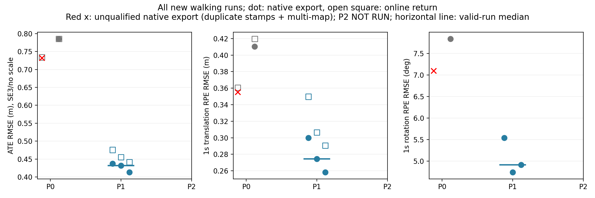
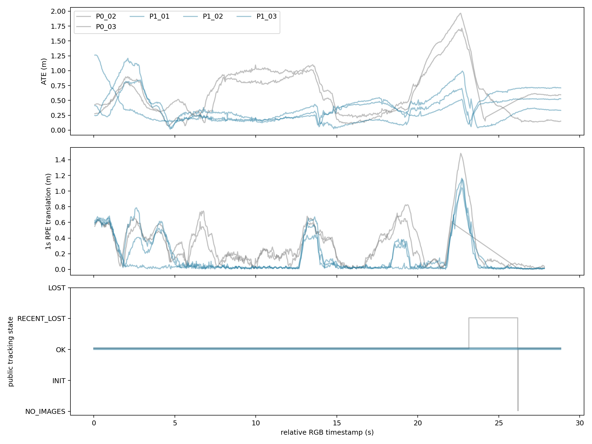

# RGB-D格式控制与简单人物排除：受限诊断比较

2026-10-15。**阶段结论：TECHNICAL_INCOMPLETE，限定于P2人物排除比较；P0/P1原生运行与P1轨迹评价已完成。新增论文方法仍为NO_METHOD_JUSTIFIED。**

正确色序后，walking三次仍有0.414–0.438m ATE、0.258–0.300m的1s平移RPE，且每次827帧公开返回状态均为OK。这个定位误差已经得到重复证据；**尚不能把它解释为动态错误关联，或简单人物排除后的剩余缺陷**。轻量检测器权重在限定获取中未完整取得、无法校验，故`MASK_NOT_QUALIFIED`，P2为0次。没有绕过掩膜资格门，没有扩大数据或运行预算。

证据标签：**实测**＝本轮文件/程序/轨迹/测试；**源码支持**＝固定源码路径；**推测**＝未经干预验证的解释；**UNKNOWN**＝本轮证据不足。状态ANALYZED，非独立团队复验。研究范围仅MINIMAL_DIAGNOSTIC_COMPARISON，无正式算法、ROS/Stage/Gazebo、训练或主动动作。

## 1. 范围、固定项与预算

已读取父目录正式REPORT、NEXT_MINIMAL_COMPARISON、四项源码/色序审计、两条headless01结果、原attempts/protection和用户附件。本轮指令优先：P1使用`imread BGR + Camera.RGB=0`，替代旧提案的显式通道交换。新内容全部在本独立子目录；旧结果不覆盖。

- ORB-SLAM3官方commit：`4452a3c4ab75b1cde34e5505a36ec3f9edcdc4c4`。
- P0/P1链接同一个旧核心库，SHA256 `a20db0416fc54ca5949e6b6ac834c12f59dc0bae5f08dc2945e46943a3532c46`。未重编译或修改估计器、后端优化、线程调度、Shutdown。
- 复用Ubuntu20.04、g++9.4、OpenCV4.2、Eigen3.3.7、父目录本地Pangolin0.6；仅编译小型无窗口入口及独立功能测试，无软件安装。CPU运行；GPU未使用。
- 数据原样复用walking827对、sitting1219对；原关联文件、Freiburg3内参、深度5000、ORB1000/1.2/8、FAST20/7均不变。GT只在离线评价/局部运动核验读取。
- 新增walking P0两次、P1三次、sitting P1一次；均完整执行，进程退出0。P2 walking0/3、sitting0/1。历史P0单列，旧失败未改。
- [设计冻结](protocol/design_frozen.json)在首个SLAM运行前保存入口/配置/评价hash、运行顺序和门槛；[P2源码登记](protocol/P2_code_frozen.json)在P1门未通过后、任何P2运行前保存，后者**不是已运行实现认证**。
- 事前P1消除问题门：三次walking均ATE和1s RPEt≤0.05m、覆盖≥99%、退出0。没有通过，因此允许检查P2资格；该5cm是本轮停止门，不是普适应用标准。

P0/P1按P1_01→P0_02→P1_02→P0_03→P1_03交错，最后sitting P1。没有失败重跑。台账：[attempts.jsonl](protocol/attempts.jsonl)、[预算结算](protocol/attempts_final.json)。

## 2. 色序逐字节控制

**实测PASS**：[color_proof.json](audit/color_proof.json)。两序列全部2046张输入图像均满足：

`BGR → BGR2GRAY == BGR → RGB → RGB2GRAY`，逐像素完全相同。

PIL独立RGB读取与imread的反序通道在固定代表帧及[固定种子随机帧](audit/random_color_checks.json)上完全相同。P0/P1灰度绝对差均值：walking4.174、sitting3.759灰度级。`config/P0.yaml`与`P1.yaml`只差`Camera.RGB`一项，无图像、深度或帧序改写。

**源码支持**：固定`Tracking::GrabImageRGBD`根据mbRGB选择RGB2GRAY/BGR2GRAY；Settings读取Camera.RGB。颜色格式差异真实存在；灰度差并不直接给出轨迹误差的因果比例。

## 3. 每次原始运行与评价

ATE采用固定单次SE(3)对齐，不拟合尺度；RPE为1s±20ms，端点GT容差20ms，输出缺口规则与父目录评价完全一致。下表均为**原评价输出，不删除不利运行**；†标记输出身份/坐标不合格，数值仅留存，不能解释为可信全局精度。

| 序列/运行 | ATE m | RPEt m | RPEr ° | 输入精确位姿覆盖 | 公开返回状态 | 当前图导出KF | 墙时 s | 退出 |
|---|---:|---:|---:|---:|---|---:|---:|---:|
| walking 历史P0/headless01 | 0.915863 | 0.446205 | 8.656633 | 827/827 | 无此入口逐帧状态 | 540 | 40.28 | 0 |
| walking P0_02† | 0.732044† | 0.355248† | 7.098601† | 744/827 | OK739、RECENT_LOST87、NO_IMAGES1 | 8† | 39.78 | 0 |
| walking P0_03 | 0.785331 | 0.410484 | 7.841423 | 827/827 | OK827 | 515 | 39.33 | 0 |
| walking P1_01 | 0.437544 | 0.299724 | 5.539982 | 827/827 | OK827 | 239 | 41.06 | 0 |
| walking P1_02 | 0.431839 | 0.274264 | 4.741337 | 827/827 | OK827 | 241 | 40.33 | 0 |
| walking P1_03 | 0.413644 | 0.258353 | 4.912050 | 827/827 | OK827 | 215 | 40.29 | 0 |
| sitting 历史P0/headless01 | 0.009668 | 0.012171 | 0.499673 | 1219/1219 | 无此入口逐帧状态 | 50 | 61.87 | 0 |
| sitting P1_01 | 0.009186 | 0.011565 | 0.488131 | 1219/1219 | OK1219 | 52 | 61.05 | 0 |
| P2两序列 | NOT_RUN | NOT_RUN | NOT_RUN | — | MASK_NOT_QUALIFIED | — | — | — |

完整命令、环境路径、时间、hash、资源、stdout和原始Camera/KeyFrame/OnlineTrajectory位于[results](results)，汇总[summary.csv](results/summary.csv)。新进程峰值RSS约547–861MiB；每次完整记录`/usr/bin/time -v`，不是GPU内存估计。KF导出的是当前Atlas map的关键帧，P0_02的8个不能解释为整个任务只创建8个。

**同配置变异**：P1三次ATE跨度0.023900m，中位0.431839m；RPEt跨度0.041370m，中位0.274264m。n=3只报告范围，不给显著性或跨场景泛化结论。P0两个新增运行之一输出不合格，不能把两次ATE跨度当作有效自然变异估计；历史与新有效P0的ATE分别0.915863和0.785331，但入口有诊断差异。

P1中位ATE比新增有效P0_03低约45%，中位RPEt低约33%。这是有限重复下的描述性差异，**不是“色序解释了45%动态误差”的因果分解**。格式因素确实影响实验条件，不能解释P1剩余的大局部误差；亦不选择历史最差值制造收益。

## 4. 在线位姿、后台修正与新发现的输出身份问题

新无窗口入口用同一公共`TrackRGBD`返回Tcw，反演成Twc，在内存缓冲逐输入stamp、返回状态及位姿；仅OK记为有效在线位姿，不把无效单位阵当成功。无逐帧磁盘写入；原生Shutdown和两个轨迹导出先执行，然后写缓冲。所有P0/P1使用同一入口，完整代码[在此](code/rgbd_diagnostic.cc)。没有修改线程等待或优化公式。

| 运行 | 在线ATE m | 在线1s RPEt m | 导出ATE m |
|---|---:|---:|---:|
| walking P1_01 | 0.475774 | 0.349693 | 0.437544 |
| walking P1_02 | 0.455491 | 0.306529 | 0.431839 |
| walking P1_03 | 0.441545 | 0.290591 | 0.413644 |
| sitting P1_01 | 0.009108 | 0.011334 | 0.009186 |

因此walking大误差并非只在官方最终导出阶段出现。GetTrackingState＋逆变换计时平均0.13–0.23µs，单次最大3.765µs；缓冲插入及计时开销不完整包含在这一数值中。**未证明诊断数值无影响**，不把相同代码/hash当严格等价实验；旧未缓冲运行只作带风险的历史参照。官方Shutdown未等待全部后台优化的问题保持原状，导出轨迹不称为完全收敛最优解。

**P0_02输出资格FAIL**：输入827、状态记录827，但CameraTrajectory有826行、82个重复stamp，仅744个不同stamp精确匹配输入；87次RECENTLY_LOST后出现NO_IMAGES并重新建图。其全局单SE3规范也未认证。**退出0不是轨迹身份合格**，不能用826行冒充826个输入成功定位。

源码`Tracking.cc:2300–2318`在当前帧未isSet时复制上一条relative pose、reference和**上一条timestamp**，提供重复时间戳的直接代码机制；旧数据没有逐分支日志，因此不声称已记录82次该分支。原SaveTrajectoryTUM也不能认证跨map统一坐标。没有去重、更换stamp、逐段GT拟合或覆盖原指标。

独立evo初始“全部全等”断言**失败**并保留[初版脚本](code/final_audit_initial.py)：P0_02默认evo匹配825对/复用82个GT索引，ATE0.730228；固定唯一索引匹配750对，ATE0.732044。P1及其余11项对照吻合至1e-9以内。[匹配审查](audit/matching_policy_review.json)在相同冻结配对上调用evo的独立SE3/ATE数学，12项全部吻合；**没有改变主评价或放宽容差伪装初次PASS**。P0_02仍不具备全局轨迹精度解释资格。

## 5. 实际定位误差与机制边界

**实测**：walking三个P1均持续返回OK，同时在约22.7–23.8s附近出现大局部误差。P1_01最大1s RPE为1.164588m：GT位移仅0.160362m，估计位移1.091892m；P1_02同一时间对为1.043591m RPE；P1_03邻近时间对为1.152015m。[局部运动核验](audit/local_motion_evidence.json)表明这不只是ATE对齐伪影。RPE区间分布全部保留于[固定5s窗](results/local_RPE_windows.json)，未只选有利片段。

**UNKNOWN**：这些错误是否由人物错误关联、静态特征不足、空间集中、深度失效、模糊/相机运动或初始化造成。本轮没有关联身份/静态真值、Hessian或特征深度几何的直接证据。人出现在图像中不是其特征进入优化或构成错误关联的证明。sitting是低动态参考，不是相机运动匹配的因果对照。

公开状态是每个TrackRGBD返回后的采样，第一帧返回OK不表示内部没有初始化；没有采样到state4不表示调用内部从未经过LOST。不得由状态曲线反推所有内部转移。

## 6. 人物掩膜与过滤资格：明确未通过

本机定向搜索未发现可复用ONNX/Caffe检测权重。使用事前指定的轻量候选：[作者MobileNet-SSD](https://github.com/chuanqi305/MobileNet-SSD)，固定commit `bb17b6c3eef36d80be441ae8e5339be66e8e3b7a`。Git tree确认权重23,306,119字节；deploy/demo/LICENSE已下载并通过Git blob SHA与固定提交核验。没有安装Caffe/Torch/CUDA。

权重获取记录：raw SSL失败；直连raw在90s只取得486,099字节，失败文件保留；最后一次API blob获取在60s传输预算结束仍未能形成完整可校验权重。**到此停止检索/下载，不延长预算**。[来源核验](audit/detector_availability.json)、[末次失败](audit/model_blob_transfer.json)、model_download*.log和models/*.partial_raw均保留。没有模型推理、没有真实人物掩膜，故掩膜质量/召回/误删静态背景/CPU推理耗时全部UNKNOWN。不能把网络获取失败写成模型检测能力失败。

源码确认固定ORBextractor忽略`_mask`。仅完成轻量软件单元控制：[exclusion_helper_test.json](audit/exclusion_helper_test.json)：

| 检查 | 实测结果与范围 |
|---|---|
| 原ORBextractor全白mask是否起作用 | 与无mask的关键点/描述子完全相同，证实被忽略 |
| 新过滤helper空mask | 与原输出精确相同 |
| 人工矩形**软件测试** | 1013个特征排除309、保留704，描述子逐行对应 |
| 全白排除、错误大小 | 全部移除；错误大小抛异常 |
| 黑边/新角点、输入像素 | helper只取原特征子集，未改任何图像像素 |
| 实际Frame深度、grid、map匹配整链 | **NOT_TESTED，不合格** |
| 每帧真实mask及timestamp/质量 | **NOT_RUN，MASK_NOT_QUALIFIED** |

人工矩形仅是单元测试，不是ORACLE科学结果。候选前端补丁位于[feature_exclusion.patch](audit/feature_exclusion.patch)及`masked_source`：新增不改变类布局的RGBD重载，在ExtractORB之后、N/去畸变/深度/grid之前同步过滤关键点与描述子，原方法保留；已有地图点不删除，也不新增投影级语义裁决。**此重载未编译/运行/深度索引整链认证，不能作为可用P2交付。** 只编译了链接原库的小型helper测试，没有重建SLAM后端。没有因为helper测试通过而启动P2。

预定person=VOC15、置信度0.5、无bbox扩张、300×300、当前单帧BGR、CPU、预计算并单列感知成本等均已冻结，但都没有实际执行结果。预定掩膜成本和效果不能填成0或宣称实时。

## 7. 十个科学问题的直接答复

| 问题 | 本轮回答 |
|---|---|
| 色序解释多少误差？ | 灰度差已证明；有效新P0与P1中位ATE差约45%，有限非配对重复不能作因果百分比分解。未证明FORMAT_CONFOUNDER_DOMINANT。 |
| 正确色序仍不准确？ | **是**，三次walking全覆盖仍有显著ATE/局部RPE。 |
| 自然变异多大？ | P1 ATE范围0.413644–0.437544m、RPEt0.258353–0.299724m；只对这一序列/入口成立。P0含不合格输出，不能完整估计。 |
| 简单人物排除改善轨迹？ | **UNKNOWN，P2未运行。** |
| 过度过滤/静态几何不足？ | **UNKNOWN**。软件矩形测试不能回答实际静态背景损失。 |
| 持续OK但严重偏差？ | **是**，本轮三次P1公开状态与GT局部运动已直接关联。 |
| 可验证的动态错误关联？ | **尚无**，缺少进入优化的关联及其语义/运动证据。 |
| P2改善局部RPE而非ATE？ | **UNKNOWN**。P1在线/导出RPE已各自保留。 |
| P2依赖检测误差/额外成本？ | 必须计入；本轮未推理，无法评价。下载失败不是感知成本测量。 |
| 简单方法之后仍有残差？ | **未建立**。仅证明正确输入后残差，不能跳过简单人物排除。 |

## 8. 文献边界与唯一后续任务

复用并明确限定父目录[最近邻审查](../literature/NEAREST_NEIGHBORS.md)。[DynaPix, GCPR2024](https://arxiv.org/html/2309.09879v2)及[作者代码](https://github.com/robot-perception-group/DynaPix)已研究软动态概率、保留可用静止部分和跟踪/地图/BA处理；不能把普通人物mask、动态概率加权或保留静止物体作为创新。其公开运动概率生成有GT位姿及前后帧依赖，本轮不将其冒称为当前帧可部署基线。DGO-VINS/QualiSLAM全文或认证实现未齐部分仍UNKNOWN；DynoSAM、DROID-W机制也不因本轮未部署就视作缺失。未新增泛化新颖性主张。

**当前最可能机制仅是假设**：moving foreground导致不可靠对应或静态支持不足，两者都未区分；相机运动/模糊/深度数据质量也是竞争解释。没有资格选择其中一种开发算法。

**下一轮唯一建议任务**：在取得并校验这一固定轻量权重后，先完成现有简单人物排除的mask质量与真实Frame深度/grid索引资格，才使用未执行的P2上限做同序列反证比较。保留既有P1，不增加数据、网络、后端或新模块；本轮到此停止，不自动实施下一轮。若仍无可信权重/掩膜或接口无法轻量认证，停止这条比较，不建设分割平台。

反证目标明确：若普通P2使局部RPE与ATE降至事前5cm门内、覆盖不损失且sitting无明显回退，则优先结论SIMPLE_MASK_SUFFICIENT；若只在缺失输出增多时误差下降，不算改善；若增益不超过同配置变异或mask质量不合格，保持UNKNOWN，不宣布新方法必要。只有通过可信简单基线后的可重复实际损失，才讨论残差机制；面积匹配非语义排除**只作为以后可能的消融设计，未授权执行**。

## 9. 最终资格与保护

| 项目 | 结果 |
|---|---|
| P0/P1原生执行 | 6次完整，均退出0 |
| P1轨迹/时间资格 | **QUALIFIED**，4次online/exported无重复stamp、无重建map日志，原SE3/GT规则不变 |
| P0_02原生导出身份/全局坐标 | **FAIL**，重复stamp/多map，不以退出0掩盖 |
| 格式控制 | **PASS**，2046帧逐像素 |
| mask来源及端到端过滤资格 | **MASK_NOT_QUALIFIED / INCOMPLETE** |
| 正确输入后的实际误差 | **SUPPORTED**，不等于动态原因已证明 |
| SIMPLE_METHOD_SUFFICIENCY | **UNRESOLVED** |
| 新方法必要性/新颖性 | **NO_METHOD_JUSTIFIED / UNRESOLVED** |
| 本轮阶段决策 | **TECHNICAL_INCOMPLETE（P2），不进入正式SCI方法开发** |

开始可用1,968,779,264字节，结束约1.96GB，保留1GB事前安全余量；没有清理旧文件、安装或下载新数据集。[保护检查](audit/protection_after.json)确认旧MANIFEST的142个文件hash全相同、主仓HEAD/status/diff相同、旧核心SO相同，两个未提交修改保留。其他旧独立目录只作修改时间补充检查，**没有冒称全量hash前后复验**。本轮数据/构建/脚本均位于本子目录。

交付包含6次完整原始轨迹/状态/资源/失败身份结果、冻结协议、逐像素证据、独立数学核验及其首次失败、单位测试、源码草稿的未认证标识、图表和下载失败。没有真实人物mask或P2轨迹，交付不伪装完整。所有新SLAM/下载/测试进程已退出；最终文件清单见MANIFEST.json。
