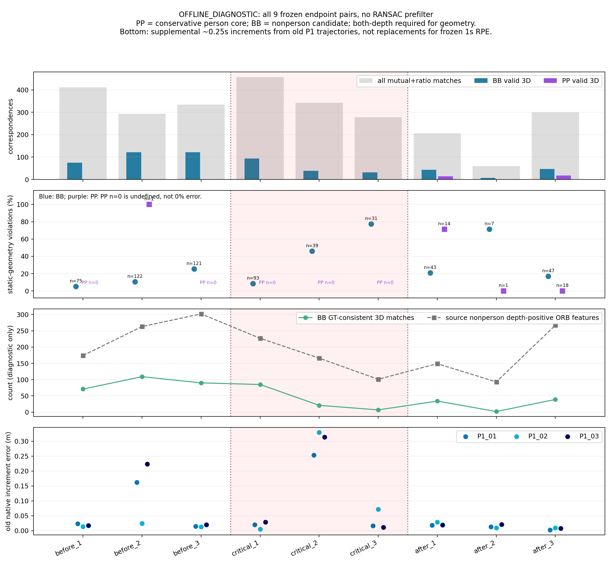

# 固定帧对动态观测几何审计

**OFFLINE_DIAGNOSTIC，2026-10-15。结论：当前证据不足以归因ORB-SLAM3实际污染约束，建议停止以该walking窗口为依据的方法开发，不扩展动态SLAM系统比较。**

离线对应审计已完成；**实际SLAM失效归因仍为DATA_INSUFFICIENT**。这不等于证明动态观测无害或P2无效。没有新SLAM运行、权重获取、数据下载、训练、编译或ROS/仿真启动。

## 固定对象与证据含义

读取最新`p2_window_validation_20261015/REPORT.md`及窗口原图、depth、时间/局部运动表和前端特征分析。沿用Freiburg3标定、BGR灰度和原RGB-D关联。三个时段各固定3组、目标间隔0.25s，实际间隔0.204–0.269s，共18张图；全部结果保留。[冻结协议](protocol/design_v02.json)。登记中两个最近帧略低于窗界，**在任何匹配结果计算前**按窗界修正；原[登记](protocol/design.json)保留。

使用现有OpenCV4.2 ORB：1000特征、1.2尺度、8层、FAST20；Hamming双向匹配，比值0.75＋互检。**这是独立OpenCV ORB探针，具有其Harris选择/边界规则、没有原生分网格FAST7回退；不是ORB-SLAM3提取器或实际优化内点。** 没有用RANSAC预先删掉不一致数据。

仅对固定原图做目视多边形标注，由本助手逐帧填写，非自动检测、非独立人工真值。P为保守人体核心区（上半身为主），U为包含肢体/边界/可能背景的保守包围区，B为区外非人物候选背景；B也可能含移动椅子。标签在匹配前冻结，包围区内未标核心部分不擅自归为背景。[标签与局限](annotations/manual_person_v02.json)、[冻结hash](protocol/annotation_frozen_v02.json)。不能将这些标签作为自动P2或运动真值。

GT仅离线插值，计算`T₂←₁ = inverse(Twc₂) × Twc₁`，无外参/尺度拟合。双端depth>0才评价三维；主一致标准为重投影≤5px且深度差≤max(0.05m,预测深度×3%)。连续残差、3/5/8px敏感性和3×3深度稳定子集均保留。[TUM官方规范](https://cvg.cit.tum.de/data/datasets/rgbd-dataset/file_formats)确认GT为彩色相机光心位姿、depth已注册到RGB、Freiburg3已去畸变、深度比例5000。

## 直接结果

每张提取1000个OpenCV ORB点。PP/BB表示匹配两端都在P/B；表中三维分母要求双端有效深度，**PP分母0的比例未定义，不能写成0%不一致**。

| 帧对，相对时间 s | 互检＋比值匹配数 | PP有效三维 / 不一致 | BB有效三维 / 一致 | BB重投影中位 px | 旧P1同端点增量误差范围 m |
|---|---:|---:|---:|---:|---:|
| 18.026→18.262 | 411 | 0 / — | 75 / 71 | 1.36 | 0.013–0.024 |
| 19.266→19.502 | 293 | 1 / 1 | 122 / 109 | 1.93 | 0.025–0.223 |
| 20.506→20.742 | 334 | 0 / — | 121 / 90 | 3.58 | 0.013–0.019 |
| **22.014→22.250** | **457** | **0 / —** | **93 / 85** | **1.77** | **0.005–0.028** |
| **22.986→23.228** | **343** | **0 / —** | **39 / 21** | **4.14** | **0.253–0.330** |
| **23.994→24.262** | **278** | **0 / —** | **31 / 7** | **5.21** | **0.011–0.071** |
| 25.030→25.234 | 206 | 14 / 10 | 43 / 34 | 2.46 | 0.018–0.029 |
| 25.735→26.003 | 60 | 1 / 0 | 7 / 2 | 3.53 | 0.009–0.021 |
| 26.506→26.742 | 300 | 18 / 0 | 47 / 39 | 2.51 | 0.002–0.009 |

最后一列只读取旧三次P1导出轨迹；约0.25s增量为**事后辅助上下文**，不替换旧全程ATE/1s RPE、不用于重新选帧。其登记见[补充范围](protocol/posthoc_supplement.json)。端点探针没有使用中间帧和已有地图，不能与真实SLAM的信息量等同。

[逐帧对数据表](results/pair_summary.csv)、[所有前向对应/几何残差](results/matches.csv)、[各匹配阶段](results/matching_stages.csv)、[二维/三维分布和敏感性](results/group_geometry.json)、[逐图像depth/模糊/标签统计](results/frames.csv)均可复算。

## 六个科研问题

**1．关键窗口是否有较强运动前景几何不一致证据？**

**尚未取得。** 三组关键窗PP主审计分母都是0，无法估计其不一致率。未筛选的1NN中也只有23.994s帧对保留1个双深度PP不一致候选，随后被固定比值规则拒绝。相反，低误差25.030s帧对有14个双深度PP，10个违背静态几何；3×3深度稳定子集仍为10/13不一致。

互检＋比值匹配中“至少一端落在人工人物核心区”的比例，前段为0.00%/0.34%/0.30%，关键窗为0%/0%/0%，后段为8.25%/3.33%/10.33%。这是保守核心的下界，不是完整人物区域占比；U区对应不自动算人物或背景。

因此“人物对应不符合静态场景模型”在序列中确有实例，但**没有证明它特异对应当前故障窗口**。PP核心标注不完整、OpenCV提取/匹配与原生前端不同；分母0不能反推真实SLAM没有用到人物。即使PP不一致，也可能是真实运动点的正确匹配、描述子误配或深度误差，不等于已证明错误关联。

**2．可靠背景观测是否明显减少？**

**本探针中部分关键帧对减少，但不具有足够的故障特异性。** BB几何一致对应为前段71/109/90、关键窗85/21/7、低误差后段34/2/39。对应的源B有效depth特征为174/263/302、227/166/101、149/93/267。关键窗后两对确实较少；然而健康后段也出现更少的2个一致BB。

按可见B面积归一化后仍重叠：每10% B图像面积的一致BB，关键窗为11.04/3.43/1.37，后段为7.64/0.56/12.64。关键窗最后一对一致BB只覆盖3个8×6图像格，后段最少者更只有2格。三维协方差特征值仅作点集形状记录，**不叫位姿不确定性或几何退化证明**。

源B像素depth有效率关键窗为47.0%、44.8%、33.0%，前段为59.3%、60.9%、56.2%；有下降。但GT投影的“目标更近”证据未在人物核心内形成直接遮挡计数，多落在U或B；不能将其全部归因为人体遮挡。详见[occlusion.csv](results/occlusion.csv)。

**3．哪种解释的数据支持更充分？**

**“非人物候选背景的深度/端点对应可用性发生变化”比“运动人体污染了SLAM约束”更有直接量化支持；仍不是充分因果解释。** 后段有更少背景对应或更多PP不一致却保持低误差，否定了从这些单一代理量直接推断SLAM失败的做法。

全局特征数始终1000，不能据此说静态支持充分。25.735s图像Laplacian方差约302，比22.986s的764更低且匹配更少，SLAM仍较准确；模糊/纹理代理量也不能单独解释失败。固定帧对GT位移0.022–0.073m、转动0.50–1.92°，关键窗不独有大运动；曝光内模糊、地图历史和真实匹配错误仍可能参与。

**4．哪些仍是UNKNOWN？**

P1实际优化内点与MapPoint身份；候选是否真实同一物理点；动态约束是否进入优化、进入多少；静态三维可观性；depth/模糊/遮挡/地图历史各自因果贡献；简单人物排除能否改善SLAM；P2有效性。**观测相关性、离线几何一致性、实际内点身份、动态错误关联及因果作用没有混为一类。**

**5．现有方法是否已直接处理这些现象？**

| 工作 | 核查范围与判断 |
|---|---|
| [DynaPix](https://arxiv.org/html/2309.09879v2)及[代码](https://github.com/robot-perception-group/DynaPix) | 已有全文/源码缓存支持：利用运动概率处理跟踪、地图点与BA，并保留静止可动物体的可用部分；直接针对普通动态前景/静态支持矛盾。公开实验已包含walking_xyz。本审计没有发现超出该一般机制的新剩余能力需求。不能把其不同后端、背景/位姿条件下的结果当成本机复现。 |
| [DynoSAM](https://arxiv.org/html/2501.11893v3) | 已有全文支持：联合相机与动态刚体结构/运动估计。非刚体运动不在该文研究范围，不能宣称已完整处理人体关节/衣服变形；但本轮也未证明非刚性是当前误差主因。 |
| [DGO-VINS](https://doi.org/10.1109/LRA.2025.3583611) | 全文/实现仍未认证，DOI定向访问失败；旧摘要级信息不足以逐机制断言覆盖，也不能反过来将UNKNOWN当创新空白。 |

这是一项有边界的近邻核对，不是“所有动态问题已解决”的断言；普通动态概率/特征加权/更换检测器没有因此获得新颖性。

**6．值得继续开展真实动态SLAM方法比较吗？**

**目前不建议为当前walking问题继续投入方法比较或新增平台工程，建议STOP_CURRENT_WALKING_METHOD_DEVELOPMENT。** 理由是关键窗人物几何审计分母不足，背景/对应稀缺也出现在低误差段，且实际优化约束身份缺失。当前数据不足以选定需要改进的独立机制；不是因为权重下载失败就否定动态SLAM。

本轮不追加帧对、改匹配阈值或增加提取器寻找正结果；不提出新的算法或扩大试验矩阵。**下一项仅归档本次负向/不足证据，停止以该窗口为依据的方法开发；不再追加反证实验。** 这项工程投入决策不等于科学上证明人体观测无害。

## 可靠性与保护

已通过已知物理位移/投影方向、SLERP、GT插值/禁止外推测试；独立OpenCV crossCheck API复核9对互检身份，全等，见[audit/matching_unit_tests.json](audit/matching_unit_tests.json)。空分母未变成0%，不对同一视频中相关特征作独立统计显著性检验。3/5/8px敏感性不改变关键窗PP分母0的事实。粗人物核心与保守U区的覆盖限制，完整保留在[标注图](figures/annotation_labels_critical.jpg)和JSON中；无独立标注者复验。

旧三个MANIFEST和主仓保护结果见[audit/protection_after.json](audit/protection_after.json)，原P0_02、P1和冻结结论均保留。本轮原图/深度只读，所有对应和人工标签都没有进入SLAM。新增文件清单见MANIFEST.json。
