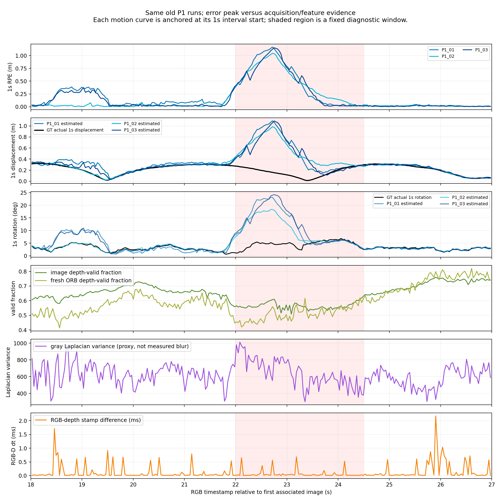

# walking关键误差窗口归因与P2最后资格

2026-10-15。**结论：TECHNICAL_INCOMPLETE（人物掩膜/P2）；新增方法仍为NO_METHOD_JUSTIFIED。**

关键窗口有值得用人物排除进行受控验证的**合理机制假设**：有纹理的人体前景跨越视野、遮挡背景，且这些区域有原生ORB提取特征。它与误差在时间上重叠，但没有P1优化内点/MapPoint身份来证明动态错误关联。此次最后的三条官方权重获取路径均失败，已停止获取；没有模型推理、没有P2科学运行，不能评价简单人物排除是否充分。

本轮额外完成了**实际Frame构造及原生投影匹配器的11帧软件索引测试**。这补上了此前“仅helper测试”的部分缺口；不等于真实人物mask、System/Tracking整链或P2科学资格通过。

证据标签：**实测**＝实际文件、离线重算、程序或软件测试；**源码支持**＝固定代码执行路径；**推测**＝待干预验证解释；**UNKNOWN**＝缺直接证据。分析状态ANALYZED，没有正式方法开发或独立团队复验。

## 1. 读取、保护和实际预算

读取旧诊断目录的REPORT、design_frozen、attempts_final、local_motion_evidence、exclusion_helper_test、feature_exclusion.patch、summary.csv，并核对原数据、P1在线/导出轨迹和旧observer记录。旧P0_02及其重复stamp/多map失败完整保留，没有重算覆盖旧评价。

- 新目录为`p2_window_validation_20261015`，与旧`diagnostic_comparison_20261015`平级；所有新增文件均在这里。
- 官方ORB-SLAM3固定commit仍为`4452a3c4ab75b1cde34e5505a36ec3f9edcdc4c4`；旧原生核心SO hash保持`a20db0416fc54ca5949e6b6ac834c12f59dc0bae5f08dc2945e46943a3532c46`。
- 保留P1 `Camera.RGB=0`、原RGB-D关联、内参、深度/ORB/优化配置和SE3评价。GT仅离线归因使用。
- 新P0/P1运行**0**；P2 walking **0/3**、sitting **0/1**。这沿用未使用预算，不是另加3＋1次。新SLAM System启动、ROS/Stage/Gazebo、训练、安装、大数据下载均为**0**。
- 参数、窗口、固定检测样本、获取路线和退出条件先登记于[protocol/design.json](protocol/design.json)。[预算结算](protocol/attempts_final.json)明确权重门失败后停止。
- 旧两份MANIFEST共**346个文件**hash全相同，主仓HEAD/status/diff与27个原编译object未变，两个未提交修改保留。证明见[audit/protection_after.json](audit/protection_after.json)。这项hash证明限于清单列出的文件，未冒称重哈希全部RGB-D图像。

根分区开始1,958,404,096字节可用，结束约1.92GB；新增目录约40MB。保持1GB事前安全余量，未清理旧资料。

## 2. 按时间排列的真实图像和运动证据

本轮仅分析既有walking输入。窗口22.0–24.5s；事前比较时段18–21s和25–27s。相对时间均从首个关联RGB stamp `1341846313.592026`计算。图片取事前指定时间最近输入帧，原stamp/索引见[图像选择](audit/evidence_image_selection.json)。

**图像观察**：约22.49s一名格纹衣着人员从右侧进入前景，22.99–23.99s位于中部并遮挡部分桌面/显示器背景；另一人在右侧坐下/活动。格纹衣服上有明显可提取纹理。25.5–26.5s仍有人体和活动，但三次P1的该段局部误差很低。因此**“出现人物”本身不构成充分失效解释**。

完整[PDF](figures/time_ordered_evidence.pdf)保留细节。深度图统一0–6m显示、黑色为无效值，不为不同帧调整显示范围；绿色ORB点表示其图像位置depth>0，橙色为depth=0。**所有这些点是单独调用原生提取器得到的原始特征，绝不是P1跟踪匹配或位姿优化内点。**

### 2.1 实际运动与局部RPE

沿用旧SE3/配对/RPE定义。下表为本轮**辅助窗口统计**，要求1s运动对的两个端点均落在给定窗口内，不替换旧全序列指标。每次关键窗口42对、前比较57对、后比较27对。

| 旧P1运行 | 原全程ATE m | 原全程1s RPEt m | 18–21s导出RPEt RMSE m | 22–24.5s导出RPEt RMSE m | 22–24.5s在线RPEt RMSE m | 25–27s导出RPEt RMSE m |
|---|---:|---:|---:|---:|---:|---:|
| P1_01 | 0.437544 | 0.299724 | 0.2424 | 0.8046 | 0.8804 | 0.0196 |
| P1_02 | 0.431839 | 0.274264 | 0.0233 | 0.7271 | 0.7497 | 0.0219 |
| P1_03 | 0.413644 | 0.258353 | 0.2022 | 0.7634 | 0.8495 | 0.0192 |

**18–21s不能统一称作“正常段”**：其中两次仍有明显误差，全部保留，不因结果不好更换比较时段。25–27s才在三次中均呈低误差。所有P1仍为827帧完整输出、返回状态OK，沿用旧记录，未新增回放。

关键窗口GT的1s位移中位约0.1505m、最大0.2724m，GT的1s转动最大约5.46°。三次估计的1s位移最大分别1.0919、0.9848、1.0891m，估计1s转动最大约23.14°、18.34°、24.21°。旧最坏对仍为1.04–1.16m RPE，证明误差不是单纯ATE对齐现象。

另用GT的0.1s步长核查短时运动：关键窗速度中位0.1768m/s、最大0.3217m/s，角速度中位5.77°/s、最大21.89°/s。前比较段最大角速度也为21.68°/s。这不支持“该窗口只有异常剧烈相机运动”这一简单解释，但**不能排除曝光内抖动、模糊、短时模型失配或初始化/地图历史的影响**。见[GT短步长](audit/GT_short_step_motion.json)；曝光时间本轮不可得。

逐运动对数据：[local_motion.csv](results/local_motion.csv)；全部窗口统计：[window_motion_summary.json](audit/window_motion_summary.json)。三次关键窗RPE范围0.7271–0.8046m，是后续P2应面对的实际局部基线，不能只比较全程ATE或最好一次。

### 2.2 图像、深度、同步与分布

| 辅助量（窗口中位数，除特别标注） | 18–21s，87帧 | 22–24.5s，73帧 | 25–27s，57帧 |
|---|---:|---:|---:|
| RGB-depth stamp绝对差 ms | 0.0169 | 0.0210 | 0.0260 |
| 最大RGB-depth差 ms | 1.710 | 0.687 | 2.173 |
| 灰度Laplacian方差 | 653.7 | 612.9 | 581.1 |
| 全图depth>0比例 | 66.21% | 55.75% | 73.01% |
| 原生ORB数量 | 1006 | 1007 | 1007 |
| 原生ORB位置depth>0比例 | 55.96% | 50.69% | 75.47% |
| 原生ORB占用8×6图像格比例 | 97.92% | 97.92% | 97.92% |
| 原生ORB归一化空间熵 | 0.9515 | 0.9499 | 0.9554 |
| 原生ORB二维分布协方差特征值比 | 0.7950 | 0.8694 | 0.8828 |

数据：[window_image_metrics.csv](results/window_image_metrics.csv)、[分布统计](audit/window_image_summary.json)。使用固定官方ORB提取器1000/1.2/8、FAST20/7；实际提取数略超1000是实现结果，没有增加特征参数。

**支持的判断**：关键窗没有明显更大的RGB-D时间配对误差；全图原始特征数量和二维空间覆盖没有坍缩；depth有效性比后段低。图像局部可见运动模糊，但整图Laplacian方差既依赖纹理也依赖模糊，不能据此诊断为相机模糊主因。时间戳配对正常也不等于已验证传感器曝光时刻的所有同步误差。

**不支持的跳跃**：以上原始点分布不是最终内点几何、Hessian或位姿不确定性。当前depth无效的关键点仍可能匹配已有3D地图点，不能把depth有效比例当作“进入优化的有效测量比例”。全图分布均匀也不能排除真正静态内点集中或动态前景主导。

## 3. 地图点身份与竞争解释

旧`observer01`可取得每帧nonnull指针数量和图像位置，但它是**另一种P0/viewer运行条件**，没有MapPoint唯一身份、内点标签或动态真值。其前/关键/后窗口nonnull中位数为144/147/225，仅作为旧记录存在性审查，不能套在P1上。详见[existing_match_information.json](audit/existing_match_information.json)。

P1的真实匹配身份、优化内点、其是否落在人身上，以及它们是否跨帧违反静态几何：**全部UNKNOWN**。本轮没有用普通ORB点或nonnull指针替代这些证据。

| 竞争解释 | 现有支持 | 仍缺证据 |
|---|---|---|
| 有纹理人体前景产生不可靠关联或遮挡静态背景 | 图像顺序、人物位置及原始ORB点重叠，时间与误差一致；合理待证机制 | P1真实内点身份、静态背景支持量、人物排除的受控结果 |
| 深度支持不足参与失效 | 关键窗depth有效率较后段低 | 被使用地图点/深度残差；depth无效不等于2D跟踪不可用 |
| 相机运动/模糊导致匹配质量下降 | 图像有局部运动模糊，短时角运动存在 | 曝光/快门、实际匹配残差；GT运动并非仅该窗异常 |
| 静态几何退化或特征集中 | 本轮没有直接证据；原始全图分布并不坍缩 | 真静态优化内点的3D分布/可观性，不是原始2D代理量 |
| 地图历史、错误对应延续或异步优化影响 | 前比较窗有运行间差异；在线/导出误差不同 | 因果事件与图约束/匹配身份，不能从轨迹峰值逆推 |

**任务二答复：有理由做一次受限人物排除反证实验；没有理由据此宣布“动态错误关联已证实”或开发新的几何/概率加权方法。** 低误差后段仍有人物，是必须保留的竞争证据。

## 4. 固定权重最后获取：失败并停止

固定作者仓库：[chuanqi305/MobileNet-SSD](https://github.com/chuanqi305/MobileNet-SSD/tree/bb17b6c3eef36d80be441ae8e5339be66e8e3b7a)，commit `bb17b6c3eef36d80be441ae8e5339be66e8e3b7a`。作者[该提交README](https://github.com/chuanqi305/MobileNet-SSD/blob/bb17b6c3eef36d80be441ae8e5339be66e8e3b7a/README.md)中的deploy链接已定向核查；没有使用未认证镜像或更换检测器。

预期完整权重：23,306,119字节，**Git blob SHA1** `253e5012dd6a17666fd7ae16cfa14a6860280ff7`。这不是plain `sha1sum(file)`，而是`SHA1("blob "+size+"\0"+content)`。旧486,099字节部分文件仍保留并拒绝通过校验；没有将部分文件改名冒充权重。

| 本轮唯一一次该路径尝试 | 实际结果 |
|---|---|
| 固定提交raw，带Range探测 | 15s读取超时，未取得数据；未开始7路分块 |
| 作者Git blob API，raw媒体格式 | HTTP403，响应reason为rate limit exceeded |
| 作者README官方部署链接 | 网络不可达，未取得部署文件 |

三条路径合计约26.26s即全部失败，未用满300s上限后继续重试。源码中的`MaxRetryError`是请求库异常名称，本轮没有设置失败重试循环。来源/完整性日志：[weights_qualification.json](audit/weights_qualification.json)、[download_events.jsonl](audit/download_events.jsonl)、[旧文件检查](audit/existing_weights.json)。链接从本机不可达不等于作者资源已失效。

`deploy.prototxt`再次通过固定提交Git blob `88021a94bca5c22753a23664d388d4922b2186bb`校验。OpenCV4.2的`readNetFromCaffe`接口存在，**实际固定模型格式兼容性仍未测试**，不能由API存在宣称推理通过。

**MASK_NOT_QUALIFIED**：有效walking人物mask为0/827；没有检测误检/漏检率、框内静态背景比例、逐帧推理时间或CPU开销结果。它们均是NOT_RUN/UNKNOWN，不填0或称模型性能失败。person=15、置信度0.5及原预处理设置未改。检测框即便以后可得，也只是语义排除区域，不能当真实运动标签。

## 5. 实际Frame与索引测试：新增的软件证据及边界

在独立目录复用上一轮前端草稿，仅编译新增重载所在的**Frame.cc**并链接27个原对象文件；`Optimizer/System/Tracking/ORBmatcher`等原object均只读复用，未重编译或修改后端公式。原核心SO未覆盖。新库是**Frame测试库**，不是可部署P2系统。

测试使用已有0、18、21、22、22.5、23、23.5、24、24.5、25、26.8s最近帧，共11帧。比较原生Frame、空mask新增Frame、矩形排除新增Frame，随后以从原Frame深度构造的软件地图点调用**原生ORBmatcher::SearchByProjection**。固定单位测试位姿只用于索引测试，不是真实SLAM结果或GT在线修正。矩形是软件输入控制，绝不是人工P2人物掩膜。

| 检查 | 结果 |
|---|---|
| 空mask与原Frame | 11帧关键点位置/方向/尺度/响应/层级、描述子、去畸变点、depth、右目投影、grid及时间戳完全相同 |
| 非空mask实际排除 | 每帧确实删除特征，保持剩余原索引次序；例如首帧1013→704，排除309 |
| 关键点/描述子/深度 | 保留行逐一与原行对应，N和向量长度一致，深度对应原像素；非空mask先于深度关联生效 |
| 图像grid | 所有索引在[0,N)，每个保留点可被原生GetFeaturesInArea检索；空mask的grid逐格相等 |
| 地图点关联 | 原生投影匹配正常产生关联；写入只落在过滤后合法索引，指针属于测试地图点集合；**这不证明匹配物理正确** |
| 人工边缘/输入像素 | 只取原关键点/描述子子集，无新角点或涂黑边缘；原RGB像素未改 |
| 全部排除 | 构造器返回N=0；**未认证这种情况下完整Tracker的后续行为** |
| 真mask和input的827帧身份、System/Tracking传播、估计行为 | **NOT_RUN，不能由软件测试替代** |

详见[frame_chain_qualification.json](audit/frame_chain_qualification.json)、[逐样本结果](results/frame_chain_test.csv)、[实际Frame补丁](audit/actual_frame_test.patch)、[编译与原object登记](protocol/frame_test_build_frozen.json)。`ldd`确认测试加载本目录的Frame测试库。

测试夹具首版把YAML的ThDepth乘数40直接传给Frame，并以double转换深度；随后修正为原生有效`b×40=2.988m`及float深度比例，前后均通过。首版源码/输出保留为fixture_v01，修正说明见[audit/frame_fixture_correction.md](audit/frame_fixture_correction.md)。这是软件夹具一致性修正，**未改变SLAM参数或重跑科学任务**。

实际过滤边界未扩大：过滤当前帧原始特征和描述子，既有地图点不删除、不自动标动态；原生匹配器只在剩余当前特征中寻找对应，没有新增投影级语义裁决。旧地图点仍可能匹配其他保留点，不能声称已彻底消除动态地图污染。

因此**Frame软件索引资格PASS（11帧范围）**，但**真实mask＋完整System/Tracking＋P2资格仍INCOMPLETE**。没有因部分测试通过跳过掩膜门。

## 6. P1/P2比较与最终科学决策

| 项目 | 本轮结果 |
|---|---|
| 关键窗口真实位姿误差 | **SUPPORTED**，复用旧三次，在线/导出均存在 |
| 人体排除的合理机制 | **CANDIDATE_ONLY**，图像/原始特征与误差时间重叠，有竞争解释 |
| 动态错误关联 | **UNKNOWN**，没有P1内点/MapPoint身份 |
| 可信权重/人物检测 | **MASK_NOT_QUALIFIED / NOT_RUN** |
| Frame索引软件测试 | **PASS，限定11帧合成矩形及原生投影匹配** |
| 完整P2技术资格 | **INCOMPLETE** |
| P2对ATE/局部RPE/覆盖/状态/KF/耗时的影响 | **UNKNOWN，P2为0次** |
| 人物误检、静态背景误删、计算成本 | **UNKNOWN，不以矩形测试代替** |
| SIMPLE_MASK_SUFFICIENT | **未判定** |
| RESIDUAL_FAILURE_OBSERVED（指P2之后） | **不成立为本轮结论**，只确认P1残差 |
| 最终阶段结论 | **TECHNICAL_INCOMPLETE** |
| 新增方法必要性 | **NO_METHOD_JUSTIFIED** |

没有可比P2结果，因此无法回答收益是否超过P1重复变异、是否牺牲覆盖或静态观测。也没有证据宣布简单方法失败或足够。普通动态概率、特征加权或检测器替换仍不构成新的论文贡献；本轮没有发现可独立于最近邻工作认领的方法机制。

## 7. 下一步唯一建议与退出条件

**停止P2自动获取和运行；下一项仅保留“固定权重的离线验收”，不再增加平台工程。** 若通过其他正常网络/合法作者下载取得同一个文件，可用[verify_model.py](code/verify_model.py)仅检查文件内容的Git blob与大小；验收不自动启动推理或SLAM。获取路径和校验方式见[models/README.md](models/README.md)。若仍无可信文件，保持暂停，不继续下载重试、换大模型或开发分割器。

只有文件验收、原阈值检测质量、完整mask时间关联和System/Tracking接口全部通过后，才有资格执行尚未使用的3次walking＋1次sitting预算。原P1和原评价全部保留。若执行，优先看本报告22–24.5s固定局部窗口及两个比较时段，再看全程ATE、1s RPE、覆盖、状态、KF和完整计算成本，不以最好一次或只对齐ATE认定收益。

既有退出标准不改：若简单P2已达到事前5cm/99%等门槛且无明显sitting退化，优先SIMPLE_MASK_SUFFICIENT，不开发复杂方法；若mask质量不足、输出缺口变多或效果在变异内，保持UNKNOWN；只有可信简单对照后重复的真实损失，才允许讨论新的具体残差。**本轮权重获取失败不提供任何动态SLAM方法失败证据。**

文件交付包括时间排序RGB/depth/原生特征图、旧P1局部运动逐对数据、同步/深度/图像统计、Frame软件测试/夹具修正与补丁、官方获取失败日志、完整保护核验和未使用的P2预算。没有真实人物mask或P2轨迹，交付不伪装完整。最终文件清单见MANIFEST.json。
