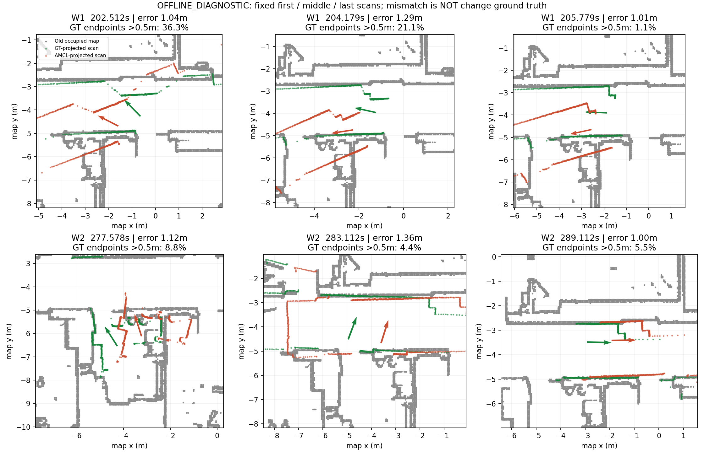

# 阶段收口与L1/V3决策

2026-10-16，**OFFLINE_DIAGNOSTIC / ANALYZED**。**总决策：NO_METHOD_READY；L1_NOT_YET_JUSTIFIED。** 正式停止A1/A2新观测模型开发，也不以A0残差另起AMCL模型。V3仅作为优先补证候选，不是已合格的方法主线。

标签：**实测**＝现有结果/本轮离线计算；**文献支持**＝全文/固定源码；**推测**＝待验证解释；**UNKNOWN**＝缺直接证据。没有新增SLAM、ROS、仿真、训练或数据/模型下载；未改旧源码和原始数据。

## 1. A1/A2正式结题

接受最终控制的 **EXISTING_AGGREGATION_SUFFICIENT**：同91物理槽、同恢复关闭、实际Gaussian seed1702，A1-R0全程位置RMSE **6.142m**，原生A0-91-R0 **0.445m**；后者P95 **0.973m**、最大 **1.659m**。此前A0-102-ON约0.432m仅为强简单参照，不当纯聚合对照。

这是本序列/有限运行内原生方案已显著缓解严重损失的证据，不是一般加和模型优于概率模型的定理。随机恢复关闭不足、同束评分冲突等历史证据保持原解释边界。**不继续开发自适应权重、区域一致性、模型切换或网络。** 本轮不重新审计已经成立的A1/A2结论。

## 2. A0两段剩余误差

从旧onsets登记直接固定两段持续>1m区间，仅提取其中全部**27次实际sensor-update扫描**，而非另选失败窗口。每段首/时间中点最近/末更新作图，共6帧；范围和选择在计算前冻结。估计位姿取对应原生输出，GT只离线插值，不做空间对齐。沿用原生距离场、外参、91槽及加和公式；54个GT/估计评分与已有C++原生探针最大log差1.78×10⁻¹⁵。

| 旧登记持续>1m区间 | 实际更新/位置误差范围 | GT下端点离旧占据格>0.5m比例，中位〔范围〕 | 当时估计下该比例中位 | 原生加和评分更支持GT |
|---|---:|---:|---:|---:|
| 202.203–205.853s，3.650s | 7 / 1.014–1.288m | 21.1%〔1.1–36.3%〕 | 53.8% | 7/7 |
| 276.954–289.204s，12.250s | 20 / 1.004–1.656m | 3.4%〔0–12.1%〕 | 7.1% | 20/20 |

比例分母为实际有效返回，分别90–91、87–91束，不把91个采样槽都称有效命中。区间端点来自旧GT时间评价，实际更新首尾分别202.512–205.779s、277.578–289.112s；表中误差范围是这些原生更新时刻，未覆盖或更改旧连续指标。

**较明确的证据**：第一段存在较大但快速变化的旧地图端点冲突；第二段大部分GT端点仍接近旧地图。所有27个时刻，GT点的加和评分高于当前估计，log评分差“估计−GT”为第一段−1.325至−0.818、第二段−0.531至−0.171。**没有复现“当前观测评分持续更偏爱这个错误估计”的解释。** 这也不保证GT是全地图最优；没有新做位姿网格搜索。

**竞争解释及边界**：

- 图中长直平行墙和少量转角，使沿墙方向约束弱或局部相似结构成为合理怀疑；**没有量化多峰/可观性证据，地图别名仍UNKNOWN**。不能仅凭长走廊宣布退化。
- 两段实际更新首尾间，GT路径长约1.29/4.67m，绝对转角累计约41.8°/134.4°。里程计与GT的首尾机体系相对运动差约0.015/0.030m、0.215°/2.618°；**没有明显的区间净里程计跳变证据**。首尾接近不能排除区间中误差、历史运动预测或噪声参数影响。
- 扫描名义逐束时间覆盖约50ms，存在转动；没有做去畸变因果对照。扫描畸变、地图表示、外参/GT误差、运动噪声与更新阈值仍是竞争因素，不能由此认定某个参数错误。
- 扫描不一致没有变化真值；当前有用几何是否被错误匹配/处理、正确模式是否在实际粒子集内、是否被重采样丢失，均**UNKNOWN**。两段已是高误差阶段，不能用窗口内现象倒推起因。

因此只有**真实剩余损失**，还没有“具体错误处理＋现有方法不足＋可执行独立修复”的完整链。不能借GT评分更高就宣布需要新采样器或新观测模型。

数据与复算：[27次逐扫描表](results/scan_diagnostics.csv)、[两段摘要](results/window_summary.csv)、[冻结范围](protocol/scope_frozen.json)、[原生评分核验](audit/native_score_equivalence.json)。

## 3. 最接近的三篇工作

| 工作 | 对当前研究决策的实际含义 |
|---|---|
| [Reliable MCL，JFR2023](https://arxiv.org/pdf/2205.04769) | 按候选位姿联合处理已知/未知观测，并提供可靠性与恢复机制；原文明确讨论鲁棒排除与纠偏取舍。宽泛L1问题已被直接研究。当前两段是否被其解决仍未知，不能说现有方法已失败。 |
| [LILocBench，IROS2025](https://www.ipb.uni-bonn.de/pdfs/trekel2025iros.pdf) | 公开评价支持长期变化下的真实定位困难；不是新定位算法。不同系统已有明显差异，不能将自己的A0长尾等同于领域未解决能力。 |
| [ENM-MCL，ICRA2025](https://www.ipb.uni-bonn.de/pdfs/kuang2025icra.pdf) | 用方向相关SDF等改进地图观测表达，已在LILocBench作竞争者。源码公开，但本机GPU/环境和具体残差上的效果未认证；不为寻找残差再建设神经地图平台。 |

逐项输入、机制、地图变化能力、恢复开关、实现与成本见[三篇矩阵](literature/NEAREST_THREE.md)。默认als_ros类别条件模型不是完整Reliable MCL；固定launch还需全向模型等适配，本轮未部署。

## 4. L1与V3直接比较

| 维度 | L1：A0长期定位长尾 | V3：RGB-D边界表面归属 |
|---|---|---|
| 科学问题具体性 | 已限定两段损失，但观测处理失效机制未定位 | 图像位置误差跨表面取depth，机制更明确；本机未验证 |
| 真实损失 | **实测**：约1–1.66m残差 | **UNKNOWN**：cables_3未取得，B0/B1均0次 |
| 最近邻竞争 | Reliable MCL、成熟MCL及地图表达方法直接相关 | MAC-VO协方差、可见性门、概率RGB-D深度融合均是强近邻 |
| 新算法空间 | **未建立**，不可从残差大小推导 | **UNRESOLVED**，多表面/GMM不是独立贡献保证 |
| 平台与数据 | 地图/激光/GT/评价齐全，但继续方法比较仍有成本 | ORB3/评价齐全；新数据容量、标定、边界暴露尚未验收 |
| 最低成本反证 | 现阶段无可信的新机制可供原型验证 | 已有冻结B0/B1分阶段协议；数据合格后先检查暴露，再做简单深度无效化 |
| 实现与审稿风险 | 容易只是旧模型调参；残差归因及强基线不足 | 数据网络门；快速运动混杂；单序列、2018概率融合重复风险 |

**四层判断不混同**：L1证明有损失，没有证明合理已有方法不足；V3有文献机制依据，没有本机损失证据。两者目前都没有正式SCI方法开发资格。

V3实际状态来自[Phase0正式报告](../passive_visual_slam_v3_cables3_20261015/REPORT.md)：官方数据TLS/超时未验收，**DATA_NOT_QUALIFIED / TECHNICAL_INCOMPLETE**。不是已经做过ETH3D科学实验而失败，也不是MAC-VO被证明失败。本轮不重试下载、不执行V3。

## 5. 最终主备与唯一下一步

**A1/A2：正式结题；L1：L1_NOT_YET_JUSTIFIED；项目当前：NO_METHOD_READY。** 停止围绕现有AMCL继续开发新模型，不自动引入als_ros/ENM、更多种子或误差窗口。

**研究顺序：V3为唯一优先补证候选，L1仅归档备选；当前没有已批准的方法主线。** 这项排序来自V3反证更明确、可复用ORB3，而非已经证明其创新或收益。数据障碍未解除时不以工程活动替代科学进展。

**下一步唯一建议：仅在官方cables_3文件合法可获取或网络条件确已改变后，恢复既有V3分阶段反证协议。** 先验收数据和边界暴露，门不过即停；门通过才讨论沿用原预算的原生/简单深度无效化比较，不新增平台或多表面优化器。现在不自动重试，也不再为L1追加机制审计。若原生健康、简单拒绝已足够或无法排除运动/匹配混杂，停止V3方法开发；若数据仍不可得，项目维持暂停。

## 6. 执行与保护

本轮只离线读bag、轨迹/GT/TF与现有原生地图/观测函数，不运行滤波器。首次保护工具误把旧manifest均当嵌套格式，修正后才登记范围并提取扫描；系统Python缺pandas后使用已有Conda环境，不安装软件。两项工具失败及边界见audit，不是SLAM失败或新增科学运行。

2208项清单内旧文件、主仓HEAD/status/diff前后保护结果见[audit/protection_after.json](audit/protection_after.json)；不声称全量重哈希所有历史RGB-D图像。所有新增文件都在本目录，源码/原始数据未覆盖。新SLAM运行0次，未创建ROS master。复算入口[REPRODUCE.md](REPRODUCE.md)。
