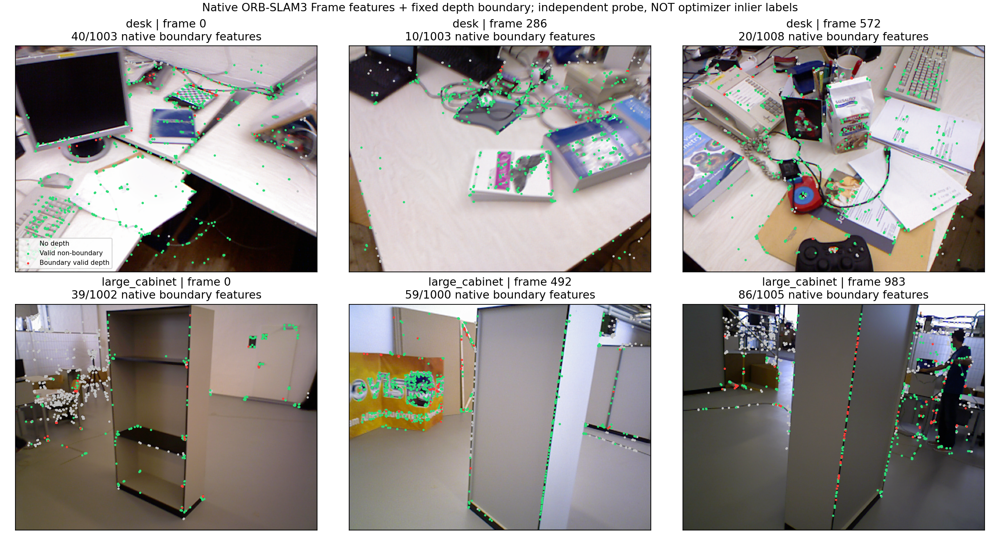
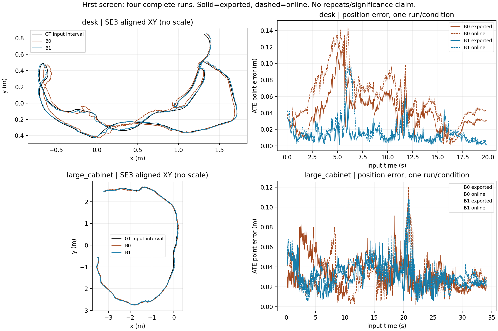

# 被动RGB-D深度观测：第一轮4次真实对照

2026-10-19，**ANALYZED**。**4/4完整完成。A存在可测的原生观测和任务影响，值得一次受限重复确认；尚无“简单方法仍不足”的证据，不开发SCI方法原型。B仅部分源码支持，独立冻结地图query未取得运行资格。** 不预设旧V3多表面假设成立，不借用主动/AMCL异常作论文依据。

证据：实测＝本机执行/原始日志；源码支持＝固定实现；推测/UNKNOWN＝缺直接证据。每条件仅1次，不能给统计显著性、稳定因果比例或泛化结论。

## 1. 实际平台与数据

检查主仓、全部远端分支、已登记工作树和研究目录正式报告：所查范围未见固定归档`96156bb2e5ff9ae93e8664391fc9d850b467dcd7`之后的新有效研究结果；没有据此断言整个磁盘无其他成果。主仓仍在research/phase4c-formal，原两处未提交修改保留。独立研究分支为`research/passive-rgbd-depth-20261019`。

复用Ubuntu20.04、g++9.4、OpenCV4.2、Eigen3.3.7及本地Pangolin；CPU运行，无ROS/仿真/GPU训练。官方ORB3 commit **4452a3c4ab75b1cde34e5505a36ec3f9edcdc4c4**，原库SHA256仍a20db041…；新诊断库c9f08e6c…仅替换System对象以添加只读Frame/Atlas快照，其他27个核心对象原样链接。未改估计公式、ORB提取、回环、关键帧策略或鲁棒核，未覆盖旧库。新诊断会增加负载，**不宣称与旧无诊断异步运行数值等价**。

数据经[TUM官方入口](https://cvg.cit.tum.de/data/datasets/rgbd-dataset/download)重定向到官方webshare HTTPS。本机未找到既有目标包后获取；初始直连吞吐过低中断，保留未完整文件，再复用同一Range下载器切换现有环境网络路径一次，逐块核验完成。没有SSL绕过或镜像。下载/环境失败不是科学失败。

| 项目 | freiburg1_desk | freiburg3_large_cabinet |
|---|---:|---:|
| 压缩/解压payload字节 | 344,011,403 / 367,285,514 | 497,551,823 / 543,337,123 |
| RGB / depth / 完整关联输入 | 613 / 595 / **573** | 1011 / 993 / **984** |
| RGB-depth绝对时间差中位/最大 | 11.648 / 19.742ms | 0.022 / 10.083ms |
| GT条数 / 可评价输入 | 2335 / 573 | 3399 / 979 |
| 原图无效depth均值 | 25.44% | 26.30% |

所有输入图像已解码验收并登记SHA；时间严格递增，关联复用旧唯一匹配<20ms规则。cabinet首5个输入无严格GT匹配，仍完整送入SLAM，不删帧。[数据验收](audit/dataset_desk.json)、[cabinet验收](audit/dataset_large_cabinet.json)。系统盘始终保留5GiB。

标定各取固定官方TUM1/TUM3 YAML，分别fx/fy/cx/cy=517.306408/516.469215/318.643040/255.313989和535.4/539.2/320.1/247.6；fr1保留原径向/切向畸变，fr3零畸变。OpenCV输入BGR，**Camera.RGB=0**，代表帧与PIL RGB反序逐像素核验。depth/5000，**不额外乘fr1的1.035**；[官方格式](https://cvg.cit.tum.de/data/datasets/rgbd-dataset/file_formats)说明深度已缩放、已注册RGB。desk的较大时间偏差是必须保留的竞争解释。

## 2. 固定干预及真实原生观测

首跑前冻结协议/代码/数据/标定hash和顺序：desk B0→B1→cabinet B0→B1；[设计](protocol/design_frozen.json)、[台账](protocol/attempts.jsonl)。

B0不改depth；B1仅将满足以下规则的有效中心depth置0：3×3内至少2个有效深度，max−min **> max(0.05m, 0.03×中心depth)**；0忽略，图像外忽略，不膨胀。RGB从不改写。B0同样计算边界供只读审计、B1额外执行置0，两者诊断/预处理成本均计入。

独立原生Frame软件测试证明RGB、关键点、描述子与非边界depth不变，64/1013个原生特征depth变成`mvDepth=-1、mvuRight=-1`。实际SLAM每次TrackRGBD返回后检查真实mCurrentFrame，**全部1557对B0/B1输入的时间、N和边界特征数相同**；B1全部81,596个逐帧目标depth观测都通过−1传播核验。这里是观测次数，**不是81,596个不同地图点**。

| 实际干预/地图证据 | desk | large_cabinet |
|---|---:|---:|
| 目标原生depth观测数 | 22,909 | 58,687 |
| 占全部原生特征 / 原有效depth | 3.98% / 4.66% | 6.25% / 10.77% |
| 首帧边界关联 B0→B1 | **40→0** | **39→0** |
| 首帧初始化地图点 B0→B1 | **942→902** | **310→271** |

首帧源代码StereoInitialization对正depth建立新MapPoint，且真实Frame关联恰好相差目标数量，支持**干预确实影响原生地图点建立**，不只是像素边缘统计。无depth保留2D并不自动生成3D点；之后可能关联已有点或被多视图建立，不能统称“观测被删除”。

绘图不是另一种ORB实现；6个原生Frame探针N与实际B0对应帧一致。图中close-depth资格不保证成点，远点也可能被初始化或前若干深度排序选择，不能把近远阈值当绝对建点门。

## 3. 全部4次结果

统一旧评价：单次SE3刚性对齐、无尺度；1s±20ms RPE、GT匹配<20ms，间隔>100ms对另列。在线TrackRGBD返回与最终原生导出分别评价，不混合。导出是官方Shutdown后立即保存，**未认证所有后台优化完全排空**。

| 序列/条件 | 导出ATE m | 1s平移RPE m | 1s旋转RPE ° | 在线ATE / RPEt m | 位姿覆盖 | 退出 |
|---|---:|---:|---:|---:|---:|---:|
| desk B0 | 0.046584 | 0.045384 | 1.8007 | 0.065174 / 0.056577 | 573/573 | 0 |
| desk B1 | **0.016398** | **0.022727** | **1.4490** | **0.024673 / 0.035150** | 573/573 | 0 |
| cabinet B0 | 0.037390 | 0.029414 | 0.7482 | **0.035814** / 0.034654 | 984/984 | 0 |
| cabinet B1 | **0.031888** | **0.026612** | **0.5919** | 0.037143 / **0.031564** | 984/984 | 0 |

RPE合法对desk524、cabinet922；GT可评价输入均完全覆盖。全部公开返回OK，非OK连续时长0，map_id一直0、CountMaps一直1；无重建/重复stamp，在线与导出时间身份合格。100%分母是关联输入；相对全部原始RGB分别93.47%/97.33%，未关联帧不是SLAM丢帧。公开返回状态不穷尽函数内部短暂状态转移。

| 实际原生快照/资源 | desk B0 | desk B1 | cabinet B0 | cabinet B1 |
|---|---:|---:|---:|---:|
| 2D保留关联均值/帧 | 31.69 | 43.25 | 62.62 | 86.61 |
| 3D保留关联均值/帧 | 336.99 | 323.02 | 208.56 | 215.48 |
| 有效depth特征均值/帧 | 857.55 | 817.57 | 553.95 | 494.31 |
| 末帧地图点快照 | 6661 | 6623 | 3394 | 1775 |
| 末帧关键帧快照 | 136 | 119 | 313 | 225 |
| 规则/置0预处理均值 ms | 1.43 | 2.20 | 1.86 | 1.86 |
| TrackRGBD均值 ms | 13.81 | 21.31 | 13.67 | 12.66 |
| 管理墙时 s | 28.88 | 29.05 | 46.60 | 46.70 |
| 用户/系统CPU s | 40.11/2.29 | 46.23/2.25 | 82.95/3.91 | 79.04/4.11 |
| 峰值RSS MiB | 626.23 | 615.65 | 879.29 | 797.37 |

“2D/3D”按真实Frame非空关联且!mvbOutlier，依mvuRight<0或≥0划分，是**返回时保留残差候选**，不是全部优化轮次/BA累计边数；初始化帧也可能没有普通跟踪优化。删除depth数量不能直接换算成减少多少3D优化约束：cabinet的3D保留关联均值反而增大，说明地图/匹配共同改变。

地图点/关键帧是末次跟踪快照，不是持久化地图或唯一创建总数；后台之后仍可变化，例如cabinet B0最终关键帧导出314行而末帧快照313。不能称B1压缩效果或未来定位质量已验证。只读快照均值约13–36µs/帧，但线程调度效应仍未知。

## 4. 机制边界与A决策

**已得到**：有效边界depth确实进入原生初始化地图/Frame，置无效后改变地图与保留关联；此次简单处理在desk的在线/导出ATE和RPE均改善，cabinet导出指标小幅改善。不是只有代理指标变化，也不是靠少输出得分。

**没有得到**：逐点真实depth表面标签、特征误配真值、错误depth与正确depth的可靠分类；简单方法之后稳定、值得修复的剩余任务失效。cabinet在线ATE略升，不能用导出改善掩盖；单次差异不证明哪一种深度被误删。

竞争解释包括深度边界/混合像素、RGB-D配对与相机运动、低纹理/反射或模糊、初始化地图差异，以及异步局部BA/回环与运行波动。图中靠近几何边缘不等于depth错误，现有鲁棒优化已经工作。当前没有深度GT，也没有执行“可靠2D但错误depth”对应级诊断，不能将全部收益直接归因跨表面错误关联。

**A：继续价值仅为低成本重复确认，METHOD_PROTOTYPE_NOT_JUSTIFIED。** 不说简单方法已经完全足够，也不把单次改善升级成SCI创新。固定边界无效化是竞争基线；RAS2018、MAC-VO、COMO等已有深度不确定性/融合/可见性机制。没有可认领的新估计机制，本轮不编写原型。

## 5. B/C与唯一下一步

指定七篇的[简洁矩阵](literature/MATRIX.md)区分完整方法、真实源码与UNKNOWN：MS-SLAM已在线稀疏化非局部点并考虑可见性/分布；Good Feature Matching已做预算匹配；PKS改变关键帧；SlimSLAM全文/可运行代码未认证，不能据摘要断言其功能缺失。MS-SLAM出版为2024在线、2025卷期。

[B/C最小实施检查](literature/B_C_FEASIBILITY.md)：ORB3真实支持Atlas .osa保存/加载和定位模式，但加载会CreateNewMap，NOT_INITIALIZED仍走StereoInitialization。**独立冻结地图query未合格，B不能立即开展可信科学比较。** 还需证明查询不建新图、不增点，且输出统一参考图坐标。A中不同估计轨迹构建的两张图不能冒充同一原图下的公平保留策略。C不写调度器；未下载OpenLORIS或构建第二系统。

**下一步唯一建议：desk B0/B1各追加2次，共4次受限重复，总数8，不超过12。** 顺序、复核/停止条件见[NEXT_MINIMAL_ACTION.md](NEXT_MINIMAL_ACTION.md)，这里只提出，不执行。若收益落在运行变异内，降低A优先级；若简单收益稳定而无新剩余损失，接受现成方案，不开发复杂模型。B/C当前不并行开展工程。

## 6. 复查与保护

原始数据、4次全轨迹/状态/资源/stdout保留在本目录results；全部退出0。没有删除或覆盖直连未完整文件；Conda缺cv2、系统Python缺scipy的环境试错保留，数据验收改为复用两个既有环境，不安装软件。一次显示命令的find占位误替换导致SyntaxError，未影响数据/科学运行。新工具编译与离线探针不是SLAM全序列运行。

[核验](audit/final_validation.json)确认冻结20文件、原28核心对象未变，真实干预与4次预算一致；[保护](audit/protection_after.json)仅对登记旧报告、原库和主仓HEAD/status/diff作前后证明，不冒称全量旧图像清单。新数据hash在本轮前验收，B1只在内存改depth。

原生配置、源码诊断补丁、命令和复算入口见[REPRODUCE.md](REPRODUCE.md)。科学状态ANALYZED，无独立团队复验。GitHub发布的真实提交SHA会在提交/推送后写入独立发布回执，避免把预估SHA或未推送提交冒称发布成功。
