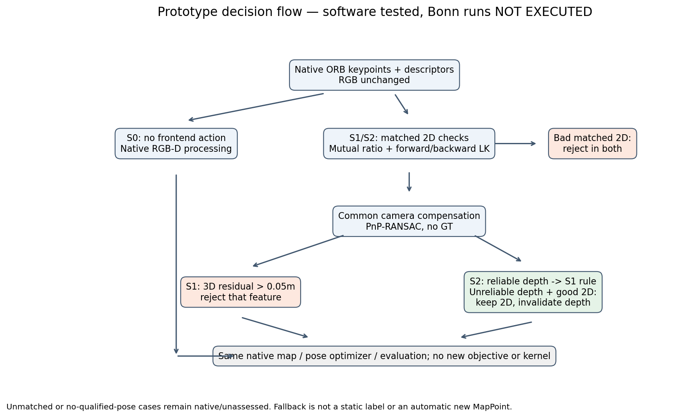

# RGB-D几何筛选与深度质量退回：小型组合原型

2026-10-19。**TECHNICAL_INCOMPLETE / DATA_NOT_QUALIFIED。原型已编译并通过有限软件测试，Bonn真实S0/S1/S2比较未完成，不能判断组合收益。** 没有新的SCI贡献或SLAM改善结论。此前walking的DATA_NOT_EXPOSING_MECHANISM、V3重复的B1_INCONCLUSIVE保持不变。

## 数据与实际执行

[官方Bonn文件](https://www.ipb.uni-bonn.de/html/projects/rgbd_dynamic2019/rgbd_bonn_moving_obstructing_box.zip)预期320,845,314字节。原301,989,888字节partial只读保留；本轮复制后官方Range响应206，续传至316,669,952字节，达到300秒预算后停止。随后一次普通下载因吞吐过低取消；最后4,175,362字节的尾部请求在SSL握手时UnexpectedEOF失败。三次请求和部分文件全部保留，**获取到此停止，不再自动重试**。

最近副本仍缺4,175,362字节，不能通过完整ZIP CRC；没有解压、Bonn标注、可信动态/静态对应或GT评价。未将残差反推为运动标签。准备配置按Bonn参数设置Camera1.fx/fy=542.822841/542.576870、cx/cy=315.593520/237.756098及其畸变，BGR、depth/5000；它尚未通过真实输入验收，不沿用TUM3内参。

| 条件 | 完整运行 | 在线/导出ATE、1s RPE | 覆盖/失跟 | 实际拒绝/2D/3D约束 | CPU/耗时/内存 |
|---|---|---|---|---|---|
| S0 原生估计器＋同一只读诊断 | NOT_RUN | N/A | N/A | N/A | N/A |
| S1 简单几何筛选 | NOT_RUN | N/A | N/A | N/A | N/A |
| S2 S1＋深度质量退回 | NOT_RUN | N/A | N/A | N/A | N/A |

科学预算**0/3**；没有启动真实SLAM System、ROS或仿真。数据门的软件拒绝不算科学运行。因无真实轨迹，**没有ATE/RPE和覆盖结果图**，不以示意曲线冒充结果。

## 已完成的最小原型

固定ORB-SLAM3 commit `4452a3c4ab75b1cde34e5505a36ec3f9edcdc4c4`，复用OpenCV4.2和无窗口入口。代码位于[code](code)，原生接入差异见[补丁](audit/native_frontend_and_trace.patch)。只独立编译Frame、Optimizer、System和Combo，25个旧估计器对象只读复用；原源码、核心库、后端目标/鲁棒核/优化公式不改。Optimizer仅增加实际PoseOptimization结束后的计数，不能据此保证与未诊断运行时序逐位等价。

- **S1**：原生ORB关键点/描述子；参考帧龄0.2s（允许0.18–0.28s），Hamming双向比值0.75、距离≤50；LK往返≤1px且与ORB对应≤2px。匹配但2D不合格者拒绝，未评估点留给原生处理。共同相机运动用EPNP-RANSAC（100次、3px、0.99、至少8内点；源depth 0.3–6m），双端有效depth的3D残差>0.05m拒绝当前特征。无合格运动估计时不作3D运动裁决。
- **S2**：同一对应与相机运动；两端depth质量要求0.3–6m、3×3至少5个有效值、max−min≤max(0.05m,0.03z)。可靠时执行S1；不可靠但2D可靠且运动估计合格时保留关键点/描述子，仅将当前有效depth置为`mvDepth=mvuRight=-1`。2D不可靠者不受保护。所有门固定，不使用GT。
- **原生传播**：子集过滤在N、深度和grid构造前；2D退回在ComputeStereoFromRGBD后完成。记录被选退回点最后一次实际PoseOptimization的mono/stereo边及内点计数，并在Track返回后记录原生保留关联。现有地图点不清除；深度无效化不保证产生地图点或成为优化内点。

PnP保存/恢复OpenCV RNG状态；S0/S1/S2同一入口。完整Track耗时应包含处理开销；S0独立前端计时字段目前为停用标记0，不是实测零成本。真实耗时全部未知。

## 测试的实际证据与边界

| 软件检查 | 结果与范围 |
|---|---|
| Combo独立夹具 | PASS：S0无动作一致，RGB不改、描述子子集一致；构造的坏depth使S1删除1点、S2保留并无效化1点 |
| 实际原生Frame构造 | PASS：合成输入S2保留1004点、64个depth退回；S1保留943点；检查depth/right均−1、描述子行、grid和关联向量长度 |
| 冻结评价软件控制 | 3项PASS：SE3无尺度、时间/RPE、缺失覆盖处理 |
| 不完整数据拒绝门 | 按预期在System启动前拒绝；无运行台账产生 |
| Bonn完整System/Tracking及原生动态约束 | **NOT_TESTED**，不能由Frame测试替代 |

编译与测试日志见[audit](audit)。软件数值不是动态检测率、真实特征损失或SLAM轨迹证据。

## 组合是否有效与下一步

**目前不能回答S1是否优于S0、S2是否有额外收益，或保留的点是否真实进入Bonn位姿优化。** 代码具备计数路径，尚无实测事件。深度质量门可能保留真实运动的2D约束，也可能删除有用depth；PnP本身可能受动态对应影响。范围门与邻域门的效果未隔离，不能将未来差异自动归因深度边界。

[五篇机制来源与实际差异](literature/METHOD_SOURCES.md)明确借鉴边界。SInDSLAM、NGD-SLAM、SR-SLAM、DynaPix、DIF-SLAM已有几何动态筛选或质量处理；本原型不称作者完整复现，也不将光流残差、深度门或2D保留认领创新。

**唯一下一步：通过正常浏览器/其他正常网络取得同一官方完整ZIP，传入本目录离线验收。** [REPRODUCE](REPRODUCE.md)提供完整性、来源前缀、CRC和磁盘检查入口。验收后只检查事前30/50/70%三组图像对，得分计算前固定箱体/静态/UNKNOWN标签；必须分别统计可信2D和双depth对应。若无可信动态/静态样本，不追加窗口。合格后沿用尚未使用的S0→S1→S2各一次预算，不加系统、不扩大实验。当前没有证据推荐强化某个算法机制。

## 保护与发布范围

旧主仓HEAD、两个未提交修改及diff、此前报告/旧partial、原28个编译对象与核心SO均复核，见[audit/protection_after.json](audit/protection_after.json)。本轮只写独立目录，没有修改旧实验。保护范围限明列文件，不声称全量重哈希历史数据。

GitHub独立分支发布自有原型、补丁、配置、冻结预算、软件测试、获取失败及本报告；数据partial、模型、原第三方源码、SO/object不上传。原始构建和部分下载在本机保留。推送后真实SHA和远端核验记录保存在本地PUBLISHED.json，避免在提交内自引用SHA。
