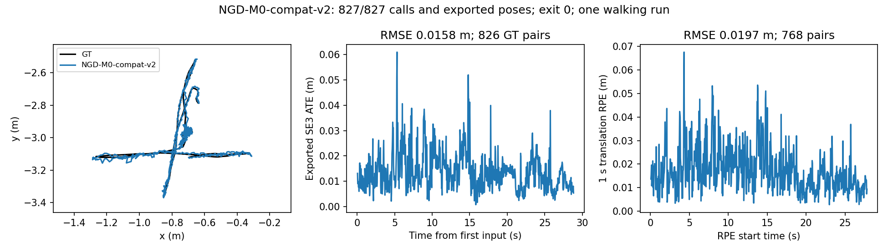

# NGD-M0-compat-v2：第二处SAUF兼容修复与首次完整walking

2026-10-20。**BASELINE_TECHNICAL_PASS_SINGLE_SEQUENCE。** 12帧验证通过；唯一一次完整walking执行827/827次TrackRGBD，正常退出0并导出827条相机位姿。导出ATE **0.015766m**，1秒平移/旋转RPE **0.019701m / 0.587427°**。这是兼容修复后的首次单序列技术资格，不是新算法或稳定优势证据。M1/M2未开发。

## 最小修复与保留范围

固定作者提交`a93a14c4019efc7a209be5fbf9fefa46f5d1d90f`。在新的外置副本`/media/wcqw/KESU/slam_research/ngd_ccl_compat_v2_20261020/NGD-SLAM`中，只追加Tracking::CreateMaskFromClusters的一个参数，保留上一轮YOLO补丁：

```cpp
cv::connectedComponentsWithStats(localMask, labels, stats, centroids,
                                4, CV_32S, cv::CCL_SAUF);
```

[Tracking补丁](audit/Tracking_sauf.patch)与[YOLO补丁](audit/YOLO_sauf.patch)。作者项目全部相关源码检索仅有这两处调用，分别Tracking.cc:4565、YOLO.cc:128，均显式四连通SAUF/CV_32S。[调用清单](audit/call_sites.json)。检测、光流、聚类、深度阈值、80%清零、roll、优化器与关键帧策略未变，428项作者文件中只有这两个文件不同。两处都是兼容补丁，不是科研创新或字节级作者原版。

**已记录未修复风险**：Tracking.cc:4547可能在pointsDepth为空时直接读取其中位数；本轮未遇到对应故障，不预防性修改。构建另有原作者bOK可能未初始化的编译警告，未扩展修补。

只编译Tracking.cc一个翻译单元；复用上一轮YOLO兼容对象、其他原对象和原无窗口入口对象，再重新链接新库/入口。既有隔离OpenCV4.5.5不重装、不替换系统4.2。`ldd`与两次实际进程maps均确认新compat-v2核心和私有4.5.5，没有4.2混用。[构建](audit/build.json)。原作者源码/二进制、上一版YOLO单点版本和旧日志均保留。

## 四连通语义检查

复用四邻域BFS参考，实现6个固定掩码（小/大空掩码、对角点、多区域、等面积区域、触边）×1/4线程×默认/SAUF，共24个独立进程。对前景标签规范化后比较，最终阶段按Tracking实际逻辑选择最大区域再7×7膨胀，**不套用YOLO特有的80%清零**；保留无前景时作者largestLabel=0的背景回退。

- 默认实现8/12返回，4/12 SIGSEGV；SAUF **12/12通过BFS连通域核对**。
- 默认能够返回的8组，规范化连通域、最大区域、最终二值掩码均逐像素相同。
- 默认崩溃的输入没有修复前有效输出，不作等价声明。等面积样例通过不保证所有未来平局的选择相同；SAUF标签次序与默认算法的区别仍保留。

[完整测试结果](results/ccl_tests.json)。这次是连通域/最大区域/膨胀的有限软件检查，不冒充所有真实传播掩码一致性认证；上一轮5组真实YOLO检测掩码相同的证据保持原范围。

## 真实运行与评价

同一walking数据、关联、词典、检测模型、无窗口入口；BGR、Freiburg3内参535.4/539.2/320.1/247.6、depth/5000、原ORB参数不变。OpenCV线程1，其余线程保持作者原实现。没有下载、安装、ROS或新算法。GT只离线评价。

| 项目 | 前12帧 | 唯一完整walking |
|---|---:|---:|
| 输入 / 完成调用 | 12 / 12 | **827 / 827**，frame ID连续0–826 |
| 退出 / SIGSEGV | 0 / 无 | **0 / 无** |
| 导出相机 / 关键帧 | 12 / 3 | **827 / 75** |
| 关联输入导出位姿覆盖 | 100% | **100%**，无重复/倒序时间戳，无输出缺口 |
| GT配对 | 不作科学评价 | **826/827输入**，GT可用输入全部配对 |
| 导出ATE RMSE | 不作科学评价 | **0.015766m** |
| 1秒RPEt / RPEr RMSE | 不作科学评价 | **0.019701m / 0.587427°**，768对 |
| TrackRGBD均值 / 中位 | 17.194 / 12.923ms | **13.018 / 12.804ms** |
| 管理墙时 | 4.004s | **40.530s**（time进程40.31s） |
| 用户 / 系统CPU | 4.01 / 0.15s | **72.70 / 1.57s** |
| 峰值RSS | 509132KiB | **598484KiB，584.46MiB** |

首个输入早于GT可配对范围，所以827条导出中只有826条匹配GT，不是删掉一次失败。827/827指已关联输入；原rgb.txt共859帧，关联前未纳入的32帧不冒充已处理。导出时间范围1341846313.592026–1341846342.416195。[全程实际记录](results/full/result.json)、[评价](evaluation/metrics.json)、[短序列身份](results/short/identity.json)。

**在线ATE不可用**：原入口未保存在线位姿或每帧公开状态，本轮没有添加钩子。输出存在不能证明每帧状态OK。两次日志只见初始化map0、初始526点，没有后续重置/新map/重定位消息；没有逐位姿map-ID trace或最终地图点数，不能认证所有内部转移。相机轨迹来自原生参考关键帧回算；75是实际导出KF数量。作者Shutdown只请求后台结束、不等待所有线程，保持原状，导出不称完全收敛BA结果。

沿用固定尺度1的单次SE3位置对齐、GT容差20ms、1s±20ms RPE且区间无>100ms输出缺口。未根据结果改评价规则。独立SciPy刚性对齐/相对变换核对：ATE差2.08e-17m，RPE最大差2.67e-14。[数值检查](audit/evaluation_check.json)。



## 历史比较、边界与下一步

既有正确色序ORB-SLAM3 P1三次：导出ATE 0.413644–0.437544m、1s RPEt 0.258353–0.299724m、RPEr 4.741337–5.539982°，输入覆盖100%。本次NGD误差明显较小，仅作**描述性比较**。[逐次表](results/descriptive_comparison.csv)。两者虽复用相同walking/标定/色序与评价，NGD使用其作者的检测、光流和传播前端、不同核心/运行入口（没有旧在线缓冲诊断）以及私有OpenCV4.5.5，旧ORB3是4.2。一次不同系统/环境结果不能归因于某个模块，更不能宣称稳定优越、动态错误约束已证或新方法有效。

本轮预算关闭：12帧1次、完整walking **1/1**；无崩溃，无需新GDB重放。**首次完整技术基线已取得，科学方法资格仍未授予。唯一下一步建议：冻结这份NGD-M0-compat-v2基线，下一轮先制定统一输入、记录和评价的正式对照协议；本轮不追加序列、重复或M1/M2。**

1011项登记的旧源/二进制/报告文件前后hash一致，主仓HEAD/status/diff不变，[保护结果](audit/protection_after.json)。范围限登记清单，不宣称重哈希全部历史数据。全部新增大构建在外置盘；Git归档仅必要脚本、补丁、原始轨迹/日志、评价和一张图，不含模型、词典、原图、可执行文件或库。
