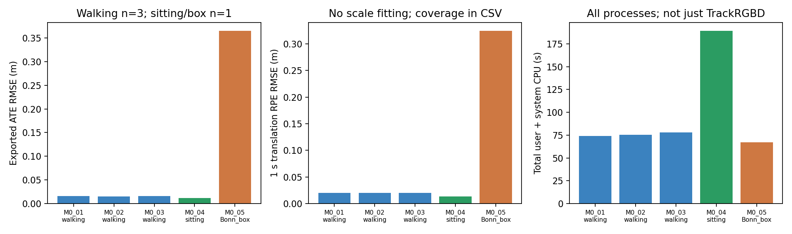
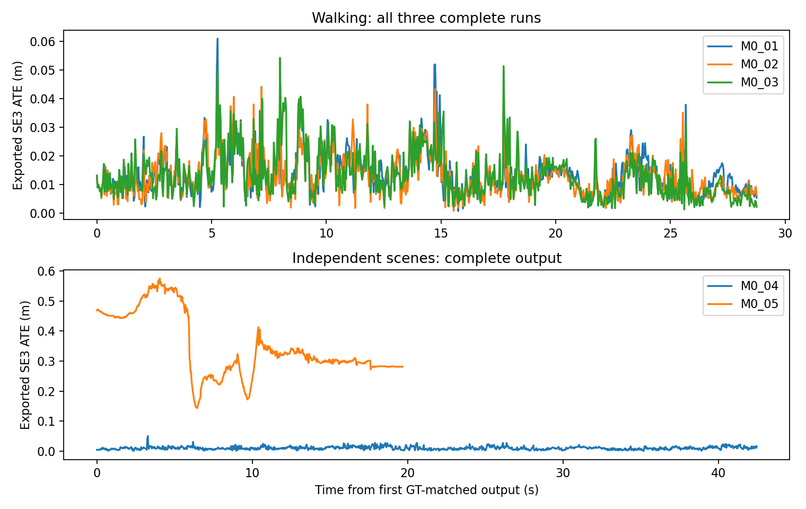
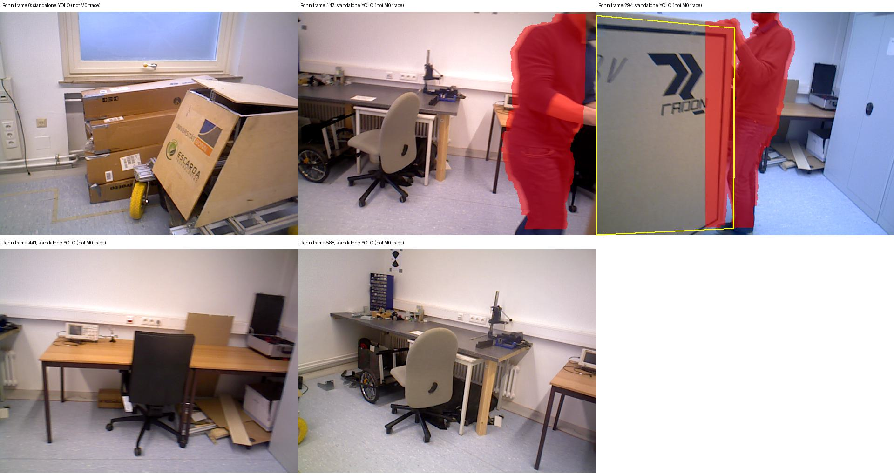

# NGD-M0科学基线确认与局部原型建议

2026-10-20，ANALYZED（当前助手执行，非独立团队复验）。**INITIAL_SCIENTIFIC_BASELINE_READY；推荐下一轮GO_TO_BOUNDED_REGION_PROTOTYPE。** walking三次厘米级误差得到重复；sitting保持低误差；Bonn遮挡箱体完整运行但有明显轨迹损失。唯一主线建议是**person掩码外相邻刚体区域的接受/不扩张决策**。本轮M1/M2实现与运行均0，不宣称SCI创新已成立。

## 1. 冻结方法、数据与评价

完整复用成功提交`92156b25a671cce73d0f8055c1953af94ab54a0f`对应的**同一个NGD-M0-compat-v2二进制、核心库和无窗口入口**。作者固定`a93a14c4019efc7a209be5fbf9fefa46f5d1d90f`；只包含此前YOLO/Tracking两处SAUF兼容修复。没有重编、算法改动、诊断钩子、安装或数据下载。80%规则、roll、光流、聚类、ORB/优化/关键帧均未变。

[运行前冻结协议](protocol/design_frozen.json)登记顺序M0-02→03→04→05、全部hash和4次上限；没有失败重跑或择优。原M0-01保留并单列。每次实际进程maps确认兼容v2库＋隔离OpenCV4.5.5，无系统4.2混用。

- walking827对、sitting1219对使用原Freiburg3标定与关联；BGR、depth/5000。
- Bonn使用已有**589对**关联（原RGB590/depth592），无改写图像；[官方标定](https://www.ipb.uni-bonn.de/data/rgbd-dynamic-dataset/)fx542.822841/fy542.576870/cx315.593520/cy237.756098，畸变0.039903/−0.099343/−0.000730/−0.000144/0，depth/5000。没有套用TUM3内参；虚拟Stereo.b=.0747和ThDepth40沿用既有配置，不称Bonn物理基线。
- GT仅离线评价。使用原评价代码：唯一20ms时间配对、单次SE3刚性对齐、scale=1；1s±20ms RPE，区间不跨>100ms导出缺口。新增4条轨迹数学独立核验见[independent_math_check](audit/independent_math_check.json)。没有按结果改配对或删失败片段。

## 2. 全部真实结果

下表都是**导出轨迹**，不是在线ATE。每条均完成全部输入、退出0、导出时间戳严格递增且无重复，关联输入位姿覆盖100%，无导出缺口。GT配对walking826、sitting1216、Bonn588；未匹配输入不被冒充失败或用于拟合。

| 运行 | 场景 | 完成帧 | ATE m | 1s RPEt m | 1s RPEr ° | 覆盖 | KF |
|---|---|---:|---:|---:|---:|---:|---:|
| M0-01，旧成功基线 | walking | 827 | 0.015766 | 0.019701 | 0.587427 | 100% | 75 |
| **M0-02，新** | walking | 827 | **0.015368** | **0.020058** | **0.608486** | 100% | 75 |
| **M0-03，新** | walking | 827 | **0.015703** | **0.019873** | **0.605730** | 100% | 79 |
| **M0-04，新** | sitting | 1219 | **0.011671** | **0.013149** | **0.489644** | 100% | 100 |
| **M0-05，新** | Bonn moving_obstructing_box | 589 | **0.364655** | **0.324270** | **18.742741** | 100% | 101 |

walking三次ATE范围**0.015368–0.015766m**、中位0.015703m，跨度约0.40mm；RPEt范围0.019701–0.020058m、中位0.019873m。**1.58cm初次结果已在本设置下重复**，n=3仅报范围/中位，不给显著性、置信区间或跨场景稳定结论。同视频数百帧不是独立重复。

sitting单次1.17cm表明低动态场景未出现大的损失，但不能证明所有静态场景无退化。Bonn虽完整输出，精度明显不足；最大1s平移RPE0.674608m，出现在事后定位的9.08149–10.08659s区间。这个区间仅说明真实局部运动误差，不反推错误约束身份。

## 3. 实际成本、地图和可测边界

| 运行 | TrackRGBD均值/中位 ms | 总墙时 s | 用户/系统CPU s | 峰值RSS KiB |
|---|---:|---:|---:|---:|
| M0-01，历史 | 13.018 / 12.804 | 40.530 | 72.70 / 1.57 | 598484 |
| M0-02 | 12.250 / 12.043 | 40.279 | 74.10 / 1.46 | 599424 |
| M0-03 | 12.431 / 12.136 | 39.275 | 76.41 / 1.61 | 601560 |
| M0-04 | 16.186 / 14.394 | 111.817 | 186.35 / 2.77 | 640496 |
| M0-05 | 11.153 / 10.004 | 48.280 | 65.96 / 1.31 | 582244 |

均为CPU运行，GPU未使用。图像输入时长walking28.824s、sitting42.564s、Bonn19.705s。墙时含词典/模型启动、读取、入口节拍和后台；CPU覆盖异步线程。**不能用Track均值认定端到端实时，也不能用含启动/I/O的墙时直接推断稳态检测延迟**。本机非独占，少量离线读源码/五帧独立探针与运行管理可能影响成本；没有独立记录I/O、实际mask年龄或线程调度，sitting较长墙时的来源UNKNOWN。

复用原生打印的累计GrabImageRGBD阶段均值反推逐调用阶段时间，P95分别23.55/24.25/29.85/25.38ms（02/03/04/05），见[derived_stage_times](results/derived_Grab_stage_time_summary.json)。这是**舍入累计文本的差分估计**，不是新增原始逐帧计时，也不是整个TrackRGBD或检测耗时，不用于判断传播失效。

四条新运行原生日志均只显示初始化map0，没有reset/重定位/“LK匹配不足”消息；各自frame ID完整连续。**没有逐帧公开状态、map-ID或真实优化边/内点计数**，不能把100%导出叫成全部状态OK。在线pose原入口未保存，在线ATE/RPE为UNAVAILABLE，未从最终轨迹伪造。作者Shutdown不等待所有后台线程的限制保留，导出不叫完全收敛解。

## 4. 已有优势与公平比较

同二进制、相同输入配置/评价的walking三次是本轮可靠重复比较。历史正确色序ORB3 walking导出ATE0.414–0.438m、RPEt0.258–0.300m；NGD当前三次明显更小。旧ORB3 sitting导出ATE0.009186m，本次NGD0.011671m；Bonn旧ORB3 S0导出ATE0.532349m/RPEt0.355163m，本次NGD0.364655m/0.324270m。**均只作历史描述**：前端/核心、OpenCV4.2与4.5.5、入口日志与后台轨迹实现不同，不能把差异全部归为person检测，也不混用旧S0在线ATE0.557452m作导出基线。

因此现有能力是：在所测walking具有重复厘米级定位、sitting低误差、所有序列完整输出、TrackRGBD成本较低；不能泛化为动态SLAM总体优势或端到端实时保证。

## 5. A/B/C机会筛选与新增证据

**A：大mask/静态支持不足——不作为当前主线。** 80%清零分支真实存在，但正式运行没有清零事件/静态内点日志。当前没有证据证明它触发并导致损失，不能从源码单行制造故障。SR-SLAM、DynaPix等已有可靠性/静态支持策略。

**B：person之外的相邻移动刚体——推荐唯一主线。** 固定YOLO.cc:67只把class0用于mask；NGD作者[2026修订稿§VI](https://arxiv.org/html/2405.07392v4)承认类别外实例边界，同时也说明depth/连通域能部分应对人携物体。不能把“未直接检测box”写成“NGD完全不处理box”。本轮真实Bonn残差提供了需要验证的实际损失。

有限补充：在查看mask前固定Bonn索引0/147/294/441/588，用已有独立YOLO探针执行5次**单图**检测（不是完整SLAM或传播），结果mask面积比例0/20.72%/21.22%/0/0%。探针链接上一兼容库，其YOLO源码与当前v2相同；没有另装系统或改正式M0。进程时间含模型构造，不作为纯推理耗时。

第294帧箱体占据大量视野；先看原RGB填写一个粗polygon，再看mask，该区域仅**19.34%**落在独立检测mask内。标注由本助手完成，可能含边界背景，**不是独立人工真值、动态像素真值或优化内点标签**。5帧postprocess结果无法判断80%分支发生与否；不能把独立mask当本轮异步M0实际mask。

这些证据支持一个可以低成本原型检验的问题：**人类语义种子只覆盖搬运物体的一部分时，能否把相邻刚体运动区域适当地纳入动态mask，并避免误吞相近depth静态背景？** 还没有证明未遮罩箱体的特征进入实际优化；与局部RPE重叠不是因果。

**C：异步时效与计算成本——记录，暂不平行开发。** 作者本来已处理异步检测和mask传播；本机源码输入/输出没有stamp，实际跨帧年龄未记录，YOLO空输入路径忙轮询存在。总CPU和墙时提示有成本，但不能证明mask过时。普通时间戳、传播或调度不自动新颖，本轮不开展第二套调度模块。

竞争解释必须保留：Bonn非零畸变下，原`SearchByOpticalFlow`把LastFrame.mvKeysUn用于原灰度LK、再把结果交给带畸变的PnP；这是**坐标域一致性疑点，未证明解释本次误差**。遮挡、匹配错误、相机运动、地图历史、depth边界、异步差异也未隔离。`ComputePixelPotential`中isBrighter/isDarker未显式初始化和边界保护疑点，以及pointsDepth空访问风险均只记录，不修补，不当作方法创新。原型若实际只修正这些问题，应归技术修复并撤回动态机制主张。

## 6. 下一轮M1/M2，明确推进而非无限诊断

**只推荐一个局部机会，下一轮直接实施[具体M1/M2设计](NEXT_M1_M2.md)。** M1是成熟的邻接深度区域扩张；M2对相同候选增加背景相机假设与区域刚体运动假设的接受检验，证据不足就保留M0。它们只影响现有mask接口，不恢复旧S1/S2逐点几何删除/二维退回，不改后端、不加网络/GMM/HMM。

[最近邻矩阵](literature/NEAREST_METHODS.md)说明：NGD已有传播；Measurement2026已有传播与未知动态残差；SR已有质量门控；DynoSAM提供成熟刚体运动思路；VAR已有未知动态鲁棒损失；DynaPix已有软权重/静态保留。**宽机制高度重叠，独立SCI贡献仍UNRESOLVED**。拟议差异只可能来自“person种子边界外的区域级接受/回退”带来的额外真实收益；不会因改换平台或组合名称变成创新。

下一轮最小完整矩阵为**Bonn M0/M1/M2各一次**，先固定代码/阈值/共同日志。M1足够则接受简单方案；M2无额外收益或只靠缺输出降误差则停止；有意义差异才另行少量重复与walking/sitting回归。本轮不自动执行，不在新方法前再强求完整因果归因。建议约3–4工作日完成局部实现/测试和三次比较，属于估计。

## 7. 执行与保护

新增完整运行4/4，全部保留，零算法构建和零M1/M2运行。84项登记旧文件（含成功v2交付、源/二进制及词典）hash不变；主仓HEAD/status/diff不变，见[protection_after](audit/protection_after.json)。这不是全量旧数据hash声明。新内容在独立目录，未改历史报告或旧源；根分区仍有安全空间，未删除资料。

归档包含4条完整轨迹/日志/配置、全部指标/图表、有限独立检测证据与明确设计。研究分支`research/ngd-scientific-baseline-20261020`；提交与远端SHA在发布核验后单独报告，不把自引用SHA写成已验证事实。
