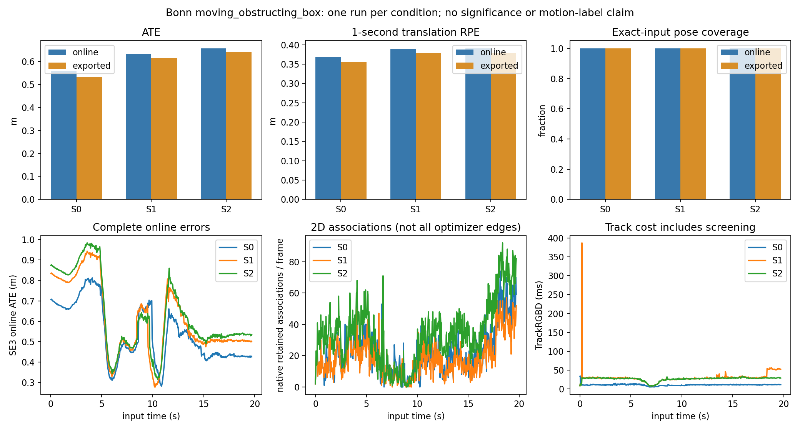
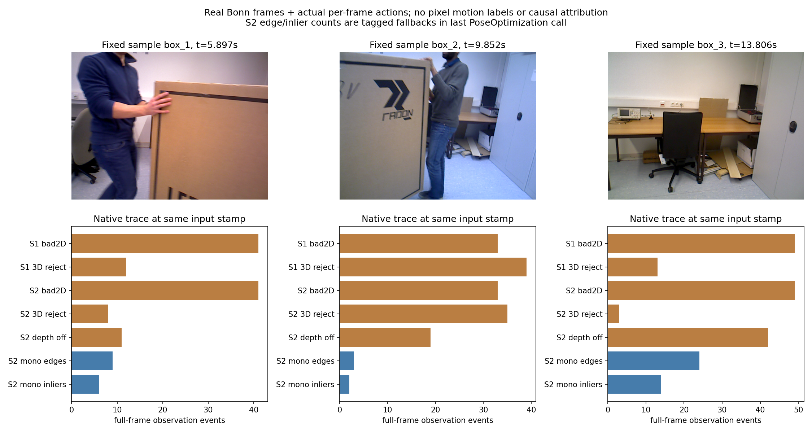

# Bonn RGB-D组合原型：S0/S1/S2首次端到端对照

2026-10-20，ANALYZED。**三次真实运行完成，预算3/3关闭。本次S1未优于S0，S2虽增加了实际接受的二维约束，也未取得额外定位收益。** 这是每条件一次的初步负向结果，不是统计显著性、跨数据泛化或动态误判机制结论；没有SCI方法贡献认定。

## 数据、协议和公平性

用户提供的官方`rgbd_bonn_moving_obstructing_box.zip`为320,845,314字节，SHA256 `d0fc8c33d896b6a4c4a506508f44ddec63bf7dc37c8f58524826cbca1bbba689`；本地既有官方前缀一致、全部ZIP CRC通过。此SHA是本轮登记值，不冒称官方发布校验值。解压330,413,516字节，未下载任何新文件，原ZIP与partial保留。

原始RGB590帧、depth592帧；固定20ms唯一关联得到589组（19.7053s），有1张RGB无唯一合法关联，不是SLAM丢帧。589组均以OpenCV4.2完整解码，最大RGB-depth差16.67ms，平均有效depth86.40%。GT593行、单调、四元数范数合格；588个输入有20ms内GT，首RGB早于GT支持。详细[数据验收](audit/dataset.json)。

使用[Bonn官方标定](https://www.ipb.uni-bonn.de/data/rgbd-dynamic-dataset/)：fx/fy=542.822841/542.576870、cx/cy=315.593520/237.756098、畸变(0.039903,−0.099343,−0.000730,−0.000144,0)，BGR输入、depth/5000。全589帧BGR灰度控制逐像素通过。Stereo.b=.0747及ThDepth40是前轮保留的虚拟RGB-D配置，不是真实Bonn双目基线；各组相同。

[运行前修订](protocol/revision_before_runs.json)将**技术运行资格**与**运动机制评价资格**分开。原20261019协议、代码和失败报告不变；新入口仅移除可信静态/动态点标签作为运行阻断项，仍要求完整数据、标定、可解码输入和原预算。固定三对原图可见搬运箱体与背景，但没有逐点可信运动标签，机制准确率仍UNKNOWN；不以GT或残差反推标签。

固定ORB-SLAM3 `4452a3c4ab75b1cde34e5505a36ec3f9edcdc4c4`；复用原型可执行文件和核心库，未重编译。S0/S1/S2同输入顺序、同标定/后端/ORB/评价/诊断，顺序S0→S1→S2，各一次。共同原始特征数量、匹配数、LK质量计数、PnP成功及内点数逐帧完全一致（S1/S2）；没有逐点身份全等日志；其分支改变只发生在原固定筛选规则中。源码、二进制、配置与数据hash在运行前冻结，见[run_inputs_frozen](protocol/run_inputs_frozen.json)、[比较检查](audit/comparison_checks.json)。

GT仅离线评价。在线Twc与原生最终导出分别做单次SE3刚性对齐、尺度1；1s±20ms RPE、端点GT容差20ms、跨输出缺口>100ms排除规则未改。无额外种子、失败替换或重复。

## 全部真实轨迹结果

| 条件 | 在线ATE m | 导出ATE m | 在线/导出1s RPEt m | 在线/导出1s RPEr ° | 输入位姿覆盖 | Track均值/P95 ms |
|---|---:|---:|---:|---:|---:|---:|
| S0 原生 | 0.557452 | 0.532349 | 0.368908 / 0.355163 | 20.159 / 19.596 | 589/589 | 10.972 / 13.255 |
| S1 几何筛选 | 0.631257 | 0.615071 | 0.390272 / 0.379195 | 20.162 / 19.521 | 589/589 | 29.640 / 52.466 |
| S2 深度质量退回 | 0.656350 | 0.641634 | 0.390705 / 0.378938 | 19.800 / 19.458 | 589/589 | 26.769 / 30.526 |

三次均完整处理589组、退出0、公开返回状态OK589；map ID始终0、map数量1，无重置/重新建图日志、无重复输出stamp、无缺失区间。最长输出间隔约34.34ms，不称为失跟。在线/导出均588个GT配对（99.83%输入）、558个合法1s RPE对；覆盖100%指相对589个合法关联输入，非全部原始RGB或“误差合格”。第一帧返回OK不代表内部从未初始化。

S1在线/导出ATE相对S0分别增加0.073805/0.082722m；S2相对S1再增加0.025093/0.026563m。S2导出RPEt仅比S1低0.000257m，同时在线RPEt略升；这不足以宣称收益。在线和导出ATE方向一致，不能把负向结果只归因导出阶段。每条件n=1，异步建图/运行波动未估计，不给显著性或概率结论。

## 实际观测处理：候选不等于内点

下表全为**逐帧观测事件累计**，不是独立样本或唯一物理点；同一地图点可能多帧计数。Pose边指每帧最后一次实际原生PoseOptimization，未累加所有内部迭代、重复调用或全局BA。

| 实测 | S0 | S1 | S2 |
|---|---:|---:|---:|
| PnP成功帧 | 不启用 | 544/589 | 544/589 |
| LK/匹配2D不合格而删除 | 0 | 37,661 | 37,661 |
| 超固定3D运动残差门删除 | 0 | 11,479 | 6,537 |
| 原始/剩余ORB观测 | 566,493 / 566,493 | 566,493 / 517,353 | 566,493 / 522,295 |
| S2低depth质量候选 | — | — | 26,675 |
| 其中原已无depth / 新无效化有效depth | — | — | 8,723 / 17,952 |
| 标记退回点的实际mono优化边 | 0 | 0 | 11,742 |
| 标记退回点的实际mono内点 | 0 | 0 | 8,753 |
| 标记退回点的stereo边/保留3D关联 | 0 | 0 | 0 / 0 |
| Track返回后全部保留2D关联 | 12,771 | 10,868 | 19,715 |
| Track返回后全部保留3D关联 | 215,518 | 185,416 | 186,110 |

**S1确实改变了原生观测和地图行为**：共删49,140个特征观测，保留关联减少，关键帧/地图点也变化；不是未生效的外部探针。S2少删4,942个候选，并将17,952个有效depth改为`mvDepth=mvuRight=-1`；其中4,396次因范围、13,556次因邻域规则。原生二维特征没有随depth无效化自动删除。

**S2确实使部分退回点进入了实际优化**：17,952次新depth无效化中，11,742次形成mono边、8,753次成为最后一次优化的内点；约48.8%的新退回事件成为接受内点。S2总保留2D关联较S1增加8,847，但这是不同地图历史下的计数差，不能视为逐点反事实配对。整体保留2D/3D关联不等于逐个实际PoseOptimization边，本轮没有记录所有非退回点的边列表；不伪装完整约束谱系。

“有用”若指**实际被优化接受**，已有上述直接证据；若指**物理正确并改善定位**，未获支持。不得用内点增加替代轨迹收益，也不能反推8,753次都是动态污染约束。

完整逐帧动作/边时间线另见[actions_and_edges](figures/actions_and_edges.png)，全部原始状态和轨迹位于results/S0、S1、S2；[汇总表](results/summary.csv)含全部指标。

## 成本和地图变化

| 条件 | Track累计 s | 前端模块累计 s | 用户/系统CPU s | 管理墙时 s | 峰值RSS MiB | 末帧地图点/KF |
|---|---:|---:|---:|---:|---:|---:|
| S0 | 6.462 | 未单独计时 | 20.14 / 0.42 | 36.64 | 560.2 | 5200 / 72 |
| S1 | 17.458 | 11.218 | 30.06 / 0.35 | 29.30 | 582.0 | 5038 / 86 |
| S2 | 15.767 | 9.882 | 28.77 / 0.33 | 27.95 | 592.4 | 5235 / 92 |

Track包含筛选开销，S1/S2约为S0的2.70/2.44倍。墙时含词典加载、图像读取、原生按stamp等待和不同文件缓存/机器负载；S0墙时更长不等于其计算更重。S1前端中原规则也会计算depth可靠性，额外开销不是独立门控性能结论。未宣称硬实时资格。地图数均1；末帧原生数量不是经独立几何核验的正确地图点数。

## 科学判断与唯一下一步

1. **S1改变系统，但本次未改善定位。** 删除了更多观测、增加CPU，并不构成鲁棒性收益；2D拒绝造成静态支持损失、相机补偿受错误depth或运动前景影响等都是竞争解释，尚未分离。
2. **S2增加了真实接受的二维观测，却未比S1产生额外定位收益。** 不能将这写成“保住有用静态约束、修复误判”。
3. **保留动态2D观测的副作用仍UNKNOWN。** 源码中的LK往返一致和ORB对应质量只是匹配可靠性，不证明点属于静态背景；深度不可靠时直接退回2D，理论上可能保留运动点。当前没有逐点运动标签/边像素身份，不能把此可能性宣布为本次ATE上升的已证根因。
4. 竞争因素还包括：PnP先于局部depth质量门且可受动态主导；阈值拒绝有效静态点；原有地图点不清除；depth/像素时差、可见性/遮挡、RGB-D表示误差及异步地图优化。单次结果不能定位哪项主导，也不证明成熟几何筛选方法整体无效。

**下一步唯一建议：若继续，仅收紧S2的“低depth质量时退回2D”资格，检查现有相机补偿下的二维静态几何相容性，而不只检查LK匹配一致性。** 这是针对源码中明确逻辑差别的成熟机制对照设想，不是已证明的新贡献或效果；共同PnP本身也可能错误，必须保留这一限制。建议另行限定一次局部判据对照后再决定去留，不重复当前三条件矩阵、不加语义/HMM/协方差/后端，本轮不实现或运行它。

## 复核与历史保护

3/3预算已关闭；不存在技术失败替换或额外SLAM运行。原20261019文件、主仓两处未提交修改、用户ZIP及原估计器对象/核心库复核不变；新文件仅在本子目录，见[audit/protection_after.json](audit/protection_after.json)。首次unittest发现0项，记录保留；按原脚本直接执行后3项评价控制通过，未把0项说成PASS。完整数据接入、guard修订和分析脚本不改变方法二进制；[REPRODUCE](REPRODUCE.md)列出真实命令。

代码和紧凑原始结果提交到原研究分支`research/rgbd-quality-combo-20261019`；不上传ZIP、partial、完整RGB-D/GT、SO/object。发布后本地PUBLISHED.json记录真实SHA与远端相等检查，旧报告和失败归档继续保留。
