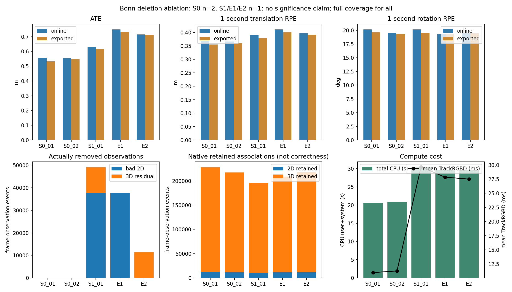

# Bonn删除消融：是否值得继续当前组合原型

2026-10-20，ANALYZED。**建议STOP_CURRENT_COMBINATION_PROTOTYPE。** E1、E2、S0重复各一次真实运行完成，预算3/3关闭。两种简化均未改善S1，且ATE/平移RPE均差于两次S0。未找到值得继续投入的具体删除环节，不追加模块、阈值、序列或运行。此为当前原型的工程/研究投入决定，不证明动态SLAM整体无效。

## 固定项与实际开关

复用589组Bonn moving_obstructing_box关联输入、原标定/BGR/depth5000、固定ORB-SLAM3 `4452a3c4ab75b1cde34e5505a36ec3f9edcdc4c4`及SE3无尺度评价。没有下载、安装、改数据或优化公式。原3次S0/S1/S2和报告不变；本轮独立目录与分支`research/rgbd-deletion-ablation-20261020`来自`2e9e20d48eba78867f384e53c9e89097b73ed916`。

只增加两个删除开关，保留19项前端统计及原43字段日志结构：

- **E1（mode3）**：在原S1共同匹配候选中，LK往返/与ORB对应不合格者照旧删除；禁止3D残差删除。仍计算原PnP和3D残差，以隔离“删除”的改变，未另外优化运行成本。未通过双向比值匹配的原始特征仍按旧规则不评估，不是全量删除。
- **E2（mode4）**：二维不合格者跳过新增PnP/3D判断，但不从原生特征集合删除；只删除二维合格、PnP合格、双depth有效且3D残差>0.05m者。其余原规则不变，不启用S2深度退回。
- **S0_02**：原mode0无动作路径重复。参考帧0.2s、比值0.75/Hamming50、LK1/2px、PnP100次/3px/0.99/≥8内点、depth范围与原参数全部固定，没有基于ATE修改。新S0与E1/E2使用同一个新链接二进制；旧S0使用原二进制，mode0源码路径不变。故两次S0范围也包含链接/线程/环境因素，不称同一二进制下的纯随机波动估计。

只重编小型Combo及入口，Frame/Optimizer/System和全部28个被复用对象保持不变；补丁见[audit/switches.patch](audit/switches.patch)。软件控制验证两种拒绝可分别关闭、RGB/描述子/深度不被额外改写、旧S0/S1/S2路径通过原测试；不是额外完整SLAM运行。真实顺序E1→E2→S0，命令/参数/hash/exit见各results目录与[冻结输入](protocol/run_inputs_frozen.json)。

## 全部五条对照

旧S0_01/S1_01只读引用上一轮结果，不重算覆盖旧文件；本轮三条全部列出。在线/导出单独SE3刚性对齐，不拟合尺度。1s±20ms RPE，GT端点20ms、跨输出缺口>100ms排除规则未改。

| 运行 | 在线ATE m | 导出ATE m | 在线/导出1s RPEt m | 在线/导出1s RPEr ° |
|---|---:|---:|---:|---:|
| S0_01，旧 | 0.557452 | 0.532349 | 0.368908 / 0.355163 | 20.159 / 19.596 |
| **S0_02，新** | **0.554072** | **0.546061** | **0.366318 / 0.360456** | **19.561 / 19.339** |
| S1_01，旧 | 0.631257 | 0.615071 | 0.390272 / 0.379195 | 20.162 / 19.521 |
| **E1，新** | **0.748970** | **0.731294** | **0.411596 / 0.400502** | **19.332 / 19.290** |
| **E2，新** | **0.714431** | **0.709351** | **0.398163 / 0.392047** | **19.468 / 19.472** |

五条均退出0、处理589/589、在线/导出位姿覆盖100%、OK589、map ID始终0、地图数1，无重建/重置日志或重复stamp；最长输出间隔34.34ms，无缺失输出区间。覆盖分母是589个合法关联输入，原RGB590帧，1张无唯一合法depth配对；不是人为丢弃困难帧。每条588个GT配对、558个1s RPE对，首RGB超出20ms GT支持。完整覆盖不等于几何准确。

**S0仅两次的描述性波动**：在线ATE范围0.554072–0.557452m，中位0.555762m；导出范围0.532349–0.546061m，中位0.539205m。在线/导出跨度分别0.003380/0.013711m。E1/E2相对两次S0均有更大的ATE和平移RPE；但S0 n=2、其余n=1不能估计各条件方差或给显著性/稳定性结论。旋转RPE部分略低，未抵消位置与平移局部误差恶化。各指标范围另见[S0_two_run_range](results/S0_two_run_range.json)。

## 删除开关是否真实隔离

| 运行 | 实际2D删除 | 实际3D删除 | 总删除 | 原生保留2D/3D关联 | 新增PnP成功帧/内点累计 |
|---|---:|---:|---:|---:|---:|
| S0_01 | 0 | 0 | 0 | 12,771 / 215,518 | 不启用 |
| S0_02 | 0 | 0 | 0 | 11,242 / 206,192 | 不启用 |
| S1_01 | 37,661 | 11,479 | 49,140 | 10,868 / 185,416 | 544 / 99,896 |
| E1 | 37,661 | 0 | 37,661 | 11,087 / 197,882 | 544 / 99,896 |
| E2 | 0 | 11,479 | 11,479 | 11,804 / 205,882 | 544 / 99,896 |

计数是跨帧观测事件累计，不是独立实验样本/唯一地图点。原生保留关联是Track返回时存在MapPoint且未标outlier的2D/3D关联，不冒充所有实际优化边或正确静态约束。没有新增逐点真值。

S1/E1/E2原始ORB数量、匹配/LK计数、参考stamp、PnP成功及内点数逐帧一致；这不是所有点身份或PnP矩阵的直接全等日志。三者PnP成功帧平均183.63内点；原始观测总量均566,493。E1二维删除、E2三维删除逐帧分别与原S1相同，N减少量与实际删除量精确相等，未进行depth无效化。E2的37,661次二维不合格候选确实留给原生处理；**不能由此断言每一条后来都被原生接受**。检查见[comparison_checks](audit/comparison_checks.json)。

## 计算与地图成本

| 运行 | Track均值/P95 ms | Track累计 s | CPU总计 s | 墙时 s | 峰值RSS MiB | 末帧地图点/KF |
|---|---:|---:|---:|---:|---:|---:|
| S0_01 | 10.972 / 13.255 | 6.462 | 20.56 | 36.64 | 560.2 | 5200 / 72 |
| S0_02 | 11.259 / 18.070 | 6.632 | 20.79 | 29.81 | 556.6 | 4959 / 69 |
| S1_01 | 29.640 / 52.466 | 17.458 | 30.41 | 29.30 | 582.0 | 5038 / 86 |
| E1 | 27.830 / 32.913 | 16.392 | 29.73 | 27.99 | 590.1 | 5469 / 96 |
| E2 | 27.484 / 31.619 | 16.188 | 29.60 | 27.95 | 582.1 | 5217 / 78 |

CPU总计为用户+系统时间；Track包含原生估计和前端筛选。墙时还受词典加载、缓存和按stamp等待影响，不能据墙时更短宣称计算更省。E1/E2仍计算同样的LK/PnP/residual，Track均值约S0的2.5倍；这不是精简生产实现的最低成本测量。地图点更多、保留关联更多也没有带来本次轨迹收益。

## A/B归因与投入决定

- **A（提前二维删除）未被隔离为主要负面因素。** 关闭它的E2相对S1在线/导出ATE增加0.083174/0.094280m，没有出现预期恢复。不能由此证明二维删除总是正确或对静态点无害。
- **B（三维残差删除）也未被隔离为主要负面因素。** 关闭它的E1相对S1在线/导出ATE增加0.117713/0.116223m，没有出现预期恢复。不能由此证明固定0.05m门合理或从未误删静态点。
- E1比E2数值更差，**不足以认定A比B更有害**：每条件一次，地图建立/匹配/异步优化具有非线性交互；“只删一类”与“两类一起删”不是两个线性、独立的误差贡献。原S1反而比两项单独版本好，仍差于S0。
- 剩余竞争解释包括几何补偿受运动前景/错误depth影响、错误对应、观测与地图历史交互、静态支持损失及线程运行波动。没有逐点运动/静态真值，不能把所有删除称为误删，也不能将错误归因于哪条具体污染约束。

**决策：停止当前LK前置删除＋固定3D残差组合原型继续开发。** 这两次未找到优于原生S0且成本合理的简化版本，不满足进入重复性验证的既定条件。没有SCI创新点，不为挽救结果增加权重、门控、模型或新数据。

**唯一下一步：归档本轮负向消融与原型，关闭该组合原型的后续运行/方法预算。** 保留可复用平台和统计代码，但不自动转入新研究方向或安排新的机制审计。

## 执行异常、保护与复查

最初预检清单构造将旧相对object路径错误地按当前目录解释，外层shell未fail-fast，E1按继承的数据资格进入运行。配置/评价相同、开关测试和正确动态库加载检查当时已通过；运行代码/二进制/输入hash在首运行前由入口冻结。随后按原构建目录解析，28个被复用object全部与本任务之前/开始时的登记hash一致。**完整object清单在E1开始后才生成**，不冒称全量预检事前通过；未改代码、重启或补跑科学任务。详细记录见[audit/preflight_path_failure.md](audit/preflight_path_failure.md)。

新运行均结束，无新增ROS/仿真或下载。旧95项代码/预算/构建/结果文件及旧报告、主仓HEAD/两处未提交修改与diff、原始对象/核心库的保护结果见[audit/protection_after.json](audit/protection_after.json)。保护范围限登记文件，不声称重哈希全部历史数据。原分支仍指向原提交；本轮只在新分支添加归档。

[REPRODUCE](REPRODUCE.md)记录真实命令；[comparison.csv](results/comparison.csv)与comparison.json提供完整五条原始指标及CPU分项。发布排除ZIP、RGB-D/GT原件、SO/object；新分支真实SHA在推送后本地PUBLISHED.json记录，不在提交内自引用。
