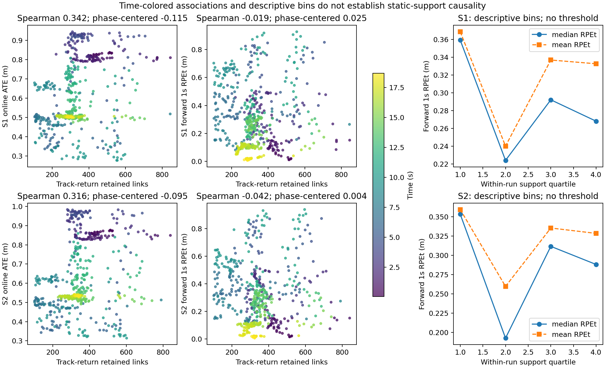
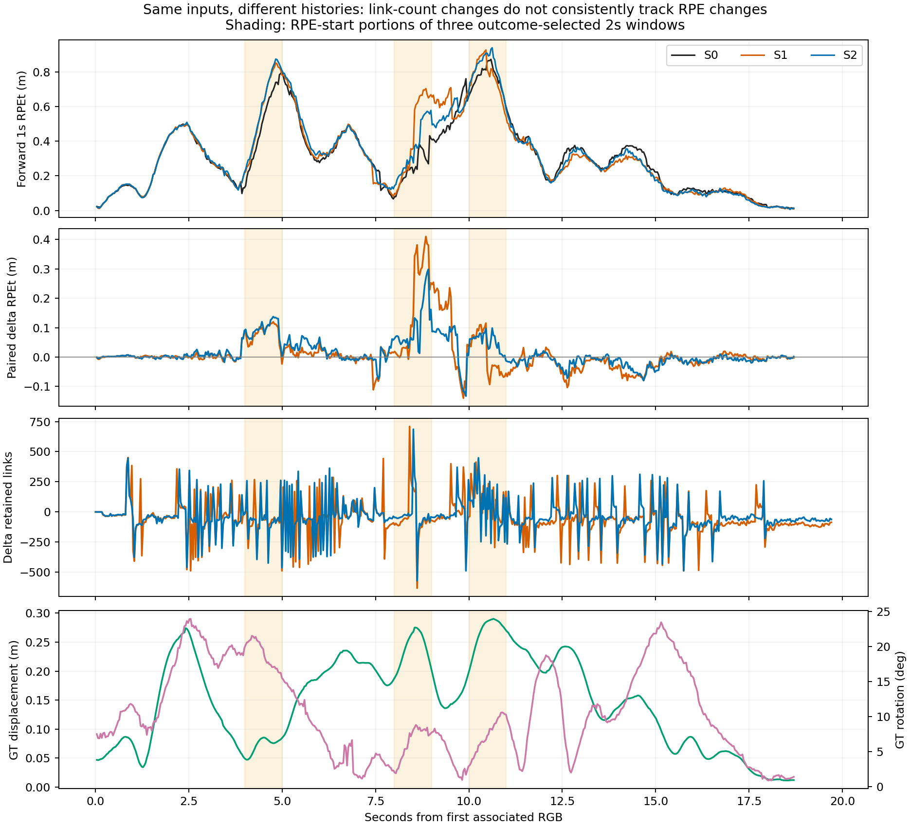
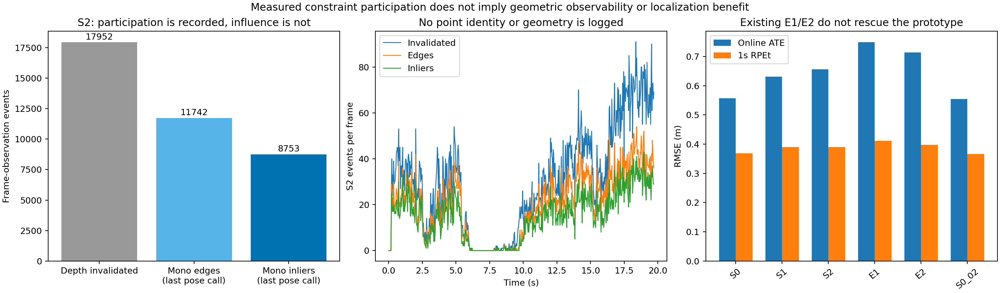

# Bonn RGB-D组合原型：受限离线机制分析

2026-10-20，**OFFLINE_DIAGNOSTIC / ANALYZED**。**结论：暂停当前组合原型，不建议下一次最小原型实验。** 本轮复核了已有相关性，并发现其对时间分组明显敏感；未获得“误删可靠静态约束”或“接受动态污染约束”的新增直接证据。没有发现可据此设定的静态支持阈值，也没有测得逐观测优化影响力。

本轮新SLAM运行、源码修改、数据扩展、安装均为0。原型和既有负向结论不变。统计均为同一段视频的描述性结果，无显著性、独立样本或因果结论。

## 1. 输入、时间配对与计数口径

读取[端到端原报告](../20261020_rgbd_combo_e2e/REPORT.md)及逐帧/在线评价文件；本机**确有有效E1/E2与S0第二次运行**，一并列作补充。六条记录每条589帧、588个ATE样本、558个1s RPE对；所有输入stamp逐项相同。评价stamp以唯一最近值、≤2µs门配回原帧，**实测差均为0**；不插值、不按行号替代时间核验。589帧全部返回OK，map ID=0、map数量=1，不等于定位准确。

- `raw_N`：原生ORB提取数；`bad_2d_rejected + motion_rejected`：实际前端删除数，逐帧等于`raw_N-kept_N`。删除比例分母为`raw_N`。
- 本文“关联数”=`retained_2d+retained_3d`：Track返回后有MapPoint且未标outlier的关联。`associated_points`只要求非空；此次六条记录两者恰好相同，**定义仍不能互换**。
- 这些关联可能包含建图/匹配历史的影响，**不是完整PoseOptimization边数，更不是已认证静态支持或信息矩阵**。源码`System_combo.cc::AuditRGBD`证实其采样位置在Track之后。
- S2优化计数只覆盖带退回标签的点、每帧**最后一次实际PoseOptimization**。所有非退回点、所有优化调用及BA的完整边数未记录。
- `boundary_*`在当前组合入口使用零mask，不能解释为无深度边界；S0的前端计时/PnP零值表示该模块未启用。

[事前统计口径](protocol/analysis_frozen.json)、[完整同stamp配对表](results/aligned_frames.csv)保留定义与输入hash。RPE使用原评价的前向1s±20ms对，关联/删除取起点；GT只用于离线相机运动上下文。ATE仍为各运行全程单次SE3对齐，尺度1；它不是因果的即时误差。

## 2. 相关性复核、时间阶段与非线性

| 复核项 | S1 | S2 | 样本数 |
|---|---:|---:|---:|
| 关联数—在线ATE，Spearman | +0.341710 | +0.315921 | 588 |
| 删除比例—在线ATE，Spearman | −0.030081 | −0.045486 | 588 |
| 关联数—后续1s RPEt，Pearson | +0.007025 | −0.005279 | 558 |
| 关联数—1s RPEt，控制2s阶段与GT运动后的残差Pearson | +0.053238 | +0.011265 | 558 |

用户提供的五个近似系数全部复现。固定2s阶段内分别去均值后，关联数—ATE残差的Spearman降至**−0.114605 / −0.094784**；原总体正相关没有保留同样方向。ATE与时间的Spearman为−0.490869/−0.453282。S0第二次运行也有正的原始关联数—ATE Spearman（+0.323957），因此这种表面关系并非筛选模块特有。

对同stamp差值，`Δ关联数—ΔRPEt`（S1−S0、S2−S0）Pearson为**+0.025499 / +0.039525**；控制固定阶段和GT运动后为**−0.005210 / +0.053874**。`Δ删除比例—ΔRPEt`为−0.206672/−0.136841，控制后−0.133631/−0.086545，不能把负值解释为删除导致改善。ATE差值、旋转RPE及一阶差分结果全部保留在[统计表](results/correlations.csv)与[summary](results/summary.json)。

这里“控制”只指对双方分别做OLS残差化，协变量为固定2s阶段指示、GT 1s位移及转角；阶段内Spearman是去均值残差的秩相关，**不是已识别的因果效应**。相机GT位移与RPEt在S0/S1/S2中Pearson为0.609/0.582/0.587，共同运动阶段值得考虑；这也可能含误差随运动长度变化的机械关系，不能宣布相机运动就是根因。时序阶段足以动摇原相关性解释，但不足以排除历史误匹配、地图偏差或异步优化。

按各运行关联数四分位分箱，S1的RPEt中位数为**0.359/0.224/0.292/0.268m**，S2为**0.353/0.192/0.312/0.288m**。最低箱较差，但最高箱并非最好，箱内时间分布也不同。**只有探索性的非单调描述，不能据此推导阈值或通用非线性定律。** 边界与样本量见[分箱表](results/support_bins.csv)。1s窗口高度重叠，558对不是558次独立重复；未计算iid p值或置信区间。

## 3. 三个局部窗口：数量变化不能单独解释误差

在评分前冻结十个互不重叠的2s窗口，按`max(S1−S0,S2−S0)`的窗口RPEt RMSE增量选前三；**是按结果选择的探索性案例**，不是运动标签或独立验证。以下按时间排序，所有十窗仍在[windows.csv](results/windows.csv)。时间零点为首RGB `1548339348.693900108`。

| 输入窗口s | 关联数均值 S0/S1/S2 | 删除累计 S1/S2（占原ORB） | 在线1s RPEt RMSE m，S0/S1/S2 |
|---|---|---|---|
| 4–6 | 453.6 / 379.6 / 384.8 | 5177 / 4666（8.65% / 7.80%） | 0.551 / 0.629 / 0.642 |
| 8–10 | 226.7 / 206.5 / 209.5 | 4147 / 4074（6.92% / 6.80%） | 0.264 / 0.479 / 0.383 |
| 10–12 | 403.6 / 395.8 / 400.7 | 4991 / 4493（8.29% / 7.46%） | 0.767 / 0.782 / 0.820 |

每窗有60个输入，计数取整窗；每窗30个RPE对要求**两个端点均在窗内**，起点约落在前1s。精确原stamp、2D/3D删除分项、ATE差及旋转RPE在CSV中。4–6s、8–10s、10–12s实际首末RGB分别为1548339352.713700056–1548339354.691080093、1548339356.702150106–1548339358.680020094、1548339358.713449955–1548339360.690259933。

- **4–6s**：关联减少并伴随RPE上升，与H1相容，但GT 1s转角均值18.91°，S0本身已有0.551m误差；不能区分误删静态、运动补偿误差与共同跟踪困难。
- **8–10s**：新增局部损失最明显；S1关联仅比S0少约20条。其窗口ATE均值反而比S0低0.043m，说明仅看ATE会给出不同印象。前端PnP误差、对应错误及此前地图历史仍未区分。
- **10–12s**：关联接近S0且约400条，三者仍有较大RPE；GT 1s位移均值0.269m。数量接近不保证约束的物理正确性或几何质量，但也不能由大误差反推动态污染。

## 4. S2：目前能测到优化参与，测不到逐点影响

源码核查`Combo.cc:45,58–65`与`Optimizer_trace.cc:1114`：只有当前depth为正、因质量规则无效化的点才被打退回标签；8723次原已无depth的候选**没有该标签**。

| 记录层级 | S2累计事件 | 可支持的含义 |
|---|---:|---|
| 低depth质量候选 | 26675 | 包含8723次本来无depth |
| 新无效化正depth | 17952 | 对当前Frame真实改变depth；范围原因4396、邻域原因13556 |
| 带标签实际mono边 | 11742 | 进入当帧最后一次位姿优化；非全后端/BA总边数 |
| 带标签mono内点 | 8753 | 最后一次优化未标outlier；与Track返回的标签2D关联逐帧相同 |
| 这些点的stereo边 | 0 | 退回没有同时保留3D观测边 |

计数是**逐帧观测事件，不是唯一物理点**。退回/边/内点分别在521/503/493帧出现。8753/17952≈48.8%是记录到的接受参与比例，**不是信息传递效率或“传导衰减”测量**。

S2相对S1增加二维关联的同时，没有在线ATE/RPE收益：S1为0.631257/0.390272m，S2为0.656350/0.390705m。它只说明本次“更多被接受的二维观测”未转化为整体任务改善，不等于这些点全都无用或全是动态点。没有逐点残差、Jacobian、MapPoint身份/运动标签，也没有全边集合，**无法计算可观测性、Hessian谱或真实逐观测优化影响力**。

有效E1/E2补充记录同样不支持继续：在线ATE/RPEt分别为0.748970/0.411596m、0.714431/0.398163m；两次S0分别为0.557452/0.368908m、0.554072/0.366318m。E2保留关联多于S1也未改善；这不是独立重复或静态点误删真值。全部运行历史已不同；同map ID不意味着同地图、同约束或同后台状态。S0两次也包含链接/线程/环境差异，不能完整估计S1/S2运行方差。

## 5. 文献边界与三项假设

| 原始来源与核查范围 | 已有机制及本轮边界 |
|---|---|
| [SR-SLAM，RAS2026对应作者稿§III](https://arxiv.org/html/2509.01111v1)；作者稿内部也称SRR-SLAM，未认证最终刊本逐式相同 | 特征分布、depth质量及历史可靠性联合影响动态剔除、直接法pose修正、关键帧和优化权重。普通“静态支持自适应”不是空白。 |
| [DynaPix，GCPR2024 §3.2](https://arxiv.org/html/2309.09879v2) | 运动概率参与加权粗pose估计、地图点增删与BA，并保留静止可动物体的可用部分。**动态SLAM不都只做硬删除**。 |
| [Good Feature Selection，IROS2018 §II–III作者稿](https://arxiv.org/html/1905.07807) | 分析测量/地图误差与Jacobian谱，Max-logDet选子集；数量不等于优化价值是已有研究基础。当前缺Jacobian，不能声称测到了其对应机制。 |
| [Good Feature Matching，T-RO2020 §III–V](https://arxiv.org/html/2001.00714) | 噪声加权Jacobian与Max-logDet引导增量匹配及预算分配；“最大化优化信息量”本身不能命名为创新。 |
| [DIO-SLAM，Sensors2024](https://www.mdpi.com/1424-8220/24/18/5929)；本轮只取得出版社/PMC索引方法及结论摘录，全文直访失败 | 相机补偿光流残差与实例类别/运动传播结合；刚体停止后保留其特征。普通运动筛选、恢复可用观测已有前例；未认证的深度噪声细节仍UNKNOWN。 |

- **H1过度删除可靠静态约束：未建立。** 有实际删除和局部负向差值，但没有删除点的静态真值/本会参与优化的身份；E1/E2也未隔离出一个改善版本。
- **H2关联数不能完整反映几何质量：本轮与此相容。** 相近数量可伴随不同误差，更多关联不保证收益；具体几何弱项、错误地图/测量偏差仍未测到，不能把一般原理升级为本次已证根因。
- **H3错误动态观测进入优化：UNKNOWN。** 已记录S2的真实优化参与，但无动态身份和逐点影响。内点判据通过不认证物理正确，也不证明它们造成退化。

11项统计解释风险已核查：阶段混杂/分组反转、帧当独立重复、筛选与生存偏差、控制变量偏差、基率问题、极端窗选择/均值回归、多重探索、分析路径、相关当因果与逆向因果。全数据保留、无p值；不能凭本次残差化消除这些风险。

## 6. 研究决定与复查

**没有新增足以支持下一次最小原型的机制证据；唯一建议是归档此次离线分析，保持当前组合原型暂停。** 不从箱界生成新阈值，不新增可靠性门控/权重，也不为补日志重跑。三项假设仍需区分的核心是物理静态性、真实对应与几何信息、以及不同地图/优化历史；当前计数无法补齐它们。

交付仅3张图、配对/统计/窗口表、可复算脚本与紧凑冻结/保护记录。8项校验通过，含时间重复/越界拒绝、GT评价RMSE复核与固定窗口端点检查，见[verification.log](results/verification.log)。[保护结果](protocol/protection_after.json)限36个实际消费的旧文件及主仓HEAD/status/diff，未冒称全量重哈希所有数据。无旧文件写回、无新SLAM进程。发布在独立离线分支，远端真实SHA推送后记录于本地PUBLISHED.json，提交内不自引用。
