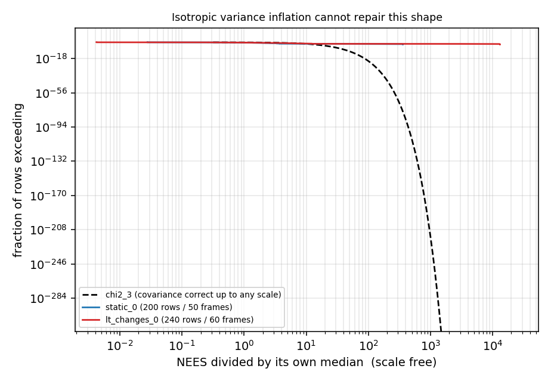

# 2D扫描匹配协方差一致性：归档与独立复算（LILocBench static_0 / lt_changes_0）

2026-10-21，**ANALYZED_TRANSFER + INDEPENDENT_RECOMPUTATION**。

**决策：`SCALE_FREE_MISMATCH_REPRODUCED / ORIGINAL_3x_OVERCONFIDENCE_FRAMING_WITHDRAWN / TAIL_CAUSATION_UNRESOLVED / DECISIVE_NATIVE_TEST_NOT_EXECUTED`。**

本轮**没有重跑任何一次扫描匹配，也没有新增任何数据**。8 个脚本与 6 份逐帧结果由 2026-10-20 工作区逐字节拷入（哈希见 `audit/source_hashes.json`）；`code/audit_consistency.py`、`code/plot_figures.py`、本报告与各协议文件为助手本轮新写。全部数字由归档原始行重新计算。

**本轮最重要的结果是一个撤回**：原工作笔记的核心论证（"有效噪声是标称的 3 倍 / 过度自信 8–9 倍"）在归档数据上**不成立为证据**——那三档 σ 是同一次计算的换写（§3.2）。但同一批数据提供了一个**更强、且不依赖任何未知噪声假设**的判据（§3.3–3.5）。

标签：实测＝可由归档原始行复算；推导＝由已冻结公式直接计算；推测/UNKNOWN＝无直接证据。

---

## 0. 2026-10-21 统计修正（后于首版归档，同日追加）

首版（提交 `38daab8d`）的 §3.4、§3.5、§4.4 存在三处统计错误，本版**撤回**；原始结果、原始审计文件与其哈希**未改动**。

| 首版主张 | 修正后 | 依据 |
|---|---|---|
| §3.4 以「预测/实测相关系数符号相反」作为协方差结构失配的证据 | **降级为 UNRESOLVED** | 池化经验相关混入 `Cov(E[e\|s])`；实测帧间方差占比 **91.3%（static）/ 94.8%（lt）**。帧内条件相关在「4 次初始化收敛到同一极小值」的设计下不可靠 |
| §3.5 用 `rank corr(NEES, 预测σ) ≈ 0` 断言「模型对坏帧零信息」 | **该统计量无效，撤回** | 若 `Σ` 正确，`NEES ~ χ²₃` **与 `Σ` 的大小无关**；零相关是正确模型的正常表现。改用实际误差与预测不确定性的关系（§3.5 修正版） |
| §4.4 「原笔记预测相关系数不可复现」 | **撤回；原文可逐位复现** | 原笔记用 `corr(mean Σ)`，首版用「逐帧相关再平均」，属口径差异（§4.4 修正版） |
| §3.3 引出的「19 cm 实际误差」 | **撤回** | `√NEES × σ_xy` 混合了平移与旋转分量，只能作量级示意 |
| §3.3 标题句「标量膨胀不够的严格证明」 | **收窄**：高斯协方差不足以描述这些误差 | 该判据不能区分协方差结构失配、非高斯估计失败与其他模型违背 |

另一处口径说明：本归档**不涉及** TUM walking／Bonn 的任何比较；此前关于「Bonn 局部误差是 walking 的 11 倍」的说法出现在工作对话中（非本归档内容），该说法混用了中位与 RMSE，已由 2026-10-21 对话修正，不写进本归档。

---

## 1. 本轮范围与保护

| 项目 | 实际状态 |
|---|---|
| 新增 SLAM/匹配运行 | **0** |
| 新增数据下载 | **0** |
| 结果文件 | 6 份 `v3_*.json` 原样拷入，未改数值、未删点、未择优 |
| 脚本 | 7 份原样拷入（逐字节校验）；`merge_imu.py` 从未执行，单列 `code/not_executed/` |
| 未入库 | 两个 `.bag`（141.8 / 103.8 MB）、两个 `.npz`（15.0 / 10.6 MB）、GT 文件；只登记 sha256 |
| 上游源码 | 2DLIW-SLAM 为 Apache-2.0，本归档**不重分发**其源文件，只保留自有补丁说明 |
| 旧结果 | 未删除、未覆盖、未按结果择优；`results/legacy/` 保留两份更早变体，并注明不可用于统计 |

---

## 2. 实际数据与采样结构（实测）

| 项目 | static_0 | lt_changes_0 |
|---|---|---|
| 场景 | 办公室 | 长期变化 |
| npz 扫描条数 | 8 982 | 6 540 |
| **实际参与匹配的扫描** | **50** | **60** |
| 束数 / 视场 / 频率 | 811 / 270.3° / 15.00 Hz | 811 / 270.3° / 15.00 Hz |
| 角度分辨率 | 0.333°（实验用每 4 束取 1 → 1.332°） | 同左 |
| GT 行数 / 频率 | 11 929 / 20 Hz | 8 700 / 20 Hz |
| `bag` sha256 | `5579090b…f01f4ce` | `638f9ee9…3cb5ca830` |
| `.npz` sha256 | `fe8e5ceb…55ce1a13` | `b1c33783…8b015927` |
| `gt_poses.txt` sha256 | `ff98cb1e…878acf6` | `32c1f451…2bcb461` |

完整哈希、topic 清单与扫描几何见 `protocol/data_qualification.json`。数据来自既有 LILocBench 资格验证目录，**本轮未重新下载**。同机另有 `dynamics_0`、`lt_changes_dynamics_0`、`mapping` 三套 GT 但无对应 bag——这是本线规模上的硬上限。

### 🔴 每帧 4 次初始化，行不是独立样本

`run_v3.py` 对每帧用 4 组随机初值（真值 + N(0, 5 cm, 5 cm, 0.01 rad)）各跑一次并各存一行。因此名义 200 / 240 行，**独立扫描只有 50 / 60**。下文所有"占比"若按行统计，权重是"帧×初始化"。

---

## 3. 复现的结果

### 3.1 主表（`results/summary.json`，实测）

| 序列 | σ_range（**假设值**） | 行 / 帧 | NEES 中位 | 均值 | P90 | P99 | 最大 | 行占比>100 |
|---|---:|---:|---:|---:|---:|---:|---:|---:|
| static_0 | 0.02 | 200 / 50 | 26.30 | 143.58 | 69.66 | 2 951.3 | 9 482.9 | 2.5% |
| static_0 | 0.04 | 200 / 50 | 6.57 | 35.90 | 17.42 | 737.8 | 2 370.7 | 2.0% |
| static_0 | 0.06 | 200 / 50 | 2.92 | 15.95 | 7.74 | 327.9 | 1 053.7 | 2.0% |
| lt_changes_0 | 0.02 | 240 / 60 | 24.17 | 4 295.83 | 138.73 | 218 654.8 | 318 347.0 | 12.9% |
| lt_changes_0 | 0.04 | 240 / 60 | 6.04 | 1 073.96 | 34.68 | 54 663.7 | 79 586.7 | 1.7% |
| lt_changes_0 | 0.06 | 240 / 60 | 2.69 | 477.31 | 15.41 | 24 295.0 | 35 371.9 | 1.7% |

逐行核验：`nees` 字段与 `eᵀHe` 的重算在浮点精度内一致（`audit/independent_check.json`）。

### 3.2 🔴 三档 σ 是同一次计算，不是三次实验

`w_i = (1/σ²)·huber(|r_i|)`，而 Huber 权重与 σ 无关，因此正规方程两边同乘 `1/σ²`，**解与 σ 无关**。实测印证：

| 检查 | static_0 | lt_changes_0 |
|---|---|---|
| 三档之间最大误差差 `max‖e(σ) − e(0.02)‖` | **2.8e-16** | **4.1e-16** |
| 对应点数是否逐帧相同 | 是 | 是 |
| `H(0.04)/H(0.02)` 的唯一取值 | **0.25**（= (0.02/0.04)²） | **0.25** |

**所以"NEES 严格按 1/σ² 缩放（4.00 / 2.25 与理论一致）"是恒等式，不是验证。** 同理：

- `σ_eff = σ·√(中位NEES/3)` 是**定义**，用它反解出的 5.9 / 5.7 cm 不含新信息；
- "σ=0.06 档中位 2.92 ≈ 3 → 一致"是把数据反向缩放到定义上，**属循环**；
- 原笔记的"过度自信 8–9 倍"依赖一个**未验证的假设**：测距噪声真的是 2 cm。本机没有任何文档记录该雷达的测距噪声（AMCL 档案里的 `sigma_hit=0.2 m` 是波束模型参数，不是测距噪声）。若真实噪声就是 6 cm，则"过度自信"根本不成立。

**本线真正独立的信息量只有 2 条序列 × 50/60 帧，三档 σ 是同一份结果的三种写法。**

### 3.3 ✅ 尺度无关判据一：归一化尾部形状（本轮核心）

把每档 NEES 除以**它自己的中位**得到 `u = NEES / median`。任何 `Σ → kΣ` 都恰好把 `u` 保持不变，因此这个比较**完全不需要知道 σ**。

若"Hessian 协方差正确，最多差一个未知标量"，则 `u` 必须服从 χ²₃ 的形状（中位归一化后：P90 = 2.642、P99 = 4.795、P99.9 = 6.875）。

| 序列 | u(P50) | u(P90) | u(P99) | u(P99.9) | 相对 χ²₃ 的膨胀 P90 / P99 / P99.9 |
|---|---:|---:|---:|---:|---|
| static_0 | 1.00 | 2.65 | **112.2** | 360.6 | **1.00× / 23.4× / 52.4×** |
| lt_changes_0 | 1.00 | 5.74 | **9 045** | 13 169 | **2.17× / 1 886× / 1 915×** |

**读法（严格）：**

- `static_0` 的 90% 分位与 χ²₃ **完全一致（1.00×）**——典型帧的协方差形状是对的；
- 顶部 1% 却重 **23 倍**，顶部 0.1% 重 **52 倍**；
- 由于标量缩放同时移动中位与尾部，**不存在任何 `k` 能使该分布变成 χ²₃**。

> 这否证的是「**误差 = 尺度化的高斯**」这一模型（这正是 Hessian 协方差所主张的），且**不依赖 σ=2 cm 这个未验证假设**：统标量缩放不能改变该经验尾部形状。

⚠️ **判据边界（2026-10-21 修正）**：它**不能**区分 (i) 协方差结构失配、(ii) 偶发非高斯估计失败（收敛到错误极小值／对应集错配）、(iii) 其他模型违背。三者对「`H⁻¹` 不可作置信区间」结论相同，但对论文主张完全不同。另注意：**跨帧异质性本身不造成 NEES 重尾**（NEES 逐帧归一化），只有「逐帧误差协方差不与 Σ 成比例」或「非高斯」才会。

### 3.4 ⚠️ 判据二（相关结构）：**已降级为 UNRESOLVED**

首版把「预测相关与实测相关符号相反」当作结构失配证据。**该比较混了两个不同的统计对象**：Hessian 侧是**逐帧条件协方差**的相关；首版的经验侧是**跨帧池化**的样本相关。

按 `Cov(e) = E[Cov(e|s)] + Cov(E[e|s])`，第二项（不同帧/状态的**均值**差异）污染池化相关。用每帧 4 次初始化做分解：

| | static_0 | lt_changes_0 |
|---|---:|---:|
| 帧间（between）方差占平移总方差 | **91.3%** | **94.8%** |
| 池化相关 (x,θ)（首版所报） | +0.370 | +0.046 |
| 帧内（条件）相关 (x,θ) | +0.959 | −0.421 |

**结论：池化相关主要反映帧间结构，不是 Hessian 预测的条件协方差；帧内相关在现设计下不可靠。本条不作为证据，状态 UNRESOLVED。** 数值本身可复现，见 `results/correlation_check.json`（两种汇总口径均保留）。

### 3.5 ⚠️ 判据三（模型能否预测坏帧）：**统计量无效，已换正确检验**

首版用 `rank corr(NEES, 预测σ) ≈ 0` 断言「模型对哪一帧会坏零信息」。**该统计量在原理上无效**：若 `Σ` 正确则 `NEES = eᵀΣ⁻¹e ~ χ²₃`，**与 `Σ` 大小无关**，零相关是正确模型的正常表现。

正确的被解释量应是**实际误差量级**。重做后（尺度无关：`Σ→kΣ` 只让预测 σ 乘同一常数，不改变排序与五分位归属）：

| 序列 | rank corr(\|e_xy\|, 预测σ_xy) | Pearson(log 比值) | 预测σ 最高五分位 与 最低五分位 的实际误差中位 |
|---|---:|---:|---:|
| static_0 | **+0.285** | **+0.651** | 2.76 cm 对 0.81 cm = **3.4×** |
| lt_changes_0 | +0.084 | +0.153 | 0.86 cm 对 0.78 cm = **1.1×** |

**修正后的结论**：`static_0` 上模型**有**实质排序信息（最不精确的五分之一，实际误差是其余的 3.4 倍）；`lt_changes_0` 上几乎没有（1.1×）。首版「零信息」的说法不成立。

**绝对尺度**：预测 `σ_xy = √tr(Σ_xy)` 中位 3.45 mm（static），实际 `‖e_xy‖` 中位 7.4 mm，比值约 2.1。⚠️ 两者**不是同一统计对象**，且 `Σ ∝ σ_range²` 仍依赖未经验证的 2 cm 假设，故该比值**不能**独立归因为「协方差尺度偏小」。

---

## 4. 五项修正（相对原工作笔记；2026-10-21 追加第 6 项撤回）

| # | 原笔记说法 | 归档复核结论 |
|---|---|---|
| 4.1 | "NEES 严格按 1/σ² 缩放 → 一致性口径可用" | 🔴 **恒等式**；三档 σ 是同一次计算的换写（§3.2） |
| 4.2 | "有效噪声 σ_eff ≈ 6 cm，是标称的 3 倍" | 🔴 是 `中位NEES` 的**换写**；"3 倍"依赖未验证的 σ=2 cm 假设 |
| 4.3 | "两条序列上尾部帧都是几何最弱的帧" | 🔴 **只在 lt_changes_0 成立**（见 §4.5）；且各序列尾部仅 **7 个不同帧** |
| 4.4 | 预测相关系数 +0.166 / −0.208 / −0.492 | 🟢 **可复现**（首版误报为不可复现）：原文用 `corr(mean Σ)`，首版用「逐帧相关再平均」，属口径差异。见 §4.4 修正版 |
| 4.5 | `γ = λmin/λmax` 作为退化度量 | 🔴 **不是尺度不变量**，见 §4.5 |

### 4.5 `γ = λmin/λmax` 不具备尺度不变性

3×3 信息矩阵的列单位是 (m, m, rad)，第三列元素带 m² 量纲。把同一批几何改用 cm 表达（纯换元）：

| 序列 | γ（米制，原用） | γ（厘米制，同几何） | 平移 2×2 块 γ_xy（尺度不变） |
|---|---:|---:|---:|
| static_0 | 0.0603 | **< 1e-4** | 0.4197 |
| lt_changes_0 | 0.0826 | **< 1e-4** | 0.4976 |

任何建在 `γ` 上的阈值都不可跨系统迁移——这与子代理查到的"6 个独立团队称阈值不跨环境迁移"在**机制上**吻合（推导级，非文献级）。

### 4.6 用不变度量后，"尾部=退化"只在一半数据上成立

| 序列 | 尾部行 / **独立帧** | γ(米制) 尾÷其余 | γ_xy(不变) 尾÷其余 |
|---|---:|---:|---:|
| static_0 | 20 / **7** | 0.775 | **1.027** |
| lt_changes_0 | 24 / **7** | 0.607 | **0.629** |

`static_0` 上看起来的效应完全来自混合单位度量；换成不变度量后**没有效应**。

### 4.4 修正版：两种相关汇总口径

原笔记报的预测相关 `(+0.166, −0.208, −0.492)`（static_0）**是可复现的**，对应 `corr(mean(Σ_k))`；首版归档用「逐帧算 `corr(Σ_k)` 再平均」得到 `(+0.030, −0.076, −0.309)`。两者都是合法汇总，但含义不同：

- `corr(mean Σ)` 与「跨帧池化的经验相关」是同一层次的对象，**与原笔记的做法一致**；
- 「逐帧相关再平均」描述的是典型单帧的相关结构。

`results/correlation_check.json` 同时保留 `predicted_mean_over_frames`、`predicted_from_mean_cov` 与 `empirical_*`，可自行取用。首版「不可复现」的结论撤回。

### 4.7 估计器从真值初始化，测的不是 SLAM 漂移

每帧初值 = GT + 噪声，匹配只在**前一帧扫描**上做。因此记录误差是**真值附近的局部收敛残差**，不含地图、不含协方差传播、不含回环、帧间不累积。本线测的是"Hessian 在解附近是否给出可信置信区间"，**不是"SLAM 何时坏"**。原笔记未列这条局限。

---

## 5. 站得住 / 站不住 / UNKNOWN

| 层次 | 内容 |
|---|---|
| ✅ **站得住（尺度无关）** | ① 归一化尾部远超 χ²₃ 形状：P99 膨胀 23×（static）/1 886×（lt）；统一标量缩放不改变该形状，故**高斯协方差模型不足以描述这些误差**；② 预测不确定性与实际误差量级正相关：`static_0` rank +0.285、最高与最低五分位差 **3.4×**；`lt_changes_0` 仅 1.1×；③ 混合单位 `λmin/λmax` 不是退化度量（可证明：同几何改用 cm 后塌到 <1e-4） |
| ⚠️ **降级为 UNRESOLVED** | 预测/实测相关「符号相反」是否为结构失配（帧间方差占 91–95%，池化≠条件）；预测 σ 与实际 ‖e‖ 的绝对比值 2.1 是否等于尺度失配（两者非同一统计对象，且依赖未验证的 σ_range=2 cm） |
| ❌ **站不住** | 「过度自信 8–9 倍」、「σ_eff 是标称的 3 倍」、「1/σ² 严格成立是验证」、「两条序列尾部都与几何相关」、「NEES>100 的**帧**占比」；首版归档另有三处已撤回：以「符号相反」作证据、以 `rank corr(NEES,σ)` 判校准、称原预测相关系数不可复现 |
| ⚠️ **UNKNOWN** | 测距真实噪声（决定性未知量）；尾部成因（错配 vs 退化 vs 畸变）；scan-to-submap / 全分辨率是否同结论；**任何真实 SLAM 系统的自身协方差是否有此性质** |

---

## 6. 文献与竞争解释

- 本线**没有任何真实 SLAM 系统的观测**：既不是 2DLIW-SLAM 的 `laser_factor` 结论，也不是 AMCL 的结论。原笔记自认的第 1、5 条局限仍然成立，且本轮把第 5 条量化得更严重（§4.7）。
- §4.5 给出一个可推导的机制（混合单位下条件数无意义），部分解释文献中"阈值不迁移"的抱怨，属推导级。
- 未做显著性检验：n=2 序列、尾部各 7 帧，不做任何统计推断。

---

## 7. 下一步

见 [NEXT_MINIMAL_ACTION.md](NEXT_MINIMAL_ACTION.md)。先说一个本轮查出的硬阻塞：**2DLIW-SLAM 无法在 LILocBench 上运行**（bag 内无任何 IMU，而该系统无条件订阅 IMU 并以 IMU 为坐标原点）。判决门已按"尺度无关判据"重写，不再使用绝对 NEES 阈值。

在本动作完成前，**不得**基于本归档写任何"2D 激光 SLAM 协方差不可信"的方法主张。

---

## 8. 交付范围与限制

- 交付：7 份原样脚本 + 2 份助手审计/绘图脚本、6 份原始结果、2 份 legacy 变体、复算汇总与逐行 CSV、4 张图、事后重建的冻结协议、数据与源文件哈希、唯一后续动作规格。
- **不是**独立团队复验；**不是**预先登记（`design_frozen.json` 内 `frozen_before_run=false`）。
- 未删除、未覆盖任何旧结果；未重跑不利结果；npz/bag/GT/上游源码按原体积与许可证不重复发布。
