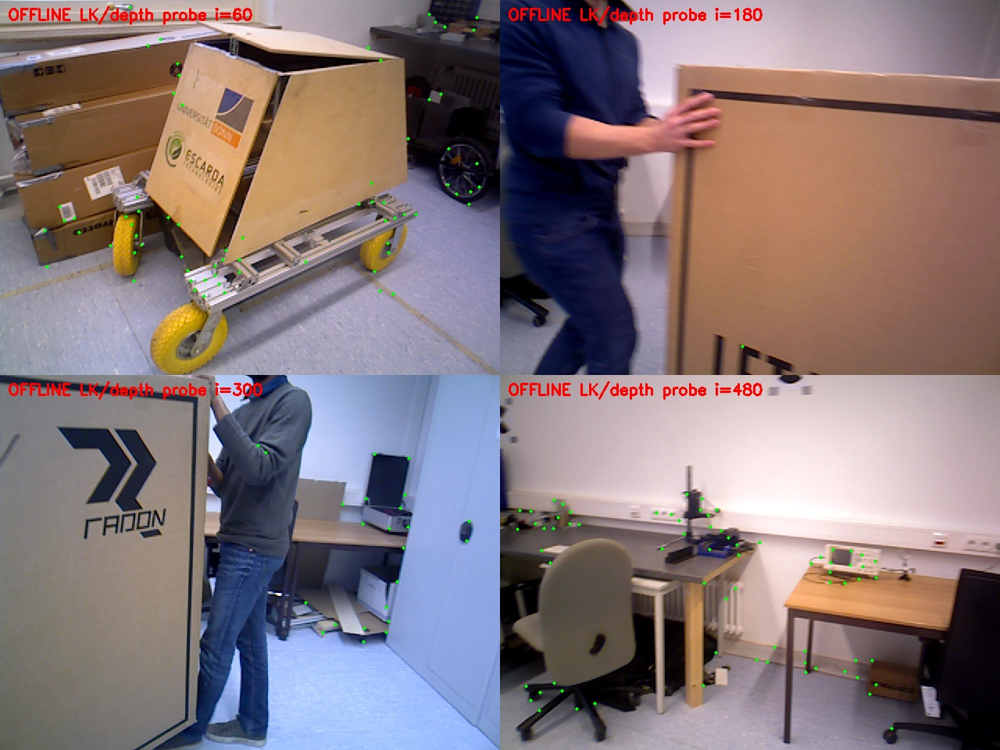
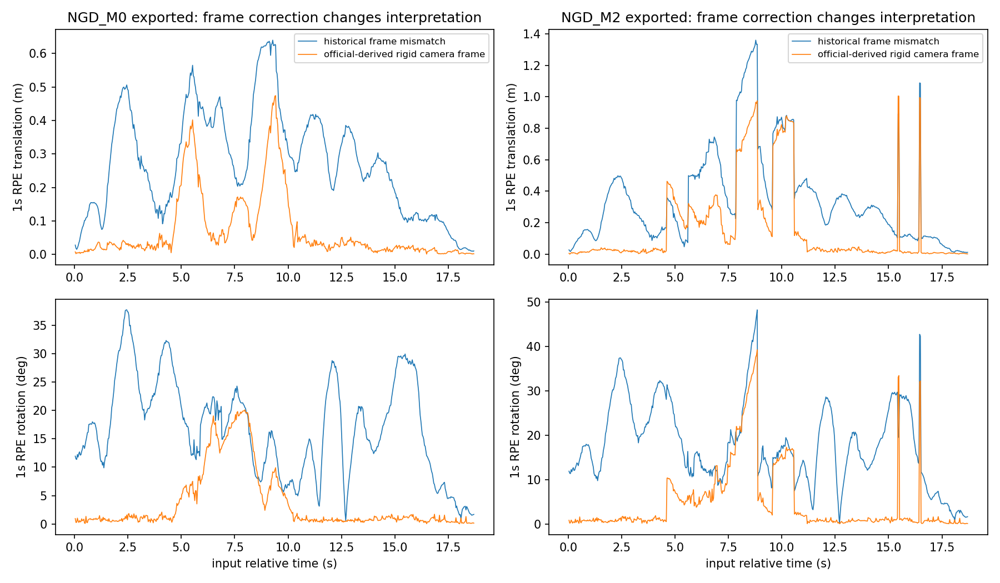

# Bonn正式评价勘误：Phase 0

2026-10-21，OFFLINE_DIAGNOSTIC / ANALYZED。**评价工程修正完成；官方外参的刚体化约定可复现，并得到独立RGB-D几何支持。** 没有重新运行SLAM、拟合SLAM外参或修改旧归档。新的指标在corrected目录，原指标保留作历史错误评价。

## 物理坐标推导与不确定性

令C为RGB optical frame（x向右、y向下、z向前），M为动捕标记刚体框架，W为动捕世界，G(t)为groundtruth.txt的原始4×4矩阵。官方模型公式为 Q⁻¹G(0)Q Tm；官方文字给出Tm从sensor到marker、Q=T_ROS为动捕ROS接口坐标错误的修正。由此解释G(t)=Q · T_WM(t) · Q⁻¹，而不是直接把G(t)当T_WC。假设标记相对传感器刚性固定，逐帧相机位姿必须为：

`H_WC(t) = Q⁻¹ G(t) Q E_MC`。

这是把官方第一帧模型链推广到各时刻的**物理推导**，并非官方额外发布的逐帧评价公式。源码入口将TrackRGBD返回Tcw反演为Twc；SaveTrajectoryTUM同样输出相机到其SLAM世界位姿。世界原点差异仅用一次SE3位置对齐，scale=1。RPE使用 `inv(inv(H_i)H_j) · (inv(P_i)P_j)`；不能用世界左乘旋转来补偿错误的相机右侧基变换。所有乘法方向和数值见protocol/calibration_frozen.json。

来源：[官方页面](https://www.ipb.uni-bonn.de/data/rgbd-dynamic-dataset/)及其[作者转换脚本](https://www.ipb.uni-bonn.de/html/projects/rgbd_dynamic2019/compute_global_transformation.py)，本机HTTPS取得200并登记hash；没有执行作者脚本中的示例初始pose。

**Tm不是SE3**：3×3奇异值1.05934755、1.05928623、1.05923757，均值1.05929045，det=1.18862586。数学上是近似统一尺度乘旋转；官方页/脚本没有说明该尺度的物理成因，不能擅称已确认是depth标尺或相机内参错误。正式规则：对Tm旋转块采用极分解最近SO(3)，保留原公布平移[0.0113,-0.0098,0.0111]m；不缩放GT平移、SLAM或depth。Q E的旋转角172.73445°来自官方常数，**不来自轨迹拟合**。

这是一项公开的刚体化处理假设，不是作者另行认证的精确刚性标定。额外报告把lever-arm除以1.05929、或置零的敏感性；前者六条Bonn输出的RPEt RMSE最大变化0.000039m，后者最大0.000674m，均不改变M2尾部更差的方向。不能由小敏感性证明真实标定误差为零，也不允许因此拟合尺度。未来正式论文仍须披露该源矩阵尺度成因未知。

## 独立验证与资格

19项评价检查全部通过：已知标记/相机外参合成轨迹、固定世界SE3左乘RPE不变、q与-q等价、SO3/det+1、错误外参方向、唯一GT配对/严格20ms容差、拒绝重复stamp及外推、独立SciPy旋转计算、TUM正对照不变。见audit/evaluation_tests.json。

冻结10组原RGB-D输入对，间隔15帧；第一组起点早于GT，**排除且不补选**。余9组用独立OpenCV LK（不是原生SLAM内点），前后向≤1px、双端有效且3×3稳定深度；471条候选不依据GT残差选取。用官方内参/畸变反投影和投影，报告遮挡、离图及连续残差，未把正常遮挡自动算错误深度。官方刚体链227条满足重投影≤5px且depth差≤max(5cm,3%)并未被遮挡；直接原GT为0，反向E为10，遗漏Q为0。每帧对重投影中位数的中位为3.63px，对照66.45/29.87/131.06px。此检查支持转换方向，**不是静态/动态真值或精确外参再标定**。观察集混有动态物体，仍有噪声和遮挡；没有用其拟合E。原始逐对/逐观测结果均保存。

## 修正主指标

以下RMSE均来自原轨迹，位置不做尺度拟合。六条Bonn输出均589行、唯一递增stamp、输入位姿覆盖100%；各588个唯一GT配对、558个1s RPE对。100%覆盖不等于所有观测正确。

| 系统/输出 | ATE RMSE / median m | RPEt RMSE / median / P90 / P95 m | RPEr RMSE / median / P90 / P95 ° |
|---|---|---|---|
| NGD_M0 online | 0.347666/0.298011 | 0.127318/0.032579/0.239450/0.332665 | 6.563174/1.058484/12.544990/17.352413 |
| NGD_M0 exported | 0.342721/0.286813 | 0.122439/0.028620/0.214687/0.321134 | 6.508209/0.952429/13.782196/17.755214 |
| NGD_M2 online | 0.306440/0.257681 | 0.214031/0.043988/0.247453/0.809159 | 9.982764/1.269487/17.306578/26.698407 |
| NGD_M2 exported | 0.277225/0.131576 | 0.301267/0.027401/0.675362/0.825221 | 9.008923/1.038065/15.181292/21.563741 |
| ORB3_S0 online | 0.559953/0.492537 | 0.233190/0.050197/0.493118/0.588974 | 9.702787/1.506664/17.601474/27.394961 |
| ORB3_S0 exported | 0.534616/0.462315 | 0.207118/0.030586/0.409264/0.576252 | 8.852821/1.106145/17.929681/20.720363 |

完整表corrected/all_metrics.csv包括所有值、raw负对照、平移敏感性与TUM。NGD walking M0-03导出ATE0.015703489m、RPEt0.019872726m、RPEr0.605730086°与旧工具一致；该入口未保存在线pose，明确UNAVAILABLE。ORB3 walking P1-01在线和导出均复算、不施加Bonn修正，数值不变。

## 正式勘误

旧NGD区域原型报告直接把Bonn groundtruth.txt当optical camera pose计算RPE，遗漏相机/标记坐标转换。此前报告中的Bonn RPE绝对值和以其为依据的局部运动解释需要撤回并引用本表；ATE也因lever-arm补偿略变，不能只改RPE不改ATE。输入、真实运行、观测计数、覆盖与成本并未因此失效。历史档案**没有覆盖或删改**。这项评价错误是我们此前评价流程的缺陷，不是NGD算法错误。

附件引用的用户离线审计代码/corrected输出在重点两处NGD目录和研究归档中未找到，故没有冒称独立复现其数值；本轮从官方常数重新推导，结果与其数值接近但不全等。例如M0导出median ATE0.286813m、RPEt0.028620m，M2为0.131576m、0.027401m。区别可能来自外参/配对/具体输出，缺原代码无法进一步断言。

**Phase 0允许继续已有数据的Phase 1，但不授权新SLAM运行。** 原评价绝对值必须更新；修正后“ATE改善但RPE尾部恶化”的现象仍存在，因果仍UNKNOWN。尺度来源未知作为公开限制保留，而非静默归一化。

## 复算

已有环境，无安装：`/usr/bin/python3 code/geometry_check.py`（OpenCV4.2独立探针）；`python3 code/evaluate_corrected.py`（现有Anaconda NumPy/SciPy）；`python3 code/test_evaluation.py`。评价脚本拒绝覆盖既有metrics_summary.json，重复复算应复制代码到新输出目录。geometry与metrics脚本不调用SLAM，不读GT给在线模块。sources/fetch.json登记作者URL与hash；不发布完整网页或大数据。
