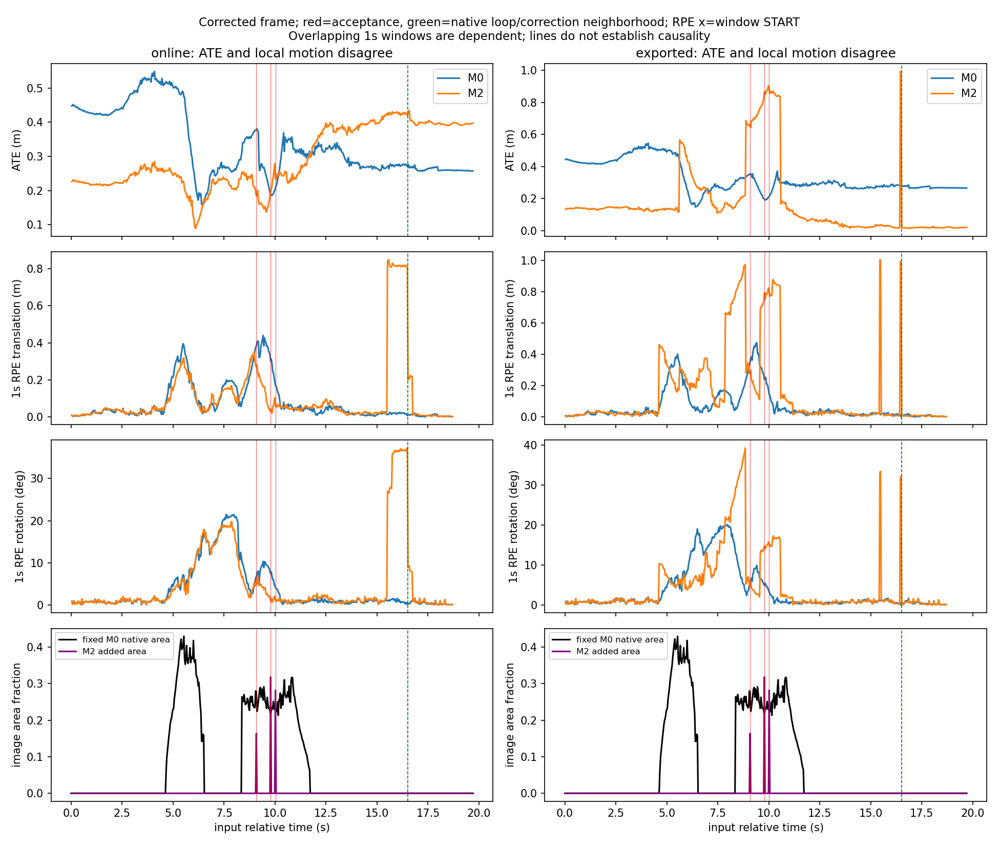
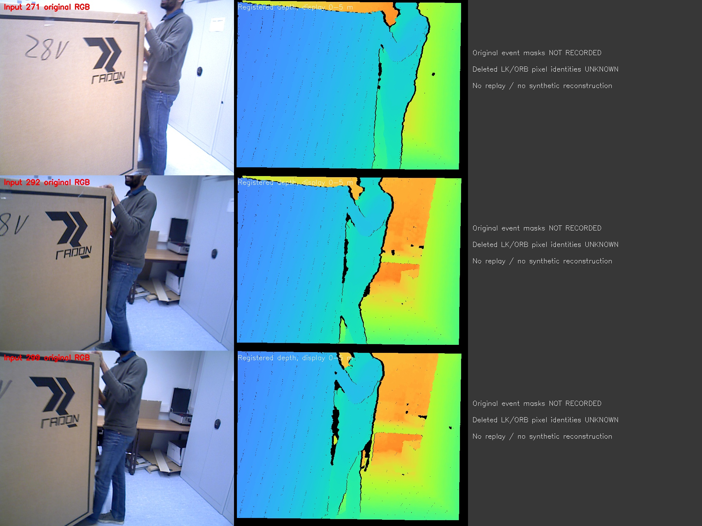
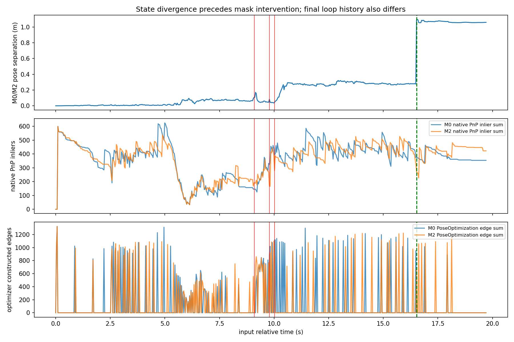

# 三次M2接受事件：已有日志的机制审查（Phase 1）

2026-10-21，OFFLINE_DIAGNOSTIC / ANALYZED。**阶段判断ONLY_CORRELATION_FOUND，限定于“扩张导致尾部恶化”的假设；没有支持新算法设计的因果证据。** 已完成三次事件证据包、共同窗口和H1–H4核查。新增SLAM/ROS运行0次，未修改NGD。

## 统一比较

依赖前一独立提交的[Phase 0评价勘误](../20261021_ngd_bonn_frame_audit/REPORT.md)：官方常数派生相机框架，scale1；不沿用历史错误Bonn RPE。M0/M2原始589个输入stamp逐一相同。以输入时钟确定全部558个合法1s窗口，两个方法使用**完全相同端点**，不按各自mask重新分组。全序列和在线/导出都保留。

非重叠时间块固定[0,5)、[5,10)、[10,15)、[15,20)s，RPE要求两端都在块内。覆盖分层只用**M0 native mask面积日志**在窗口内的均值，≤5%、5–30%、>30%，计数378/155/25。它是面积分层而非真实动态覆盖标签；事件像素mask没有保存，不能拿面积日志假装完整位图。块内1s窗口仍重叠，同视频样本相关，**不能当独立重复、置信区间或阈值证明**。所有参数在本阶段分析前写入protocol/analysis_frozen.json；这是探索性诊断，不是事前注册的多次科学实验。

| 固定块s | 合法窗口 | 在线RPEt RMSE M0 / M2 m | 导出RPEt RMSE M0 / M2 m |
|---|---:|---:|---:|
| 0–5 | 119 | 0.025388 / 0.026909 | 0.024216 / 0.021430 |
| 5–10 | 119 | 0.192608 / 0.177039 | 0.185643 / 0.451188 |
| 10–15 | 119 | 0.054460 / 0.052244 | 0.043609 / 0.318348 |
| 15–20 | 111 | 0.014140 / 0.428737 | 0.013799 / 0.189990 |

第一事件前端点全部小于271的240个窗口：在线RPEt RMSE M0/M2=0.127153/0.105214m；导出=0.125972/0.199843m。**导出早段含后来后台修正，不能把其早段误差当作当时的在线状态。** M0低覆盖分层在线RPEt0.035879m、M2=0.235744m，而中/高层M2的在线RPEt较小；导出中层M2反而更差。时间阶段、背景/遮挡及后台历史混杂，不建立“支持不足阈值”。全部ATE、平移/旋转RPE、分层与块数据见results/common_window_groups.csv和共同逐窗口表。

## 三个接受事件的实际证据与缺口

每个events/271、292、299包包含原始输入身份/hash、RGB、统一0–5m深度显示、当帧M0/M2完整已有统计、区域验证结果、±0.5s所有逐帧比较。展示原始RGB-D，**不重绘/生成/重放任何缺失mask**。

| 事件索引/时间 | 新增区域/像素 | 实际额外拒绝LK / ORB | 原生PnP内点 M0 / M2 | 当帧PoseOptimization最后边/内点 M0 vs M2 |
|---|---|---:|---:|---|
| 271 / 9.08149s | 2 / 50280 | 2 / 0 | 146 / 192 | 无调用 / 无调用 |
| 292 / 9.78452s | 1 / 97698 | 161 / 0 | 323 / 169 | 499/372 / 无调用 |
| 299 / 10.01955s | 1 / 86580 | 138 / 216 | 394 / 280 | 616/405 / 498/371 |

上述是现有计数；“无PoseOptimization调用”**不等于无PnP、没有姿态约束或跟踪失败**。LK、ORB、PnP、PoseOptimization分别记录，不互相冒充。四个区域训练/留出对应为56/28、25/13、251/126、221/111；验证静态残差约0.074–0.085m、刚体约0.003–0.016m，只证明模型验收通过，不是运动真值。

**无法补齐的事件证据**：原M0/M2实际mask、新增区域形状、被删点像素/MapPoint身份、逐点残差/Jacobian、真实静态标签、局部BA因子变动、YOLO时间戳和完整检测结果都没保存。冻结快照0/147/294/441/588没有命中事件。第294帧图像不能替代292/299的mask，也不能复用独立YOLO检测来冒充当时异步输出。**所以不能验证新增区域是否误吞静态背景、被删MapPoint是否长期可靠或各点影响力**。没有按混合量纲Hessian条件数制造几何信息量。

## 最关键的时间顺序

1. M0/M2第3帧（0.10054s）起N、关联、PnP和在线pose已有数值分化。第11帧位置差>1mm，第64帧>1cm，第173帧>5cm；首次扩张前最大位置差0.094684m。两组从相同初始化世界开始，这些是未拟合的两条在线pose之差，不是GT误差。即使全部扩张都未发生，**前置计算/异步调度/后台状态的区别已经存在**；不能称两组为相同粒子/地图/线程历史的精确反事实。
2. 第271/292/299帧确实新增mask并拒绝观测。M0/M2新扩张前native mask哈希587/589相同，差异只有319、323；最终mask另在三次接受帧不同。只有哈希/面积，无法判断319/323的差异区域或mask年龄。哈希相同也不保证关联/地图相同。
3. 最终导出存活KF为100/101、mapID均0。存活KF时间集合在很多早期输入stamp不同，**是事后存活集合，不证明这些差异在当时已经发生**。更可靠的实时证据是第26帧起实际PoseOptimization路径已不同。
4. M2 stdout在第490帧完成后打印`Loop detected`和Local Mapping STOP，492后RELEASE；M0没有同类日志。第493帧16.52142s附近，M2相邻在线位置跳0.8297m，官方相机GT仅0.0034m，间隔0.03352s；第500帧另跳0.2191m。它们与原生回环/后台校正时段重叠，足以构成**后台校正参与在线尾部的具体线索**，但缺回环约束、优化前后状态及操作内部时间戳，不能说扩张触发该回环，或宣称回环错误。日志插入位置仅由最近完成帧界定，不是精确内部事件时刻。
5. M2最差在线1s窗口跨越这一后台时段，15–20s块在线RPEt0.428737m（M0=0.014140m）。而导出5–15s块仍恶化。**一处在线跳变不足以解释全部导出尾部**；正确与错误回环、地图形变、观测历史和线程差异均未隔离。

全部相邻pose/GT运动保存在results/all_adjacent_pose_steps.csv；没有因为较大误差追加新的SLAM窗口或实验。公开状态两组始终OK、地图0，并不认证定位正确或后台一致。

## H1–H4支持与反证矩阵

| 假设 | 已有支持 | 反证/边界 | 本轮判定 |
|---|---|---|---|
| H1误删静态观测 | 接受事件确实挡掉301 LK/216 ORB，299优化边较少 | 缺像素身份/静态真值；前历史已不同；292路径也不同 | **UNKNOWN**，不能叫已证明误删 |
| H2 KF/地图传播放大 | 优化路径/KF存活集合不同，M2独有回环日志及同段在线大跳变 | 路径差异早于干预；缺BA/回环约束；不能连接扩张→地图因果链 | **后台历史参与的候选线索**，扩张因果UNKNOWN |
| H3异步mask连锁 | 319/323 native mask哈希不同，晚于三个接受事件 | 仅两帧不同；没有完整检测输出/时间戳；即便哈希同状态也早已不同 | **局部相关**，不能判传播过时/失效 |
| H4线程/随机历史 | 干预前0.10s就分化，M2增加helper时间，原生多线程/已知工程疑点存在 | 每条件单次，没有同条件重复；不能估计自然波动或排除确定性代码影响 | **可比性混杂明确，主因未确认** |

计数能到达“真实前端mask拒绝→PnP/优化调用和边/内点累计”这一层，不能到“被删静态MapPoint→几何可观性变化→BA状态→位姿误差”的逐观测链。没有阈值、信息衰减或因果成功主张。

## Phase 2门与唯一建议

**不启动Phase 2完整运行。** 当前证据能定位评价错误、早期历史分化和后台校正时段，却不能认证静态误删或独立于现成方法的缺陷。为补齐日志而新建YOLO回放/逐点追踪会形成另一轮工程，现有记录也不足以构造相同历史的单事件反事实。没有把“算得更多所以更差”当已证事实，更没有证明随机性一定是主因。

如未来重新打开该线，C0/Shadow/Full只能作为隔离历史差异的技术条件，须先定义新预算并记录逐帧原生YOLO输出/状态，流式落盘，确认C0和Shadow的基线波动；目前**未开发、未执行，也不授予新方法资格**。本轮不以此建议自动延长项目。

**下一步唯一建议：发布评价勘误及本次不足证据，停止M2机制归因向新算法开发的推进。** 最终方法机会判断另见后一阶段文献重叠审查。新增运行0、算法改动0、数据/模型下载0。

复算：`python3 code/analyze_existing.py`、`/usr/bin/python3 code/event_images.py`、`python3 code/plot.py`。原数据和旧运行均只读。系统Python仅用于已有OpenCV图像读取，Conda仅用于已有NumPy/SciPy绘图，不安装依赖。
