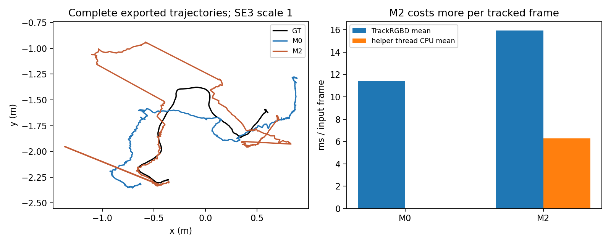
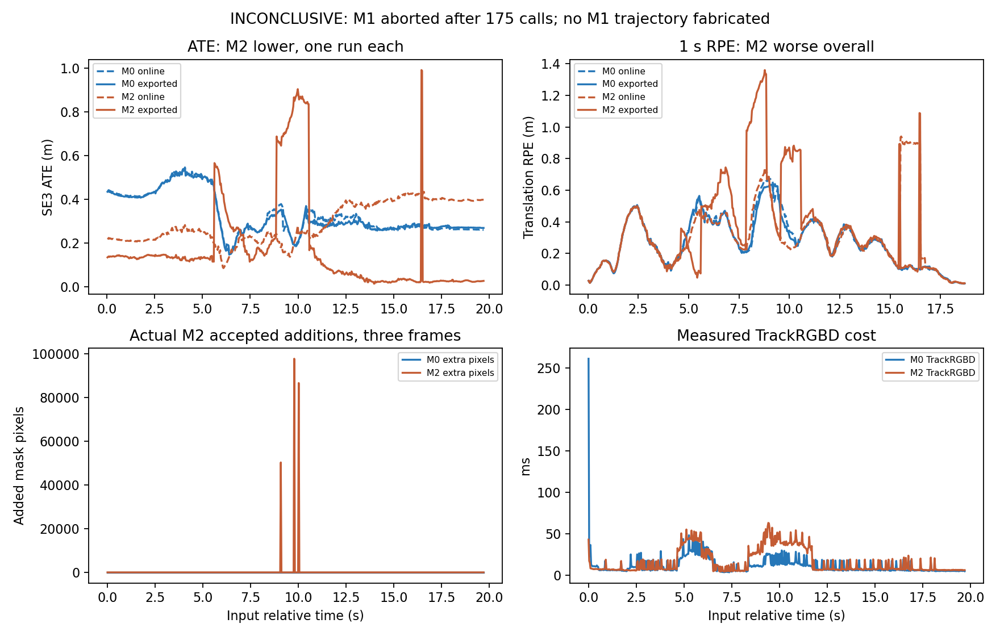
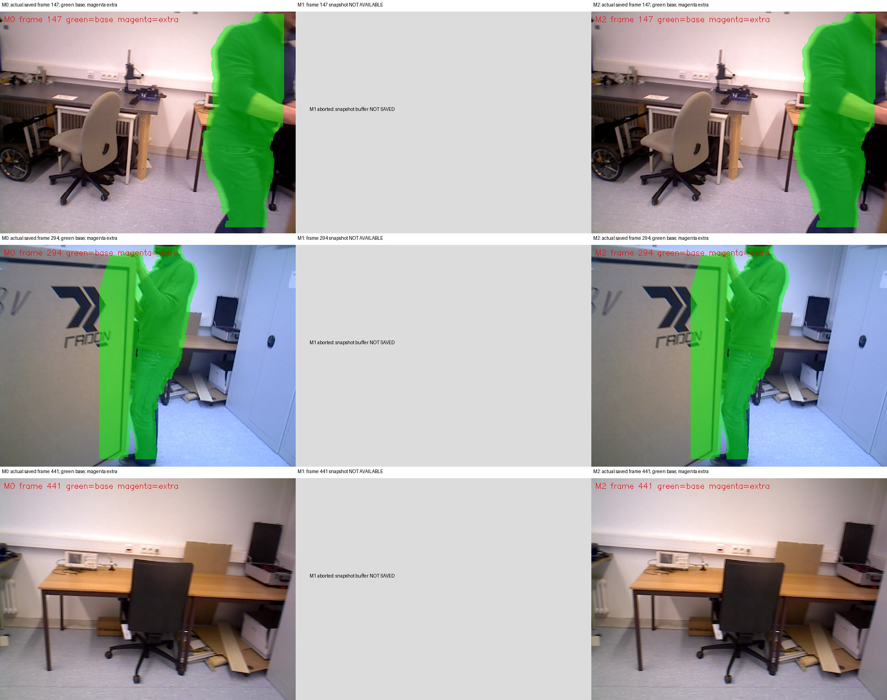

# NGD局部区域扩张M1/M2：实际实现与三次Bonn结果

2026-10-21。**决策：INCONCLUSIVE。原型已实现并执行，但当前版不支持SCI方法收益主张。** M2的ATE下降，完整1秒RPE和每帧成本却恶化；M1在175次完成调用后SIGABRT，不能作完整精度对照。建议暂停当前区域扩张原型的论文推进，不通过增加网络、权重或后端挽救结果。

标签：实测＝本轮执行/真实文件；源码依据＝固定源码；推测/UNKNOWN＝未验证。没有独立团队复验或显著性结论，没有重跑不利结果。

## 1. 本轮确实完成了算法实现

基于成功的NGD-M0-compat-v2，独立源码/构建目录`/media/wcqw/KESU/slam_research/ngd_region_prototype_20261021`，独立分支`research/ngd-region-prototype-20261021`。保留YOLO/Tracking的SAUF；原YOLO、ORBextractor、传播、ComputePixelPotential、深度聚类、80%规则、roll和native类布局均逐项核对未变。[冻结检查](audit/frozen_method_check.json)。没有安装、下载、其他系统或旧S1/S2。

M1实现共享的邻接深度连通扩张。M2在**同一Generate函数**给出的候选上，用前置背景PnP、区域SVD/RANSAC、空间/退化检查、训练与留出验证及可见性门决定整体接受。GT不进入模块，不使用尚未发生的当前帧最终pose/关联。M0跳过算法helper。详见[实际方法与公式](METHOD.md)、[完整helper](code/RegionExpansion.cc)、[接口](code/RegionExpansion.h)和[源码补丁](audit/region_prototype.patch)。

三条件使用**同一个新二进制/核心库**，仅mode=0/1/2不同；共同入口、公开状态/在线pose/地图/观测/边数计数相同。M0增加了共同只读日志和重编，因此不是与历史二进制逐位相同的试验。未修改优化公式或外点判定，原生KF策略未改，但其输出可随观测变化。

## 2. 软件检查、冻结和执行预算

23个检查通过，覆盖空mask、无候选、无效depth、不连通、多区域、实际M1扩张、面积门、刚体退化、留出集失败、PnP失败、非有限值、越界读数和Bonn非零畸变PnP数值。[单测原始输出](audit/unit_tests_final.log)。这些只是软件证据，不是SLAM收益；后续M1集成失败说明其覆盖仍不足。

全部规则、种子、代码/二进制/配置hash在正式运行前冻结于[design_frozen](protocol/design_frozen.json)。候选4px网格、depth门0.3m、最多4区、单区35%/新增45%/合并80%；M2拟合门0.05m、运动增益0.05m、至少18对应和6验证点等均未根据ATE调整。顺序M0→M1→M2，**3/3预算关闭**，没有其他序列、重复或参数搜索。

Bonn沿用589对输入、官方内参/畸变、BGR、depth/5000和原评价；所有运行实际加载同一新core和私有OpenCV4.5.5。GT只离线。评价仍是SE3刚性对齐、scale1、唯一20ms GT配对、1s±20ms RPE、区间无>100ms输出缺口。

## 3. 真实完整精度，不用部分结果冒充完整

| 条件 | 完成调用/输入 | 退出 | 在线ATE m | 导出ATE m | 在线RPEt m / RPEr ° | 导出RPEt m / RPEr ° | 在线/导出覆盖 |
|---|---:|---:|---:|---:|---:|---:|---:|
| **M0，新共同入口** | **589/589** | 0 | **0.345045** | **0.340101** | **0.319757 / 18.871252** | **0.315302 / 18.885979** | **100% / 100%** |
| **M1** | **175/589** | **134，SIGABRT** | **N/A** | **N/A** | **N/A** | **N/A** | **UNAVAILABLE** |
| **M2** | **589/589** | 0 | **0.304084** | **0.277460** | **0.372089 / 21.941794** | **0.458221 / 20.095203** | **100% / 100%** |

M0/M2均588个GT配对、558对1秒RPE，时间戳唯一递增。589帧均公开状态OK=2、pose设置且有限，map ID0、Atlas map数1；没有重置。导出KF分别100/101。这次状态是实际新入口记录，不由位姿覆盖反推。在线和最终导出独立保存，GT只做离线对齐；原生Shutdown不等待所有后台线程的限制保留。

M2在线/导出ATE分别低约11.9%/18.4%，但在线/导出RPEt分别**高约16.4%/45.3%**，旋转RPE也恶化。**不是净定位收益**。旧历史M0导出ATE0.364655m仅作描述，主要比较用本轮共同二进制M0的0.340101m，不挑历史较差基线制造收益。

## 4. M1失败和记录缺口

完成索引0–174后，在下一输入175（相对5.86304s附近）终止。原始异常：`OpenCV4.5.5 lkpyramid.cpp:1260: prevPtsMat.checkVector(2,CV_32F,true)>=0`，包装进程返回134，`time`记录signal6。[原日志](results/M1/stdout.log)、[失败登记](results/M1/failure_note.json)。资源文件尾部的Exit status0不能覆盖signal6和实际父进程134。

M1分支不调用新的LK/PnP，因此异常来自后续原生LK路径。原静态SearchByOpticalFlow对空点集合没有前置保护；独立空LK原语也复现相同断言，[empty_lk_probe](audit/empty_lk_probe.log)。**这只支持空输入边界的可能解释，不证明已记录M1现场点集合为空或确认具体调用点**。没有core/准确native栈；没有额外SLAM重放或猜测性修补。不把此故障归为此前四连通缺陷。

本轮入口把诊断缓冲到正常退出才写盘，**M1 abort使其逐帧状态、候选、在线pose及截图缓存未保存**。这是本轮记录设计缺陷，未补跑填补。175/589是已完成调用比例，不是可评价轨迹覆盖；没有把缺失计数填0、没有评价“幸存轨迹”。M1整链安全回退没有成立，单测成功不能替代这一点。

## 5. M2是否真正作出了区域决策？是，但不等于判断正确

M2有候选156帧、554个候选实例；148帧背景PnP通过，5帧对应不足、3帧支持弱。最终仅**3帧接受4个区域**。区域实例来自同一视频，不能当554次独立重复。

| 输入索引/相对时间 | 区域数 / 新增像素 | 背景PnP内点/对应，格数 | 训练内点/训练点 | 验证点 | E静态 / E刚体 m | 实际额外删除LK / ORB |
|---|---:|---:|---:|---:|---:|---:|
| 271 / 9.08149s | 2 / 50280 | 133/139，7格 | 55/56；25/25 | 28；13 | 0.07426/0.01483；0.07499/0.01624 | **2 / 0**，整帧合计 |
| 292 / 9.78452s | 1 / 97698 | 132/140，9格 | 251/251 | 126 | 0.08463/0.00267 | **161 / 0** |
| 299 / 10.01955s | 1 / 86580 | 175/189，13格 | 221/221 | 111 | 0.07691/0.00278 | **138 / 216** |

这些是**真实在线决策记录**，拟合/验证分离，不能用训练残差代替验证。少量遮挡计数分别1/4/0/1；无校准概率主张。304个区域被模型判为静态/不可区分，24个留出不一致、18个可见性不明确、其余为对应/背景不足或几何分布失败等，详见[summary](results/summary.json)和[全部区域](results/M2/regions.csv)。没有真值证明被拒绝者都是静态背景，或接受者都是真实箱体运动。

新增mask确实影响原系统：**301条原生LK状态有效关联**和**216个原提取ORB观测**在原mask判断处被额外挡掉，不是独立OpenCV探针统计。当前原型没有删除depth或直接改描述子；原Frame按mask进行的成对特征/描述子过滤保持原行为。

实际M0/M2相同输入stamp逐帧配对，原生扩张前mask哈希587/589一致，最终mask哈希584/589一致；差异索引271/292/299/319/323。[配对哈希](results/paired_mask_hashes.json)。说明干预稀疏，不证明对应身份/后端历史相同，更不证明M1/M2候选逐帧相等。M1缺记录；候选公平性只能确认同一个生成器在同输入下相同，不能伪造正式一一配对。

冻结截图是0/147/294/441/588，**没有命中三帧新增接受事件**。下图展示的是真实运行截图；不能补绘成原始接受帧，M1空白为未保存。绿色是各运行当帧新增前的native mask，不是与独立M0运行完全相同的反事实；候选/接受事件的精确证据来自CSV和计数。

## 6. 下游约束和固定局部窗口

| 可直接记录的层次 | M0 | M2 |
|---|---:|---:|
| 原提取ORB / mask后保留 | 110109 / 82580 | 108591 / 81203 |
| 原生LK状态有效 / mask后保留 | 221390 / 220586 | 223822 / 222582 |
| 原生PnP调用 / RANSAC内点累计 | 586 / 215069 | 586 / 217484 |
| PoseOptimization调用 | 198 | 202 |
| PoseOptimization构造边累计 | 81218 | 78804 |
| 原外点判定后内点累计 | 55322 | 53602 |

这是每次真实调用的只读计数，同一观测可在多次调用中重复，**不是唯一边数、完整LBA/回环图、几何信息量或静态正确性**。返回MapPoint数量也没有冒充优化边。索引299的M2最后一次PoseOptimization确有498边/371内点；LK/PnP路径与PoseOptimization分开报告。没有逐点Jacobian或完整残差/运动真值，不能计算真正的逐观测影响力或证明“误吞背景已被纠正”。

事前关注的9.08–10.09s仅包含**一对**合格1秒运动端点：M0→M2在线RPEt0.665938→0.555421m，导出0.632949→0.575055m。在线旋转也降，但导出旋转15.293→17.031°反升；完整RPE恶化不能被该单对改善掩盖。M2导出最大RPEt1.360650m（8.77916–9.78452s），在线最大0.940723m（15.54888–16.55474s），说明不能把目标窗的改善推广到全程。

## 7. 计算成本和解释限制

| 条件 | TrackRGBD均值 / P95 ms | helper主线程CPU均值 ms | 总用户/系统CPU s | 管理墙时 s | 峰值RSS KiB |
|---|---:|---:|---:|---:|---:|
| M0 | 11.395 / 28.136 | 0 | 66.75 / 1.02 | 49.838 | 592808 |
| M1，175帧后中止 | N/A | N/A | 16.27 / 0.26，部分 | 12.013，部分 | 547892，部分 |
| M2 | 15.946 / 44.736 | **6.273** | 48.07 / 0.64 | 29.118 | 638156 |

M2 helper实际CPU合计约3.695s；它不含M2旧帧缓存和共同日志成本，这些仍在完整API/进程成本中。完整API均值增约40%、尾部也增大；**不能用更短总墙时或更低总CPU声称模块加速**。固定顺序、启动、缓存/I/O、作者异步忙轮询及不同实际跟踪历史会影响总成本，本机非独占；没有单独测出各因素。CPU计时不是GT，不进入决策。

单次比较不能给显著性。静态背景假设、匹配/遮挡、原生Bonn像素域疑点、地图历史、异步检测和未初始化变量等竞争解释保留。原作者ComputePixelPotential、roll、空pointsDepth、Shutdown等风险按要求未修。留出拟合通过不等于真实动态标签；ATE下降也不等于全局/局部定位都改善。

## 8. 近邻差异与科学决定

- [NGD原作者稿§III](https://arxiv.org/html/2405.07392v4)：已有LK/depth/聚类传播。这里的新增只是边界外区域候选与整体接受，不是发明传播或未知动态识别；固定源码与v4文字范围区分。
- [DynoSAM§V](https://arxiv.org/html/2501.11893v3)：借鉴成熟区域刚体运动一致性思想；本轮用小型SVD/RANSAC，不移植对象联合因子图，不称完整作者方法复现。
- [SR-SLAM作者稿§III](https://arxiv.org/html/2509.01111v1)：已有质量/几何/剔除协调。背景支持门和静态保留本身不是创新；本轮不修改关键帧或优化权重。
- 前轮已核查Measurement2026传播＋未知动态残差、DynaPix等直接近邻，见[父轮矩阵](https://github.com/xgmszlx/ac-slam/blob/7ec1810143f78a394d5bd2868cca4d60c3eef9d2/research_archive/20261020_ngd_scientific_baseline/literature/NEAREST_METHODS.md)。宽泛“语义＋几何＋depth”不是贡献，换成区域名字也不自动独立。

**结论INCONCLUSIVE，而非PROTOTYPE_PROMISING或SIMPLE_METHOD_SUFFICIENT。** M1不可完整评价；M2确实改变观测并降低ATE，但全程RPE、尾部和API成本恶化。不能断言两者“毫无任何作用”，也不能选择性称已有净收益。当前版不建议继续作为SCI方法推进；**下一步唯一建议是归档并暂停当前区域扩张原型，不再追加复杂模块或扩大实验矩阵**。这不否定RGB-D动态SLAM整体，也不把一次M1集成失败变成领域科学负结论。

## 9. 保护与交付范围

602项登记旧文件hash、原主仓HEAD/status/diff保持；正式冻结代码/二进制/输入hash运行后全相同，[保护](audit/protection_after.json)。不声称重hash全部旧数据。三次预算均已使用，没有算法重跑、额外序列、原有结果覆盖、系统安装或清理。

交付包含实际代码/diff、单测及失败原语、M0/M2完整在线/导出轨迹与逐帧日志、M1准确异常/资源/缺失说明、固定mask快照、三张结果图、全部评价。**没有第三条完整M1轨迹，交付不伪装完整。** 分支与真实远端SHA在发布后核对报告。
